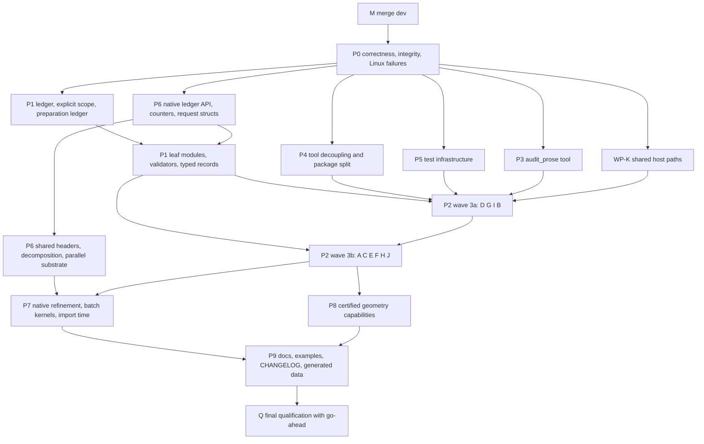

# Native meshing remediation, optimization, and qualification plan

This is a working document for `feature/native-meshing-20260929`.
- The scientific requirements and acceptance contracts are still defined in `docs/meshing_implementation_plan.md`.
- This plan defines how the branch reaches a mergeable state: merge, correctness, integrity, cleanup, performance and
  qualification.
- Item-level tracking lives in `docs/plans/native-meshing-remediation-register.md`: every audit finding, verified defect,
  test-integrity item, oversized function, eager-JAX site, and the identity-change ledger.
- The working documents remain through final qualification. Phase Q deletes them only after their durable content has
  moved into the CHANGELOG, user documentation and capability catalog.

## 0. Decisions and standing rules

| ID | Decision | Consequence in this plan |
| --- | --- | --- |
| D1 | Restore weakened tests. Undocumented deliberate contract changes go to the user. | P0.4: restore list §5.4.1; decision table §5.4.2 |
| D2 | Identity, fingerprint, PyTree-structure and persistence changes are allowed. | Every change is recorded in the register's identity ledger and the CHANGELOG. A digest pin moves only for a recorded change. |
| D3 | C ABI changes are allowed. | `_ABI_CONTRACT` and `_SIGNATURES` are regenerated in the same change as the header. |
| D4 | Merge `origin/dev` first, then clean up. | Phase M precedes all other work. |
| D5 | Full scope. | Phases M, P0–P9 and Q. |
| D6 | No OpenMP runtime. Use an in-house deterministic parallel substrate. Portable compiler-specific SIMD pragmas are allowed after benchmark proof. | §11.6 |
| D7 | Native parallelism defaults to one thread. | `MeshingExecutionPolicy.parallelism` remains the only public meshing thread request (§11.6, item 4). An outer `ResourceRequest.cpu_cores`, when present, is only an admission ceiling. |
| D8 | Phydrax-owned immutable records stay `StrictModule`. | Construction cost is reduced by changing constructor bodies and instance counts, not the base class (§6.7). Ephemeral mutable tool ledgers and internal C++ structs are not scientific records. |
| D9 | Root-cause every Linux workflow failure in P0 and fix direct defects there. | Algorithmic gaps get locked by a failing qualification case and remain owned by P6/P7; every failure closes before Q (§5.5). |
| D10 | The USD BRep, Zoo (KittyCAD) and brepgraph studies (2026-10-12) and the smlibpy study (2026-10-14) inform phydrax by ideas only. No code, documentation, proposal or data is copied; none is vendored into `native/meshcore` or added as a runtime provider or test oracle. | Evidence items in §7.4, §10, §12.7 and §12.8; capabilities in Phase P8 (§13). `NOTICE` gains an "informed by" paragraph when the first item from each study lands. |

Standing rules from the user and `AGENTS.md`:
- Fix unrelated bugs found along the way.
- Never weaken, invert or re-pin a test to get green. The only exception is a D2-recorded identity pin.
- Work only in the worktree, with absolute paths and an explicit `cwd`. Never edit the parent checkout.
- One active owner per file.
- Get the user's go-ahead before the final long run.
- `//commit` and `//pr` are user-initiated. `//pr` merges the parent branch first, never mentions test runs, and keeps
  library names out of branch names.
- `AGENTS.md` is authoritative and must be copied into every new worktree.

## 1. Baseline (Linux x86_64)

### 1.1 Environment identity
- **Machine:** Ubuntu 26.04, x86_64, 64 cores, 123 GB RAM, GCC 15.2.0.
- **Python packages:** Python 3.12.15 (uv-managed), jax/jaxlib 0.11.2, numpy 2.5.4, equinox 0.13.8, lineax 0.1.1,
  gmsh 4.15.2, cadquery-ocp-novtk 8.0.1.1.0, build123d 0.13.0, meshio 5.3.5, ty 0.0.84, ruff 0.16.9.
- **meshcore build:** Release, `-O3 -ffp-contract=off -fno-fast-math -fno-finite-math-only`.
  Source digest `d61905c36cc8a29954f1dcb5059a6f6968ad2a6d0af7f142a92341b21e1a3bc0`, binary digest
  `ca5efd5fd89ab3cf6bd2b97638a3006cffcd6ff4f93fbf631ff4f7562156ab71`.
- **Worktrees:** `/home/ubuntu/phydra-labs/.worktrees/native-meshing-20260929` at `a6827a9e5` plus the uncommitted
  typing-gate fix (`pyproject.toml`, `CHANGELOG.md`, four test files). Baseline worktree
  `/home/ubuntu/phydra-labs/.worktrees/native-meshing-baseline-d2dfcb941` at the merge base with its own environment.
- **Prior evidence:** recorded on macOS arm64. It is not evidence for this platform.

### 1.2 Gates already run
- **Pass:**
  - pinned typing (after the fix)
  - `tools/audit_selectors.py`
  - `tools/audit_contract_candidates.py --signatures`
  - public API manifest check
  - capability consistency check
  - fresh-process import of all 444 packages
  - `tests/unit/meshing/test_native_provider.py` (39 passed)
- **Not yet run on Linux:**
  - full suite
  - qualification corpus
  - benchmark campaign
  - dependency-isolation gate
  - installed typing
  - CTest and sanitizer builds

### 1.3 Code-quality baseline
Meshing scope: 410 branch-touched source files (475K Python, 42K C++ lines) and 154 test files (105K lines).

| Metric (per kLOC unless noted) | Scope | Rest of repo |
| --- | --- | --- |
| Functions with CC > 40 | 0.51 | 0.13 |
| Functions with cognitive complexity > 50 | 0.83 | 0.15 |
| Functions over 200 lines | 0.59 | 0.34 |
| Mean function NLOC (absolute) | 35.8 | 25.3 |
| Function-local imports | 4.46 | 0.43 |
| Private-name share of from-imports (absolute) | 8.6% | 2.5% |
| try/except | 0.92 | 0.18 |
| `raise RuntimeError` | 2.21 | 0.46 |
| Error messages using the filler lexicon (absolute) | 17.8% | 0.3% |
| Private-name imports in tests (per test) | 0.16 | 0.02 |

- **Mandatory decomposition:** 457 functions exceed the AGENTS.md mandatory-decomposition thresholds (CC > 40, cognitive >
  50 or > 200 lines); 378 of them are new on the branch. Per-package lists are in the register.
- **Prose lexicon:** branch-added lines use "actual" 43×, "original" 31×, "owning" 28×, "authoritative" 19×,
  "genuine" 18×, "receipt" 15×, "witness" 12× and "premise" 312× as often as the rest of the repository.
- **Function-local imports:** 2,355, against 437 before the branch.
- **Private-import edges:** 1,044.
- **ContextVars:** 12, against 0 before the branch.
- **Resource-accounting classes:** about 28.
- **Lazy facades** list each symbol three times. 1,297 public names resolve only through a runtime scan, so consumers see
  them as `Any`.

### 1.4 Diagnostic performance profile (not the release benchmark baseline)
Python-level sampling, attributed to the nearest phydrax frame:

| Share of sampled time | 5 workflows, documented sizes (~88 s) | planar res 32 (~68 s) | periodic res 8 (~85 s) |
| --- | --- | --- | --- |
| JAX lowering, compile and dispatch | 33% | 5% | 2% |
| JAX tracing and other | 15% | 5% | 1% |
| Equinox/StrictModule construction, incl. dataclass init | 21% | 4% | 4% |
| Imports | 8% | 2% | 1% |
| Resource-accounting bookkeeping | ~3% | ~30% | <1% |
| Fingerprinting and canonical JSON | <1% | 8% | 1% |
| C++ meshcore kernel | 3% | 14% (`constrained_delaunay_2d`) | 79% (`periodic_delaunay`) |
| Python `Fraction` | 0.2% | 0.5% | 0% |

| Workflow, one run | XLA compiles | Distinct functions | Compile seconds | End-to-end |
| --- | --- | --- | --- | --- |
| native-lifecycle planar-hole-feature, res 4 | 267 | 48 | 3.5 | 8.9 s |
| native-polyhedral-lifecycle, res 2 | 861 | 56 | 10.4 | 16.6 s |
| native-cad-lifecycle STEP, res 4 | 1,094 | 80 | 14.2 | 46.8 s |

- **Eager primitive compiles:** almost all compiles are eager primitives (`jit(add)`, `jit(broadcast_in_dim)`, `jit(gather)`,
  …) recompiled for each new host-side shape. Owners are listed per work package in the register.
- **Construction cost:** a three-field `StrictModule` costs 6.9 µs to construct, against 6.7 µs for a plain `eqx.Module`.
  `MeshingScope` costs 488 µs because its constructor runs eager JAX and a logical-array fingerprint.
- **Imports:** `import phydrax.meshing` takes 0.72 s and `import tools.meshing_qualification` takes 4.16 s. About 5.5 s
  per process elapses before any workflow work starts. `scipy.stats.qmc` (0.38 s) is imported at import time through
  `linalg._svd_randomized → _sampling._designs`, and `linalg.eigen` (0.82 s) through `geometry._atlas`.
- **Budget charging:** `CoordinateEnclosureBudget.reserve` crosses into native code on every exact-arithmetic step
  (`admit_work_bound`, `_unsigned_budget`, `_raise_for_call`) and sometimes walks Python objects with `sys.getsizeof`.
- **Periodic insertion:** `_native_periodic._realize_target_size_sites` rebuilds a complete periodic Delaunay
  triangulation of all points for every frontal edge × side on every insertion step (L1460-1497). Cost grows roughly with
  the cube of the problem size.

These are hotspot diagnostics, not acceptance or leadership evidence: every sampled workflow ended in a failure listed
in §1.5, and sampling proportions are approximate. Clean, accepted or failure-matched baselines are recorded under
§12.1 after M and the direct P0 fixes.

### 1.5 Workflow outcomes on Linux
All failures reproduce identically without a profiler.

| Scenario | Outcome |
| --- | --- |
| native-lifecycle planar-hole-feature, res 4 | Fails: `meshing/_adaptation.py:1534` "Geometry associations require the policy's association_transfer." |
| native-lifecycle plc-material-cavity | Crashes: `tools/_meshing_cases.py:862` reads `VolumeMeshingSpec.quality_target`, which `VolumeMeshingSpec` does not declare |
| native-surface-pde, res 4 | Fails: manufactured solve `MAXIMUM_STEPS_REACHED` after 154 iterations (relative residual 1.09e-7). The Linux mesh has 155 vertices; macOS recorded 216 vertices, 428 triangles and success after 74 iterations. |
| native-periodic-lifecycle skew-lattice, res 4 | Fails: solve `MAXIMUM_STEPS_REACHED` after 31 iterations (relative residual 2.1e-8) |
| native-periodic-lifecycle skew-lattice, res 8 | Fails `target_size_p95` compliance |
| native-polyhedral-lifecycle, res 2, capacity 20000 | `RESOURCE_EXHAUSTED`. macOS passed. Res 4 with capacity 400000 passes here. |
| native-cad-lifecycle STEP | Fails: `meshing/_certification_inputs.py:593` "Source query differs from its rebuilt numerical facts." |
| native-implicit-lifecycle | Fails: `ValueError` (inhomogeneous array) in analytic source request preparation |

### 1.6 Verified defects (before P0)
1. `native/meshcore/src/plc3d.cpp:2302, 2656, 2672`: an always-false capacity probe misreports cavity-limit refusals.
2. `phydrax/lifecycle/_meshing_sources.py:327`: package code imports `examples.curved_native_transfer` and mutates a module
   global.
3. Facade typing hole (§1.3).
4. `native/meshcore/src/level_set.cpp:90-96`: `long double` makes results platform-dependent, and the overflow protection
   it claims does not exist on arm64.
5. `native/meshcore/CMakeLists.txt:141`: `PHX_MC_SANITIZE` claims to disable the performance time bounds, but nothing reads
   the definition.
6. Tool drift in the two qualification drivers (§1.5).
7. The 24 non-legitimate test changes listed in register §3.

## 2. Invariants every phase preserves
1. **Clean cutover.** Migrate every caller in package code, tools, tests, docs and examples. No aliases, shims,
   re-exports or deprecated paths. Delete superseded code in the same change.
2. **Error semantics.**
   - Exception types follow AGENTS.md: `TypeError` for kinds, `ValueError` for values, domain errors for scientific
     contracts.
   - Refusal categories stay the same unless a decision changes them.
   - Messages may be rewritten (P3) together with the coupled `match=` sites.
3. **Determinism within a platform.**
   - Results, IDs and evidence do not depend on thread count, scheduling or process.
   - Ordering is canonical.
   - Refusal points come from deterministic bounds. Wall-clock deadlines are the only exception.
4. **Cross-platform acceptance.**
   - Hard scientific controls pass on every supported platform, and requests are never relaxed.
   - Topology decisions use exact predicates or certified bounds, never behavior that depends on the platform's last
     bits (XLA fusion or FMA contraction, libm transcendentals, `long double`).
   - Bitwise cross-platform equality of floating constructions is not required.
5. **Host/device boundary.**
   - NumPy owns host-only preparation.
   - JAX runs only inside stable module-level compiled entry points with bounded shape sets (fixed capacities).
   - No eager `jnp` on runtime-sized host data. No `jax.device_get` in constructors or loops.
   - A genuinely dual-use algorithm has one owner and one semantic plan, with paired NumPy and JAX kernels and
     host/device parity tests. It is not forced through compiled JAX when a direct NumPy host kernel is clearer and
     faster.
6. **Resource accounting.** There is one mechanical accounting substrate; domain-specific limits and evidence remain
   with their scientific owners and delegate to it.
   - The live scope reserves an upper bound per batch before the work, so concurrent or nested batches cannot overcommit
     the same allowance.
   - Counting inside a batch is local. Settlement commits the actual count and releases the unused reservation.
   - No per-item FFI calls and no `sys.getsizeof` traversal.
7. **Native code.**
   - Entry points are coarse-grained and take request/result structs. Counters are named.
   - Exceptions never cross a thread boundary.
   - Execution scopes propagate to workers explicitly.
8. **Identity.** Changes are allowed (D2) but always recorded. An old ID is never reused for changed content.
9. **Tests.**
   - Tests assert consumer contracts.
   - Every fixed defect gets a regression test.
   - No assertion is lost without a cited equal-or-stronger replacement.
10. **Complexity.** No touched function stays above the mandatory thresholds without a written rationale in the register
    (allowed for exact predicates and source-faithful kernels).
11. **Prose.** Everything follows the rules in §8.

## 3. Execution model

### 3.1 Roles
- **Integration owner (main session):**
  - merges and the ownership map
  - cross-work-package contracts
  - gates
  - test-integrity review
  - the verification record and register status
  - user decisions
- **Work-package owners (task subagents):**
  - edit only the files they own
  - verify their own surface
  - report changed files, commands, results, failing node IDs and open questions
- **Reviewers (read-only subagents):** after each wave, review the diffs for slop regression and test integrity.

### 3.2 Ownership rules
- The register assigns every scope file to exactly one work package (WP).
- **`phydrax/_meshcore.py`** is owned by WP-N for the whole program: the C ABI, `_SIGNATURES` and wrappers. Other WPs
  request changes.
- **`tools/meshing_qualification.py`, `tools/meshing_benchmarks.py`, `tools/_meshing_cases.py` and
  `tools/check_native_dependency_isolation.py`** are owned only by WP-T.
- **Tests:** a module's tests are owned by the WP that owns the module. Cross-cutting test infrastructure belongs to
  WP-S.
- **Cross-WP API changes:** announced to consumers with `write agent://<owner>`. Consumers update their callers in the
  same wave. The integration owner confirms that no stale callers remain, using LSP references plus searches of
  registries, fixtures and generated data.

### 3.3 Brief passed to every subagent
- **Policy:** read `AGENTS.md` in the worktree first.
- **Paths:**
  - Use absolute paths under the worktree and set `cwd` on every shell call.
  - Never touch `/home/ubuntu/phydrax`.
- **Scope:**
  - Edit only the files you own.
  - Do not run the full suite, formatters or builds in the middle of the work.
  - Run focused verification once at the end.
- **Test integrity:**
  - Never weaken, invert or re-pin an assertion.
  - Removed assertions need a cited replacement.
  - Compare every test diff against `git show d2dfcb941:<file>`.
- **Identity:**
  - Any identity, PyTree or persistence change is added to the identity ledger with its cause.
- **Conventions:**
  - Introduce no second convention.
  - Reuse the owners built in P1 (resource ledger, leaf modules, `_validation`, typed records).
- **Report:** changed files, commands run, results, failing node IDs, ledger entries and open questions.

### 3.4 Native builds
- **Tooling:** CMake ≥ 4.4.3 and Ninja are provided as user-level tools (`uv tool install cmake ninja`); project
  dependencies don't change.
- **Isolated builds:** every native owner builds in an isolated directory:
  ```sh
  cmake -S native/meshcore -B .tmp/build/<owner> -G Ninja -DCMAKE_BUILD_TYPE=Release -DPHX_MC_BUILD_TESTS=ON
  cmake --build .tmp/build/<owner> && ctest --test-dir .tmp/build/<owner> --output-on-failure
  export PHYDRAX_MESHCORE_LIBRARY="$PWD/.tmp/build/<owner>/libphydrax_meshcore.so"
  ```
- **Sanitizer builds** go in `.tmp/build/<owner>-asan` with `-DPHX_MC_SANITIZE=ON`. Thread-safety work (§11.6) also
  needs a `-fsanitize=thread` build in `.tmp/build/<owner>-tsan`.
- **Integration:** reinstall with `uv pip install --python .venv/bin/python --no-deps --reinstall ./native/meshcore`.

### 3.5 Resource budget (64 cores, 123 GB)
Measured on 2026-10-11: an xdist worker grows to 3–9 GB as it accumulates JAX compilation caches across test
modules. `-n 48` exhausted host memory twice and rebooted the machine; `-n 16` reached 96 GB. Single dev
nuclear-fuel test files peak at 21–36 GB and run 20–50 minutes.
- **Every test run is memory-capped** in its own systemd scope, so an overrun kills pytest, not the host:
  `systemd-run --user --scope -p MemoryMax=<cap> -p MemorySwapMax=0 …`.
- **Broad runs use file isolation**, not one long xdist session: one pytest process per test file, at most 12 at a
  time, each capped at 24 GB (`.tmp/remediation/run_files.sh`). Files that exceed 24 GB rerun alone with a 48 GB cap.
- **Focused runs** use xdist with at most `-n 8` under a 64 GB cap, and only one such run at a time.
- At most two native builds at once.
- At most 30 concurrent workflow processes (about 1.4 GB peak each), and never concurrently with a broad test run.
- Benchmarks run with no concurrent tests, builds or agents.

### 3.6 Verification record and checkpoints
- **Verification record:** `.tmp/remediation/verification.md` (git-ignored). Each entry records:
  - the command
  - the tree state (commit plus a hash of the dirty files)
  - the environment identity
  - the result, failing node IDs and duration

  A passed result is reused only while its inputs are unchanged (AGENTS.md "Reuse valid evidence").
- **Phase gates:**
  - At every phase gate the integration owner updates the register's status columns (status only, no run logs).
  - The integration owner then asks the user for `//commit`, so progress survives a machine change.
- **`dev` drift:** at every gate the integration owner checks `git log HEAD..origin/dev`. If `dev` has advanced, the user
  is asked whether to merge it before the next phase.

### 3.7 Test-integrity procedure (every wave)
1. For every modified pre-existing test file, compute the assertion delta against the merge base:
   ```sh
   git diff -U0 d2dfcb941 -- <file> | grep -cE '^-\s*(assert\b|np\.testing\.assert|(with )?pytest\.raises)'
   git diff -U0 d2dfcb941 -- <file> | grep -cE '^\+\s*(assert\b|np\.testing\.assert|(with )?pytest\.raises)'
   ```
2. These signals trigger manual review:
   - any net loss
   - any removed `match=`
   - any changed status or category enum value
   - any changed exact count or ID
   - any widened `rtol`/`atol`
   - any added skip or xfail
   - any removed parametrize row
3. A removed assertion needs a cited equal-or-stronger replacement, or a D1/D2 decision.
4. A read-only reviewer re-audits each wave's test diffs before the gate closes.

### 3.8 Ratchet measurements
- **Complexity:** `uvx lizard -t 48 --csv -f <scope list>` and `uvx complexipy`, compared with the register's
  oversized-function lists.
- **Prose:** `tools/audit_prose.py` (§8.3).
- **Coupling:** function-local import density and private-name import share, from the integration owner's throwaway
  measurement script under `.tmp/remediation/`.
- **Performance:** the campaign in §12.1.

## 4. Phase M — merge `origin/dev`
1. **Clean and preserve the tree.** Ask for `//commit` before merging, with two atomic groups:
   - the typing-gate fix (`pyproject.toml`, `CHANGELOG.md`, four stale-suppression removals), because the merge also changes
     `CHANGELOG.md`;
   - this working plan and register, so they survive a machine/session change.
2. **Fetch and preview.** Run `git fetch origin`, then `git merge-tree --write-tree --name-only --messages HEAD origin/dev`.
   - On 2026-10-10, `dev` was at `71fdd9547`, 4 commits ahead: distributed spectral hardening and the Dawson kernel.
   - Conflicts at that time: `CHANGELOG.md`, `docs/api/capabilities.md`,
     `docs/data/{capabilities,application_portfolios,capability_closure}.json` and
     `tests/unit/qualification/test_capability_catalog.py`.
   - Clean auto-merges: `NOTICE`, `docs/all-of-phydrax.md`, `phydrax/qualification/_builtin_catalog.py` and
     `phydrax/solver/_pic_qualification.py`.
   - If `dev` has moved since, re-plan the conflict set.
3. **Merge and resolve.**
   - `CHANGELOG.md`: keep both sides' Unreleased entries.
   - `tests/unit/qualification/test_capability_catalog.py`: keep both appended tests.
   - Generator-owned files are never merged by hand. Take `dev`'s version, then regenerate with
     `tools/generate_capability_inventory.py` and `tools/generate_public_api_manifest.py`.
   - Review the auto-merged files for semantic conflicts. For example, `dev`'s catalog entries may use fields the branch
     removed, such as `CapabilityProfile.version`.
4. **Semantic review** (the "think" step of `//merge`):
   - `dev`'s distributed spectral execution against the branch's linalg changes (single right-hand sides now run
     unbatched).
   - `dev`'s typing fixtures (`tests/typing/cases/distributed_spectral.py`, `tests/typing/installed/consumer.py`)
     under NumPy 2.5.4 stubs.
   - `dev`'s `phydrax/special/_faddeeva.py`.
5. **Gates:**
   - the static gates of §1.2
   - the fresh import sweep
   - every `dev`-changed test file
   - `tests/unit/qualification/`
   - the branch tests that cover the Lineax and native Krylov paths

**Exit:** the merge is committed, the gates are green, and the register is updated.

## 5. Phase P0 — correctness, integrity and Linux failures

### 5.1 Native refusal misclassification (WP-N)
- **Defect:** `plc3d.cpp:2302, 2656, 2672` test `native_execution_status(PHX_MC_OK) != PHX_MC_OK`. That test is always
  false, because `bounded_memory.hpp:440-447` only remaps `PHX_MC_CAPACITY_EXCEEDED`. As a result, cavity-admission
  refusals report `PHX_MC_CONSTRAINT_INTERSECTION` with `kPlcFixedSegment`.
- **Fix:**
  - Add `inline int32_t native_execution_refusal() noexcept` to `bounded_memory.hpp`. It returns the active scope's
    status, or `PHX_MC_OK` without a scope.
  - Replace the three probes.
  - Search the sources for any other probe of the same shape.
- **Regression tests:**
  - **CTest (`native/meshcore/tests/test_plc3d.cpp`):** recover a PLC under a scope whose cavity limit is too small and
    assert `PHX_MC_CAPACITY_EXCEEDED` with reason `kPlcTetrahedronBudget`. A genuinely intersecting input must still
    report the geometric conflict.
  - **Python (owning module test):** assert `PlcRecoveryFailure.reason` for the cavity-limit case.

### 5.2 Package import of `examples/` (WP-J)
- **Defect:** `phydrax/lifecycle/_meshing_sources.py:327` imports `examples.curved_native_transfer.LinearMarker`
  (examples are not installed with the wheel) and mutates `_NATIVE_DESIGN_MODEL_TYPE` (L329-331, L974-976).
- **Fix:**
  - **If `LinearMarker` is a real design-model type** used by package workflows: move it to its owner under
    `phydrax/meshing` and register it statically.
  - **If it is only an example type:** the example registers it through the public artifact-registration API, and
    package code has no reference to it.
  - Either way, delete the mutable global.
- **Regression test:** an archive containing the marker restores in a fresh process without importing `examples`.

### 5.3 Single-source facades (WP-P)
- **Problems:**
  - `discretization/__init__.py` lists 2,394 names three times (`_SYMBOL_MODULES`, a `TYPE_CHECKING` block, `__all__`).
    877 further `__all__` names resolve only through a scan over `_FACADE_EXPORT_MODULES`.
  - `geometry/__init__.py` has 420 scan-only names.
  - `lifecycle/__init__.py` resolves any name found in `vars()` of 14 modules.
  - `finite_volume`, `fem`, `meshing` and `meshing/providers` carry the same triple listing.
  - The scan design predates the branch; the branch half-migrated it.
- **Design:**
  - The sorted literal `_DEFERRED_EXPORTS` table (public name → owner module relative to the facade, `module:.<name>`
    for a submodule) is the single hand-maintained source in each managed facade. This is the format of origin/dev's
    `phydrax._deferred_exports` substrate (merged at `03ef670bc`), which owns runtime resolution: owners load on first
    access under the process numerical settings and register for `load_all`. The branch's earlier `_SYMBOL_MODULES`
    tables were converted in that merge.
  - `tools/generate_facades.py` rewrites the `TYPE_CHECKING` import block and `__all__` from the table between marker
    comments. Its `--check` mode fails on drift, an unsorted table, or a foreign submodule export.
  - `__getattr__, __dir__ = deferred_exports(__name__, globals(), _DEFERRED_EXPORTS)` is the only resolver. Delete
    `_FACADE_EXPORT_MODULES` and the `vars()` scans. A public alias spelling is bound once in its owner module.
  - Add the 1,297 scan-only names to the tables.
  - Restore the copyright headers that were dropped from rewritten facades.
- **Checks:**
  - `tools/generate_facades.py --check` joins the static gates.
  - The public API manifest is regenerated; names are unchanged unless dead names are found and removed.
  - A typing fixture in `tests/typing/cases/` asserts with `assert_type` for a sample of formerly scan-only names.
  - Fresh import sweep.

### 5.4 Test integrity (WP-S1 meshing tests, WP-S2 other tests)
Procedure:
1. Restore the assertions from `git show d2dfcb941:<file>` into the current test structure.
2. If a restored assertion fails, the product is investigated. An unintended product change is fixed in the product.
3. An intended product change goes through §5.4.2.

#### 5.4.1 Restore (clear weakenings)
| Test | Restore |
| --- | --- |
| `tests/unit/meshing/test_proposals.py:~59` | Protected-mark evidence: marked IDs `(10, 20, 30, 40)`, `MeshAdaptationStatus.PARTIAL`, `rejected_refinement_ids == (10,)`, `proposer_id`. The projection now filters protected cells, so restore equivalent observability through projection evidence or restore the rejection path, and document the change. |
| `tests/unit/meshing/test_cad_curving.py:~350` | P2 convergence-order coverage, `periodic=(coupling,)` curving, and observability of `accept_valid_nonconverged_relaxation`. Three rows now all expect `ROLLED_BACK_CERTIFICATION`; find out why curving now rolls back, which may be a regression from the continuous-fidelity requirement. |
| `tests/unit/geometry/test_cad_partition.py:~217` | Named-entity, kind, dimension and Gmsh-provider-scope assertions; forged-selector `match=` |
| `tests/unit/discretization/test_fem_l2_projection_transfer.py:~358` | Refusal `match=` |
| `tests/unit/geometry/test_geometry_full_substrate.py:~700` | Watertight refusal `match=`; `BRepSource` contract check |
| `tests/unit/test_linalg_sparse_factor_preconditioner_resources.py:~128` | Exact storage equality and the two removed bounds |
| `tests/integration/test_public_api_manifest.py:~36` | No silent skip on `OPTIONAL_DEPENDENCY_UNAVAILABLE`; a skip is allowed only at the canonical provider boundary |
| `tests/unit/geometry/test_process_stack.py:~46` | Operand-model file-existence check |
| `tests/unit/meshing/test_audit_quality.py:~178` | `quality_scope` pin |
| `tests/unit/ml/compose/test_parallel_columns.py:~343` | Original RandomizedSVD configuration (`power_iterations` 0); fix the refusal that the change avoided |
| `tests/unit/meshing/test_device_adaptation.py:~901` | Partitioned-commit `RESOURCE_EXHAUSTED` and device/host/single identity equality that were lost when assertions moved into the child script |
| New `importorskip` gates (e.g. `test_vorocrust_provider.py:~12`) | Keep only where they skip because the provider is absent, at its canonical boundary; otherwise remove |
| `tests/unit/meshing/test_boundary_layer.py` | Assertions moved to `tools/meshing_qualification.py` with full parity. Move them back into tests (§9, §10) and give the tests contract names instead of `scenario_N`. |

#### 5.4.2 Decision table (resolved by the user at the P0 gate)
| # | Change on the branch | Recommendation |
| --- | --- | --- |
| 1 | `test_gmsh_provider.py:~690`, `test_gmsh_capabilities.py:~440`: an overwritten persisted source used to be refused with `INVALID_SOURCE`; now the plan replays its retained result, and re-reading the file yields a new revision | Approve with a CHANGELOG entry (a plan is bound to the revision it captured), keeping the new assertions |
| 2 | `test_finite_element_field_view.py:~230`: quadrilateral locator refusal now succeeds | Approve only together with an accuracy assertion (located values against an analytic field) and a CHANGELOG entry; otherwise restore the refusal |
| 3 | `test_fem_high_order_hexahedral_topology.py:~121`: `dof_map_id` equality inverted after reordering | Approve under D2 with a ledger entry and a CHANGELOG entry |
| 4 | `CapabilityProfile.version` removed from the public API; pins dropped in 7 tests | Approve (AGENTS.md forbids internal generation fields), with a CHANGELOG "Removed" entry and regenerated API data |
| 5 | `FTetWildCompartmentProvider`/`CompartmentMeshingSpec` removed along with their only test | Approve as the planned cutover (meshing plan §19.7) with a CHANGELOG entry. If the separately named optional fTetWild comparison the plan promised does not exist, add it to WP-B. |
| 6 | `test_fem_mixed_prism_tet.py:~368`: three unsupported-field refusals removed | If those fields are now supported, replace the refusals with accuracy tests; otherwise restore them |
| 7 | `test_iga_single_patch.py:~49`: runtime weights re-pinned from 1.0 to the authored scale | Investigate. Approve only if unnormalized weights are deliberate; otherwise restore. |
| 8 | `ValueError` → `TypeError` in `test_chemical_species.py:~41`, mac-LES viscous and path-sampling tests; `TypeError` → `ValueError` in `test_device_adaptation.py:~106` | Approve where the new type follows the AGENTS.md error rules, with a CHANGELOG entry; otherwise restore |
| 9 | Digest re-pins in `test_fractional_gaussian.py:~160` and the algebra-coordinates test | Approve only with a recorded cause in the identity ledger; unexplained drift is a defect |
| 10 | `test_reacting_advance.py:~191`: exact conservation replaced by a derived γ₁₇ rounding bound, with the derivation inline | Approve, with a CHANGELOG note |
| 11 | Cosmology SIDM and battery tolerance widenings with no derivation | Restore the tight tolerances and fix the product drift, or derive a bound |

### 5.5 Linux workflow failures
Diagnosis subagents only read and run code; product fixes are made by the owning WP. P0 closes direct correctness,
driver and platform-determinism defects. A failure that requires a substantial algorithm already owned by P6/P7 is
root-caused, preserved as a failing qualification case with unchanged hard requests, and assigned to that phase. No
failure is relabeled an open research gate merely to unblock cleanup; every unapproved failure must close before Q.

| Scenario | Classification | Diagnosis | Fix |
| --- | --- | --- | --- |
| planar-hole-feature | Driver drift: the adaptation policy lacks the `association_transfer` that `meshing/_adaptation.py:1534` requires when a source publishes geometry associations | Confirm from provider evidence that planar sources publish associations by design | WP-T builds the policy through the public association-transfer owner |
| plc-material-cavity | Tool drift | `frozen_request_record` reads `quality_target` from every spec | WP-T dispatches on the spec type (volume specs record no quality target), then re-runs to find the next failure |
| implicit | Unknown | Call the scenario function directly to get the full traceback, and decide whether NumPy 2.5.4's stricter ragged-array handling or the code is at fault | WP-T or WP-G, wherever the root cause lives |
| CAD STEP | Determinism defect | Leaf-by-leaf comparison of the source query and the rebuilt tree, with paths, to find the first differing leaf. Check eager versus compiled evaluation, XLA fusion or FMA, NumPy SIMD and iteration order. | WP-F/WP-G: both computations go through one canonical host path |
| surface-PDE | Generation diverges by platform (155 versus 216 vertices); the solve then hits its step limit | (a) Assemble the Linux system and solve it with an independent SciPy reference (direct and CG) to check SPD and conditioning. (b) Re-run the native solve with XLA/YNN fusion disabled to rule out an x86 miscompile, like the known single-column `vmap` bug. (c) Trace which generation decisions depend on eager JAX or transcendental functions, and move them to NumPy, exact predicates or certified bounds. | WP-D for the surface route; WP-K for the solver path |
| periodic res 4 | Same class as surface-PDE | Same recipe | WP-D/WP-K |
| periodic res 8 | Compliance gap of a known class (macOS recorded a refusal at res 4) | Re-check after native refinement (§12.3) | WP-D/WP-N |
| polyhedral res 2 | Work accounting or generation diverges by platform | Compare per-stage work counters with the macOS record (meshing plan, "20.663169 seconds", receipt `b4925d48…`). Find the stage that ran out and determine whether the accounting depends on floating-point decisions. | WP-B/WP-G |

**Inventory completion.** Each remaining scenario runs once with a bounded configuration, and each failure is classified
the same way:
- **family:** dual-quad, dual-hex, transfinite-quad, multiblock-quad and sweep-hex
- **hybrid:** with the archive its documentation requires
- **image, design, envelope, overset** (res 1) and **reconstruction**
- **distributed:**
  ```sh
  --distributed-processes 2 --distributed-parts 2 --restart-parts 1 --distributed-checkpoint-root .tmp/remediation/dist-<n> --distributed-bisection-compatibility reject
  ```
  The canonical lifecycle (LF-19) keeps `reject`. The native-corpus positive distributed case at resolution 4 authors
  `uniform_refinement`: device bisection needs matching newest-vertex labels, and the adaptation-policy owner makes them
  by uniform refinement. The refined initial mesh is charged against the unchanged limits.
- **CAD** IGES and BRep
- **periodic** `skew-material-feature`
- **polyhedral** `stretched-L`
- **neurofluid:** `native-generated-transport` (`tools/neurofluid_qualification.py`)
- **`comparison-triangle`:** recorded as `missing-dependency` when Triangle is absent

**Cross-platform divergence protocol:**
1. Never relax a hard request.
2. Find the first divergent decision.
3. Make that decision exact or certified, or evaluate it on the host with IEEE basic operations only.
4. If the divergence is inherent (a construction that depends on transcendental functions), redesign acceptance so it no
   longer sits on a knife edge. Changing acceptance at design level needs a user decision.

### 5.6 Other verified defects
- **`level_set.cpp:90-96` (WP-N).** Replace `long double` with a portable computation:
  - Scale both magnitudes by `1 / max(a, b)` before computing `t = a / (a + b)`. This cannot overflow and gives the same
    bits on every platform.
  - Add a regression test with magnitudes near `DBL_MAX` and near the denormal range.
- **`PHX_MC_SANITIZE` (WP-N).** Implement the documented behavior: performance time bounds in tests such as
  `test_bounded_memory.cpp` are skipped under sanitizers.
- **`TetMesh3D.set_work_limit` (WP-N).** Its docstring says the limit is "additional", but the native side may restore an
  absolute ceiling. Verify, then fix whichever side is wrong.
- **Audit defects.** Defects the audit flagged as behavior-affecting are marked `defect` in the register and fixed by their
  WP in P2, each with a regression test. Examples:
  - a B-Rep `TypeError` naming the wrong function
  - an asymmetry in `NativeMeshingOptions.options_id` for polyhedral routes
  - a literal 0.0 geometry bound on nonlinear nested pairs

### 5.7 P0 gate
- All direct P0 defects and restored-test regressions are fixed, and every restored test passes.
- The §5.4.2 decisions are made and applied.
- Every §5.5 scenario has a reproduced, evidence-backed root cause. Direct defects pass at the documented parameters;
  algorithmic failures have an unchanged failing qualification case, a named P6/P7 owner and acceptance criteria.
- Static gates, the facade check and the conservative affected-test matrix pass.
- The register is updated. The user declined intermediate `//commit` checkpoints: all phases run end to end.
- Decided at the gate: declared capacities stay; the honest-accounting refusals (`test_surface_metric.py` fine-sphere
  capacity test and 10 rational fixtures at 640,000 units, LF-08, LF-01, LF-24) are P7 acceptance criteria.
- Decided during P7 (user): a native lifecycle epoch produced by nested bisection is not held to the generator-only
  laws of epoch 0. Epoch 0 keeps the full frozen source/control contract. Each later epoch keeps every other frozen
  check and replaces the median-edge band and fixed angle floors with exact descent checks: every target cell is a
  certified newest-vertex descendant of its epoch-0 ancestor (nested, measure halved exactly per generation); the
  minimum angle is at least the exact newest-vertex similarity-class bound of that epoch-0 mesh; and the longest edge
  stays within the frozen maximum. The original LF-01 res-2 receipt (p50 0.1506, minimum angle 23.246° from 25.27°)
  motivated it. Float64 meshes realize the descent by IEEE rounding: the exact checks run on the ideal rational
  descendants seeded from the published epoch-0 coordinates; retained vertices keep their epoch-0 bytes, each generated
  vertex must equal the correctly rounded value of its ideal descendant, and published angles are compared with the
  class bound less a rigorous perturbation bound derived from the exact published-to-ideal displacements.
- Decided during P7 (user, after offline demand measurement): declared capacities stay. Capacity rows that still
  exceed them close P7 as honest refusals with their exact refusal receipts, a measured demand ledger (lower bounds
  from enlarged-allowance diagnostics, never acceptance) and dominant phases. Contract defects found beyond a refusal
  are fixed regardless. Wall-deadline rows (LF-17, LF-19) are measured in the §12.1 quiet window.
- Subsequent user decision: continue algorithm work on LF-03, LF-06, LF-07, LF-15, LF-23 and LF-25 rather than
  accept their scientific failures as research gates. Implement exact rational high-order source geometry and its
  checkpoint/restore support for LF-27 rather than defer the capability. All frozen targets, limits and scientific
  controls remain unchanged. Earlier capacity-row dispositions remain in force.
- Phase Q is authorized. Prepare its run configuration while the new work proceeds; execute the final full-suite
  and qualification matrix after integration, followed by the serial quiet-window benchmarks. Reuse valid earlier
  evidence only where the new changes do not affect its inputs.
- Subsequent user decision (LF-06): the periodic resolution-4 lifecycle uses an accuracy-controlled refine/coarsen
  cycle instead of an exact return to the original coarse topology. Exact best-possible continuous-P1 bounds on the
  tested coarse carriers exceed the 0.05 target; they exclude those carriers, not every admissible source. The cycle
  must still perform genuine coarsening and keep conservation, field and history transfer, cold restore and
  rollback. The PDE, P1 fields, error norm, the 0.05 target and all resource limits stay unchanged.
- Subsequent user decision (LF-23): size statistics for the periodic material-feature lifecycle are evaluated on the
  mesh's authoritative exact geometry. The exact (radical) geometry is published as the declared geometry, and float64
  coordinates are representatives carrying certified rounding error, as LF-15/25 do for their declared rational
  geometry. The targets (p50 = p95 = 0.25), zero tolerance, quality bounds and resource limits stay unchanged; "edge
  length" means exact length. This needs an exact algebraic (radical) coordinate capability in periodic geometry.
- Subsequent user decision (LF-27): the exact rational high-order source capability stays as built and verified,
  and the 120 s deadline stays. The native-corpus hybrid case is recorded as an explicit deadline limitation in Q,
  with its measured stage demand as evidence (diagnostic run with the deadline lifted: refinement 276 s, inverse
  coarsening over 1,472 s before an 1,800 s cap, cold restore and PDE unreached; dominated by generic exact contact
  proofs for warped prism cells). Scope exception for this case only.
- Subsequent user decision (LF-23): the exact algebraic geometry capability stays as built and verified (exact
  radical coordinates, p50 = p95 = 0.25 exactly, publication, audit, independent acceptance and PDE epoch 0). All
  caps and the deadline stay. LF-23 is recorded as an explicit capacity/deadline limitation in Q: after one
  refinement L2 is 0.112 > 0.05, and a diagnostic run with the deadline lifted refuses at 108.7 s when the second
  refinement requests 85.1 MB of exact geometry storage against the declared 81.9 MB (79.2 MB live); coarsening,
  conservation and cold restore are unreached. Scope exception for this row only.
- Subsequent user decision (LF-06, LF-07): both rows pass every scientific check and are recorded as explicit deadline
  limitations in Q; the 120 s deadline stays. Diagnostic runs with only the process-local workflow deadline lifted
  (native limits bound at 120 s) complete in 322.2 s (LF-06; publication 39.9 s, cold restart 112.1 s) and 224.0 s
  (LF-07; publication 40.4 s, cold restart 69.3 s).
- Subsequent user decision (expanded `--all-native` inventory): extend the same
  honest-refusal closure policy to additional work-, storage-, and recipe-limited
  profiles discovered during installed-wheel isolation. Every existing cap stays.
  Each limitation must retain the request, refusal, demand evidence and dominant
  phase; no refused profile becomes positive qualification. This extension does
  not waive correctness or harness defects, compliance/PDE failures, verdict or
  evidence gaps, or previously unapproved wall-deadline failures.
- Subsequent user decision (Q2 deadline inventory): approve explicit deadline
  limitations for LF-13 `sweep-hex`, LF-17 repaired-envelope lifecycle, LF-19
  distributed restart, and the corpus `concave-box-core-lifecycle` and `annulus`
  profiles. Their original 120 s qualification failures remain failures.
  Separately labeled diagnostics may run for at most 1,800 s to check scientific
  stages not reached by those runs; work, storage, accuracy, source and topology
  controls remain unchanged. Fresh checkpoint destinations are bookkeeping only.
  Diagnostic completion is not an original-deadline pass or a release claim.
  Correctness, harness, compliance/PDE and evidence failures still require fixes.
- Subsequent user decision (Q4 distributed default): retain the resolution-4
  `native-unit-square`/`DEVICE_BISECTION`/`REJECT` request as an explicit
  incompatible-initial-label limitation. Its longest-edge labels do not satisfy
  the declared admission precondition. Preserve the source, resolution and
  policy; do not credit it with LF-19's resolution-1 result or the corpus's
  explicit `UNIFORM_REFINEMENT` result. The refusal remains nonpositive and
  does not establish execution of later distributed stages.
- Subsequent user decision (envelope repair carry): host authentication of
  retained envelope evidence charges work by the existing retained-owner
  convention, one unit per visited owner as `retain_owner` does, rather than
  per-element hash replays or `n log n` JSON bounds. Storage admission, refusal
  ordering and every scientific/authentication check remain. In-memory hashing
  and replay are not metered per element, matching other record-replay
  consumers. Scientific limits stay unchanged.
- Subsequent user decision (envelope checkpoint size): record the LF-17
  accepted-epoch checkpoint and cold continuation as an explicit
  archive-manifest limitation. Envelope result structure recipes (2.2–2.8 MB)
  exceed the default 1 MiB manifest bound that `MeshingAcceptedEpoch` and the
  closure writer enforce. No limit is raised and no representation changes. The
  lifecycle evidence through adapted acceptance and the epoch-1 solve is
  retained; the checkpoint and cold continuation remain nonpositive.

## 6. Phase P1 — shared substrates
P1 builds the owners that P2 depends on. Order: §6.1–6.3 (the ledger, WP-L) run alongside WP-N's native ledger API,
WP-T's decoupling, WP-S's infrastructure, WP-K and WP-P's prose tool. §6.4–6.6 then run per package.

### 6.1 Resource ledger (WP-L, with WP-N for the native side)
- **Problems:**
  - About 6 real resource concepts (work units, geometry queries, cavity cells, scratch and host bytes, wall seconds,
    published entities) are implemented by 11+ public types and about 10 private per-module ledgers (`_Budget` ×3,
    `_Capacity`, `_UniformAllowance`, `_ExactPlcBudget`, `_ExactPowerBudget`, `_ImagePreparationBudget`,
    `_NativeMetricBudget`, `_PeriodicSupportAllowance`, …).
  - One work bound is spelled 7 ways.
  - `MeshingLimits → NativeExecutionBudget` is open-coded at 11 of 14 sites.
  - The coordinate-enclosure ledger crosses into native code on every exact-arithmetic step.
- **Types and ownership:**
  - **Domain-owned limits and evidence remain domain-owned.** `MeshingLimits`, `MeshCertificateLimits`, B-Rep query
    limits, decision limits and their scientific evidence keep the fields their consumers need. Equivalent generic
    concepts use one `maximum_<noun>` spelling, but the cutover does not collapse different scientific meanings into a
    god object.
  - **`NativeExecutionLimits`** is one internal `StrictModule` transport record for the mechanical allowance (work,
    queries, cavity cells, managed bytes and seconds). Each domain limit type has exactly one owner-specific lowering
    into it; callers do not open-code field translation.
  - **`NativeExecutionScope`** replaces `NativeExecutionBudget` as the single live accounting mechanism and consumes only
    `NativeExecutionLimits`.
  - **`RemainingAllowance`** replaces `NativeExecutionAllowance`; its `remaining_<noun>` fields mirror
    `NativeExecutionLimits`.
  - **Batch tickets** are ephemeral context-managed reservations, not scientific records:
    `scope.batch(work_upper, *, bytes_upper=0, queries_upper=0)`.
- **Batch protocol:**
  1. Admission atomically reserves the batch's complete upper bound from the parent allowance. The reservation remains
     unavailable to sibling and nested batches until settlement. An over-bound request refuses before any work starts,
     with category, requested upper, remaining and consumed evidence.
  2. A nested batch reserves from its parent's reservation, not again from the root.
  3. Inside the batch, consumers increment local integer counters. Exceeding the reserved upper bound is an internal
     estimate defect, not a resource refusal.
  4. Settlement atomically commits the actual consumption (≤ upper) and releases the unused reservation, with one FFI
     call. An exception also settles measured work and releases the reservation.
  5. Refusal points depend only on deterministic upper bounds and prior settled consumption. Deadlines are checked at
     admission and at fixed logical checkpoints inside long native loops.
- **Memory:**
  - Byte bounds come from shapes and dtypes (`nbytes`), plus declared bit-length bounds for exact rational objects.
  - `sys.getsizeof` traversal (`_meshcore.py:787-911`, `_coordinate_enclosure.py:402-451`) is deleted.
  - The host-storage workspace bound is updated once per batch.
- **Evidence:** keeps `required_work_units` (maximum proposed), admitted upper bounds per stage, actual consumption, peak
  admitted bytes and refusal details. The changed evidence values are recorded in the identity ledger.
- **Native side (WP-N):**
  - one call that admits an upper bound and returns a ticket, and one call that settles it
  - deadline checks moved out of every `charge` into admission and amortized loop checkpoints (`bounded_memory.hpp:274`
    calls `Clock::now()` on every admission today)
  - child sub-ledgers for parallel workers (§11.6)
- **Migration:**
  - All readers of `current_native_execution_budget()` (109 sites in 40 modules) and `_COORDINATE_BUDGET.get()` (183
    sites in 39 files) move to batches, through §6.2.
  - Private ledgers that duplicate generic work/byte/time accounting are deleted. A domain-specific limit or evidence
    type remains when it carries scientific meaning, and delegates mechanical accounting to the scope.
  - The coordinate-enclosure ledger becomes a domain view over batch accounting with the same exact-arithmetic counters.
- **Verification:**
  - Every resource-refusal category remains unchanged. A refusal may move earlier to batch admission only when it binds
    the same request and consumed-work evidence; that timing change is recorded.
  - Concurrent and nested reservations cannot over-admit, leak reservations or under-report settled work.
  - Identity and persistence suites pass.
  - **Performance target:** accounting is at most 3% of planar res 32 (baseline about 30%).

### 6.2 Explicit scope passing (WP-L)
- Library internals never look up an ambient budget.
- Public entry points lower their domain-owned limits once to `NativeExecutionLimits`, create the scope and pass it down
  explicitly.
- `_coordinate_enclosure._COORDINATE_BUDGET` is deleted, along with the self-recursive "create a ledger if none is
  active" wrappers (`fem/_topology_transfer.py:3803`, `_cell_geometry_transfer.py:2218`).
- Deferred workers and host callbacks receive the scope through their closure or arguments. The existing
  deferred-worker mechanism in `_meshcore.py:225-285` becomes an explicit child-ticket API.
- **Exit:** no meshing-scope ContextVar remains unless the register records a reason for it.

### 6.3 Native preparation ledger (WP-L)
- **Today:** `NativeExecutionBudget` (FFI layer) carries meshing state (`_live_preparations`,
  `_imported_preparation_receipts`, `_prepared_envelope_sources`) together with `TYPE_CHECKING` imports from
  `phydrax.meshing`. Four upper-layer modules mutate it through private attributes and five private helpers in
  `meshing/_volume_generation.py`.
- **Move:** to a new public-within-package `meshing/_native_preparation.py` (`NativePreparationLedger`), keyed by prepared
  ID and attached to the scope through one public method.
- **Delete:** the private helpers and the meshing imports in `_meshcore.py`.
- **Migrate:** providers, `_surface_envelope` and `finite_volume/_automatic_remap.py:197`.

### 6.4 Leaf owner modules and import hygiene (WP-G1, WP-M1, WP-D1, WP-J1)
Shared helpers move down into leaf modules so every package's import graph becomes a DAG. All imports are then hoisted
to module top. The only remaining function-local imports are genuine optional dependencies and genuinely unavoidable
cycles, at most one documented lazy import per cycle.

**Geometry:**
- **`geometry/_rational.py`:** binary64-to-Fraction vector lift, rational dot and cross, directed rounding. It replaces
  `_vector`, `_fractions`, `_point`, `_rational_point`, `_fraction_down`, `_fraction_up`, `_fraction_endpoint`,
  `_exact_float` and `_upper_float` (about 95 sites).
- **`geometry/_embedding_state.py`:** `_EmbeddingState`, `MeshCertificateFinding`, `MeshCertificateLimits`, candidate
  pairs, facet helpers, det2/det3.
- **`geometry/_embedding_cells.py`:** `_Cell`, bounds, children, vertices, domain and reference constraints.
- Together these break the cycle `_mesh_certificates ↔ _mapped_embedding ↔ _periodic_embedding ↔
  _restricted_embedding`.

**B-Rep:**
- **`geometry/brep/_exact.py`:** `_square_root_interval`, directed rounding, `_exact_determinant`.
- **`_carrier_payload`** becomes public in `_model` (11 importers).
- **A shared trim/pcurve leaf** so `_intersection`, `_intersection_curve`, `_boolean_*` and `_query` form a DAG.
- **The `CoordinateEnclosureBudget` replacement** moves to a leaf module, breaking `_patches ↔
  discretization._coordinate_enclosure`.

**Meshing:**
- **`meshing/_host_banks.py`** takes `family_host_array`, `entities`, `ancestry`, `failure` and `entity_key` from the
  `_quad_generation` and `_volume_generation` privates (14 and 6 importers).
- This breaks `_periodic ↔ _topology_edit/_adaptation` and `_association ↔ _volume_generation/_plc_planar_support`.

**Discretization:**
- Reference-cell topology and shared types go to a leaf module, breaking `_cell_geometry ↔ _cell_mesh ↔
  _cell_geometry_validity`.
- `_assemble_local_operator`, `_quotient_dof_layout` and `_validate_restored_fem_state` go to a leaf module, breaking
  `fem/_generic ↔ fem/_distributed`.
- Hybrid chart helpers go to a leaf module, breaking `fem/_form_elements ↔ fem/_hybrid_forms`.
- Redundant re-imports are hoisted, for example `_cell_geometry_transfer` importing `_coordinate_enclosure` 60 times.

**Lifecycle:** the reconstruction import cycle is broken through the generic reconstruction owner (§7, WP-J).

**Exit:** in the scope, function-local import density is at most 0.43 per kLOC and the private-name import share at most
2.5%. The fresh import sweep is clean.

### 6.5 Shared validators and exact helpers (with §6.4 owners)
- **Validators:**
  - The 98 re-declared micro-validators migrate to `phydrax/_validation.py`: `positive_integer`, `nonnegative_integer`,
    `canonical_identifier`, `finite_real_scalar` and `positive_finite_float`.
  - The 11 inline positive-integer checks with inconsistent exception types follow AGENTS.md error rules.
  - A new validator is added to `_validation` only if it is generally reusable.
- **Exact helpers:**
  - Rational helpers come only from `geometry/_rational.py`.
  - Small exact linear algebra comes only from the owning linalg small/local substrate. The second exact Gaussian
    elimination in discretization and the inline det3 copies are deleted.

### 6.6 Typed records and check codes (WP-N for `_meshcore.py`, package owners elsewhere)
- **FFI records:**
  - `_meshcore.py` stops returning N-tuples. Functions such as `triangle_intersections`, `segment_triangle_intersections`,
    `clip_box_halfplanes`, `clip_box_halfspaces`, `polygon_intersection_simplices`,
    `tetrahedron_intersection_simplices`, `surface_reconnect`, `restricted_dual_3d`, `surface_envelope`,
    `periodic_delaunay`, `constrained_delaunay_2d`, `graph_partition` and `_read_mesh` return named `StrictModule`
    records (D8), and the 10-tuple `_source_complex` becomes one record.
  - The existing frozen-dataclass records in `_meshcore.py` become `StrictModule` too, so the module has one convention.
    The cost is negligible: one record per native call.
- **Counters:** the `*_COUNTERS` name tuples (read with `.index()` at 15+ sites) become typed counter records, built once at
  the FFI boundary from the slot definitions (§11.2).
- **Check codes:**
  - The 267 raw certificate check-name literals become one closed selector (a runtime-importable `Literal` alias or an
    `Enum`, parsed with `phydrax.typing.parse`).
  - `tuple[str, int]` contact decisions become a `ContactDecision` record.
- **Other records:**
  - The B-Rep `dict[str, Any]` hit records become `StrictModule` records.
  - Substring-classified `PolyhedralGenerationError` reasons become an enum.
  - The 16–29-argument positional result constructors switch to keyword construction during P2.

### 6.7 Constructor and host-path hygiene (D8; WP-K plus package owners)
- **Rules:**
  - Constructors validate host arrays with NumPy. No `jnp`, `jax.device_get` or JAX dispatch in `__init__` or
    `__check_init__`.
  - Identity fingerprints are computed once, from inputs that are already canonical, by reusing child IDs. For example,
    `SurfaceSourceCharts._source_identity` re-fingerprints a whole `MeshingDomain` on every `require_*` call although
    `MeshingDomain.domain_id` exists.
  - No per-entity `StrictModule` records inside loops (for example `geometry/_atlas._arc_record`). Use one record per batch
    holding arrays.
  - Records are not reconstructed just to re-validate them (the lifecycle `_rebuild_*` functions).
  - Field-by-field rebuilds become one `eqx.tree_at` path or an owner classmethod.
- **WP-K shared substrates.** Their host paths run eager JAX today. These changes are repo-wide, so the test matrix covers
  every consumer.

  | Module | Functions |
  | --- | --- |
  | `phydrax/_geometry_predicates.py` | `_classify_segments`, `_host`, `_filter` |
  | `linalg/_small_batched.py` | `solve_small_linear`, `prepare_exact_small_linear_actions` |
  | `linalg/backends/_native_krylov.py` | eager dispatch in `_fgmres_raw` |
  | `_fingerprint.py` | `canonical_json`, `_array_records`, `array_tree_fingerprint`, `logical_array_collection_digest` (byte-identical digests required unless D2-recorded) |
  | `_bvh.py` | `_pack` |
  | `linalg/_hermitian_spectral.py` | `__init__` |
  | `equations/fem/_worksets.py` | `_validate_local_region` |
  | `discretization/spatial/_morton.py` | `morton_encode_integer` |
  | `_sampling/_designs.py` | import-time `scipy.stats.qmc`, made lazy |

- **Targets:**
  - `MeshingScope` construction ≤ 30 µs (488 µs today).
  - Equinox/StrictModule construction ≤ 5% of the documented-size workflows.

### 6.8 Compile-hygiene inventory (integration owner)
- **Inventory:** run the workflow corpus with `JAX_LOG_COMPILES=1 JAX_EXPLAIN_CACHE_MISSES=1`, aggregate the compiles by
  user frame, and write a ranked inventory per WP into the register. The profile-based owner lists already in the register
  are the starting point.
- **Ownership rules:**
  - **Host-only code** moves to NumPy.
  - **Device or differentiable code** stays in JAX, behind a module-level `jax.jit`/`eqx.filter_jit` entry point.
    - It uses power-of-two capacity buckets from the existing fixed-capacity layout owners, with validity masks.
    - No runtime-constructed jit wrappers (AGENTS.md).
  - **Genuinely dual-use code** keeps one owner and one immutable semantic plan. It may have paired NumPy-host and
    JAX-device kernels where the backends require different primitives. Parity tests cover values, status, evidence and
    adjoints where applicable. Do not keep two independent planning or validation paths.

### 6.9 Contract boundaries through `phydrax.typing` (WP-P tool; every WP applies)
Measured 2026-10-11: the meshing scope has about 1,970 `if not isinstance(param, T): raise TypeError` guards on
annotated parameters, 89 more on parameters annotated `Any` or `object`, and 378 `isinstance` if/elif dispatch chains.
`phydrax.typing.checked` (4,690 uses repo-wide, 894 in scope) already enforces nominal classes, unions, optionals,
fixed tuples and Phydrax tensor/metadata forms. `audit_contract_candidates.py --signatures` reports 0 because it
flags restated guards only inside `checked` functions; 671 scope guards are classified
`retained-source-function` and 287 `retained-unchecked-method` (`docs/plans/runtime-contract-dispositions.tsv`).
The source-function retention exists because `_identity.py` fingerprints captured callables by bytecode and does not
see through `checked` wrappers.
- **Public and cross-module boundaries** (exported functions, public record constructors, provider entry points):
  annotate truthfully, apply `@checked` closest to the `def`, and delete the guards it enforces. Static-only forms
  (`Literal`/`Enum` selectors, builtin scalars and containers, `type[X]`, protocols, conversion inputs) keep their
  owning validation; selectors use `phydrax.typing.parse`.
- **Private helpers** never repeat a parameter's annotation at runtime: the pinned ty checker owns internal call
  sites. Delete those guards. A guard stays only where it narrows a genuinely dynamic value (restored archives,
  provider output, `Any` interchange boundaries), and then the parameter is annotated as that dynamic type.
- **`Any`/`object` parameters** are re-annotated truthfully before either rule applies.
- **Type dispatch** becomes exhaustive `match` with class patterns and an explicit invalid branch (`assert_never` for
  closed unions).
- **Identity:** decorating a function that an identity consumer captures changes that consumer's fingerprint; such
  changes are allowed (D2) and recorded in the identity ledger. Functions never captured by an identity consumer
  carry no source-addressed reason, so the blanket `retained-source-function` disposition does not apply to
  branch-added code.
- **Performance:** `checked` runs per call. It goes on boundaries, never on hot internal helpers inside loops.
- **Gate (WP-P):** `audit_contract_candidates.py --signatures --changed-since "$(git merge-base HEAD origin/dev)"` reports every restated
  guard or isinstance dispatch chain that is neither migrated nor recorded in the dispositions file with a specific reason;
  the gate requires 0. Scope (user decision, same as §8.3): register-owned, added and untracked files whole; other changed
  files only on the lines added or rewritten since the merge base (shared selector `tools/_branch_scope.py`). Dispatch
  chains are disposed by (path, symbol, subject, first type). The dispositions file is regenerated with the cutover.

### 6.10 P1 gate
- Identity, persistence and fingerprint suites; resource-refusal suites.
- Typing and audits; facade check; fresh import sweep.
- Coupling ratchet measurements.
- The conservative affected-test closure, including every consumer of the changed shared substrate. A global
  collection/import smoke checks cross-cutting configuration. No repeat full-suite run is scheduled here.
- Then a checkpoint.

## 7. Phase P2 — subsystem remediation
Each WP makes one pass over the files it owns, so that no file is reworked twice. P3 prose and P5 test migration for
those files happen in the same pass.

### 7.1 Common checklist (every WP)
0. **Map the change before editing.** Resolve LSP references for every exported or cross-module symbol, then search
   registries, fixtures, persistence payloads, generated data, optional-provider boundaries and documentation.
1. **Decompose** every oversized function on the register list by lifecycle phase: validate inputs, prepare the carrier,
   execute, certify, assemble the result.
   - Each helper returns a small `StrictModule` phase record. The parent keeps the loop and the fail-closed dispatch.
   - Exception type and message order are preserved, and so is native charge order.
   - Fingerprint payloads may change only with a ledger entry.
2. **Convert host paths** from the eager-JAX inventory (§6.8).
3. **Deduplicate** through the P1 owners (ledger, `_validation`, `_rational`, leaf modules, typed records), and delete
   the superseded helpers.
4. **Clean up coupling and contracts:** no cross-module private imports, no function-local imports beyond the §6.4
   exceptions, no `getattr`/`hasattr` probing, no try/except control flow, no impossible-state guards; boundaries
   use `@checked`, private helpers drop restated `isinstance` guards, type dispatch uses `match` (§6.9). Narrow once
   at the owner.
5. **Rewrite prose** under §8, together with the coupled `match=` sites.
6. **Own the tests:**
   - Split the giant tests.
   - Route assertions through public entry points wherever the contract is public.
   - Move the builders into the WP-S `tests/_support` modules.
   - Delete cross-test imports.
   - Give every tolerance literal a provenance (§10).
7. **Record** identity-ledger entries and update the register.
8. **Verify the focused surface:**
   - the owning tests
   - typing on the changed files
   - selector and contract audits
   - `tools/audit_prose.py` and `tools/generate_facades.py --check`
   - affected workflow scenarios (bounded)
   - the compile count for those workflows

### 7.2 Work packages
Line counts are whole-file sizes; "oversized" counts are functions above the mandatory thresholds. The register lists
every target.

| WP | Files (lines) | Oversized (new) | Top decomposition targets | Deduplication and structure | Host-path and coupling targets |
| --- | --- | --- | --- | --- | --- |
| A Adaptation | 12 (38K) | 46 (41) | `_mixed_adaptation._adapt_mixed_mesh` 766 lines, CC 229; `_surface_metric.execute_surface_metric_adaptation` 786 lines, 25 params; `_device_adaptation._run_prepare_restored_mixed_roots` 502; `_adaptation._finalize_native` 467; `_adaptation._check_route_request` CC 81; `_polyhedral_adaptation._split`; `_device_adaptation._packed_neighborhood` | Controller/no-controller dispatch ×4; surface/tetra/sphere executor preambles become one driver plus a schedule record; two restored-root preparers become one; `_UniformAllowance` copied ×12 (goes to the ledger); `_HostEpoch` 26-positional ×5 (owner classmethods); a 20-keyword transition call ×2; dead "expanded" scaffolding | About 38 private imports from `_bisection` into `_device_adaptation`; 14 ambient budget reads in `_surface_metric`. The device route stays JAX with fixed capacities. |
| B Generation and certification | 31 (39K) | 35 (30) | `_polyhedral_generation.generate_polyhedral_volume` 540; `_result.py:187 CollectiveMeshEvidence._initialize` 509; `_volume_generation._finish_plc_volume` 471, 19 params; `_result.py:957 __init__` 351; `_hex_generation.generate_integer_grid_hexes` 394; `_layer_core.generate_layer_core` 367 | `_local_boundary_ribbon_bounds` cloned from `_meshing_domain`; `_scope` ×4, `_failure` ×5, `_spend` ×3; copy-adapted layer-core routes with diverging audit policy; collective-source fingerprint payload typed twice; stringly polyhedral reasons | `meshing/_quality.py`, the largest eager-JAX owner (`_polyhedral_quality`, `_mapped_block_quality`, `_corner_measures`, `_mapped_boundary_angles`, `_tetrahedron_shape`, `_solid_quality`); live-preparation state moves out (§6.3) |
| C Topology, transfer, distribution | 47 (55K) | 49 (34) | `_mapped_reference_association._mapped_reference_associations` 380, CC 92; `_surface_association_transfer.propagate` 526; `_association.propagate` 471; `_hex_cut_preparation._prepare_cut_corner_hexes` 308; `_hex_frame_map._extract_source_block_integer_grid` 289; `build_collective_organization_witness` 398; `synchronize_periodic_metric_edit` 368, 14 params; `_renew_region_evidence` 327; `PreparedOversetFieldTransfer.__init__` 305 | Collective failure barrier ×3 and region consensus ×2 become one owner; two different `_collective_status`; 27-field twin restart records; the association lineage guard and per-dimension lookup copied about 18× across five routes; a `setattr` exception side channel | `meshing/_scope.py` (`MeshingScope.__init__`, `_logical_query_positions`, `_contains_ids`, `resolve_mesh_scope`), `_lineage`, `_association`, `_measurements`; `_periodic` has 85 local-import lines |
| D Providers | 32 (39K) | 30 (23) | `_native_periodic.execute_periodic_route` 609; `_realize_target_size_sites` (moves native, §12.3); `NativeMeshingOptions.__init__` 281, CC 85 (table-driven); `_native._execute_bound` 377 (one typed bind); `_native_structured._controlled_organization` 285; `_meshcore.retain_owner` 219 (moves out of the FFI layer, with WP-N); `publish_native_result` 342, 23 params | 14 `_*_request` guards and 19 isinstance-triple arms become one fail-closed `match` with one-line arms; budget/receipt block ×5; 13 literal publication-limit tuples become one policy builder; `VolumeMeshingSpec`/`SurfaceMeshingSpec` rebuilt field by field ×5 | `_native_curve` (`_chord_bound`, `_place`, `integrals`, `select`), `_native_publication.uniform_size_compliance`; `_native_layer` imports `_volume_generation` privates |
| E B-Rep (intersections) | 16 (24K) | 31 (27) | `_stationary_isolation.isolate_closest_stationary` 413 (nonlocal closure; face and edge subdivision loops copy-adapted); `_model._validate_exact_geometry` 245; `_curve_approximation_topology.certify_branch_approximation_topology` 273 (29-positional record); `_intersection._glue`; `BRepModel.__init__` 390, 26 params; `_containment.certify_solid_containment` | Rational helpers (go to `_rational`); six ledger types (go to the ledger); `_spline_bounds` re-implements the `_patches` rational Bernstein derivative owner; `trim: Any` probed with 6 getattrs; reflection-built `_CONSTRUCTION_FIELDS` registry | 3 ContextVars and 2 FIFO caches in `_intersection`; about 105 local imports |
| F B-Rep (model, query, patches) | 18 (24K) | 22 (22) | `_patches.derivative_bounds_batch` 335; `_boolean_cells.prepare_face_cell_workset` 303; `_query._contains_host` 253; `_curve_approximation_bounds.certify_coupled_approximation` 264; `_boolean_coincidence._cylinder_region`; `_query._periodic_rectangle` | Alias-merge idiom ×7; offset-chain Fraction proof ×6; 25-field `BRepModel` rebuilt in 3 modules (one evolve path); 17-element parallel tuples in `eqx.tree_at`; `object.__setattr__` on the static `StrictModule` field `certify_on_host` (AGENTS.md violation); 29 "X lost its Y" `RuntimeError`s become one narrowing accessor | `_patches.evaluate`; `_query` (`_placed_lower_entity`, `_placed_face`, `_certified_edge`, `_green_nodes`, `_box_distance`, `project`) |
| G Geometry certificates and domain | 65 (61K) | 66 (62) | `_periodic_embedding.certify_periodic_mapped_embedding` 856, CC 134; `_restricted_embedding.certify_restricted_embedding` 392; `_mesh_certificates._coordinate_scope_active` CC 58; `_mapped_embedding._certify_affine_parent_surface_contact` 208; `_exact_power_refinement.prepare_exact_power_refinement` 273; `_exact_polyhedral_geometry.tetrahedron_overlap`; `_verify_chart_chain` 300, 17 params; `_prepare_sphere_material_data` 450, 15 params; `PreparedSurfaceSourceSupport.__init__` 307 | Split `_mesh_certificates.py` (7,493 lines, four certificate families) and `_meshing_domain.py` (4,605) by invariant; 267 check literals (§6.6); 3 parallel affine/tangent contact predicates; `_source_identity` replaced by `domain_id`; `_Cell` rebuilt field by field ×9 | `_interval_enclosure` (`prepare_interval_function`, `bind`, interval operations), `_atlas` (`_arc_record`, `_certified_arcs`), `implicit/_enclosure` (`_product`, `_up`, `_binary`, `tangent`), `_meshing_domain._evaluate`; 58 ambient budget reads with 39 `None` guards |
| H Discretization (storage, FEM) | 51 (62K) | 39 (17) | `_cell_mesh.py:1097 CellMeshStorage.__init__` 406, 23 params, CC 133; `CellGeometryStorageProjection.__init__` 335; `_cell_geometry_validity._certify_polynomial_block` 241 (try/except control flow); `certify_cell_geometry_validity` 230; dual-mode `OwnerLocalFiniteElementDiscretization.__init__` and `DistributedHaloPlan.__init__`; `resolve_owner_local_field_values` 251 | Verbatim `require_exact_plan` twins (`fem/_generic.py:3190`, `:3430`); a 7-type isinstance union ×3 in `fem/_cell_map.py`; inline det3 ×3; a second exact Gaussian elimination; `getattr` probing in `_FiniteElementTabulator` | `fem/_generic` (`_evaluate_coordinate_map`, `_prepare_block_geometry`), `_cell_complex` (polygonal/polyhedral connectivity), `_periodic_topology` (`orbits`, `periodic_orbit_measures`), `_cell_mesh.__init__`, `fem/_form_elements._entity_moment_transform`, `fem/_cell_map.evaluate` |
| I Discretization (transfer, enclosure, FV) | 50 (62K) | 46 (35) | `_surface_chart_deformation.prepare_surface_chart_deformation` 621, 27 params; `_sphere_chart_deformation.prepare_sphere_chart_deformation` 454, 18 params; `_coordinate_enclosure._source_basis` CC 98; `_cell_geometry_transfer._transition_mixed_nested_geometry` 412; `_prepare_mapped_nested_dg_transfer` 400; `finite_volume/_unstructured.__init__` 443 (249 before the branch); copy-adapted `_nested_reference_pairs`/`_rooted_nested_reference_pairs` | Refine/coarsen adaptive-simplex twins; sphere versus surface chart deformation; a verbatim try/charge block in `_automatic_remap`; three never-passed keyword arguments; `object`-typed PyTree fields in `_exact_power_geometry.py`; `getattr` probing in `_field_view.py` | `spatial/_morton.morton_encode_integer`, `_coordinate_enclosure` (`_evaluate_jax_polynomial`, `evaluate_coordinate_lattice_basis`), `finite_volume/_unstructured._quality_report`, `_periodic_geometry`; 540 local imports |
| J Interchange, lifecycle, graph | 22 (35K) | 33 (32) | `_meshing_sources._rebuild_meshing_carrier` 669; `_validate_source_value` 324; `_meshing_field_records.__post_init__` 317, CC 122; `_owning_artifact_types` (a 643-line literal); graph `_part_operation` 504 (491-line closure); eight interchange functions over thresholds | 176 rebuild-by-type branches become the generic reconstruction (`_meshing_sources.py:1500-1525`) plus an explicit table only for external bindings; three parallel type lists become one admission table; STEP/IGES/BRep `read_*`/`decode_*_bytes` bodies are identical and become one codec dispatch; `MeshingFieldDeclaration` splits into FE and FV types; graph `counters = jnp.zeros(11)` magic slots become a named record; collective status block duplicated; 12-tuple measurements | About 40 modules' private internals reached from lifecycle; `examples` import (§5.2) |
| K Shared substrates | see §6.7 | — | — | Byte-identical fingerprints unless D2-recorded | Repo-wide test matrix |

### 7.3 Waves
- **Wave 3a**, the highest-leverage hot paths and monoliths: D, G, I and B in parallel, together with WP-N §11.1–11.5.
- **Wave 3b:** A, C, E, F, H and J in parallel.
- A WP whose files depend on another WP's renamed API starts after the integration owner confirms that API is stable.

### 7.4 Evidence items from the USD BRep, Zoo and brepgraph studies (WP-D, WP-E, WP-F, WP-G, WP-J)
The studies (D10) found gaps in the evidence phydrax publishes and defects in its design, interchange, provider and graph
code. Each item lands in its owner's P2 pass and follows §7.1.
1. **Certified gap evidence per entity (WP-E, register E-035).**
   - **Today:** `BRepGeometry` carries one `curve_surface_tolerance` (default `1e-8`) for the whole model, and no measured
     agreement between topology and geometry reaches consumers.
   - **Change:** a new owner module `geometry/brep/_gap_evidence.py` computes a certified upper bound for each of six gap
     kinds: vertex–edge, vertex–face, vertex–trim curve, edge–edge (paired coedges), edge–face (3D carrier against the
     lifted p-curve) and edge–trim. It reuses the existing interval machinery (`certify_coupled_approximation`, patch
     derivative bounds, `_coordinate_enclosure`), rounds outward, and publishes a `StrictModule` evidence record keyed by
     `BRepEntityId`. Bounds are evidence, not geometry, so `model_id` does not change.
   - **Rules:** a bound is never grown or repaired. A consumer compares it with a limit the caller declares and refuses
     with the measured bound and the limit when it is exceeded. Work is reserved through the request's batch ticket (§6.1).
   - **Consumers:** item 3 (export), certified-gap sewing (§13.6) and CAD import evidence (WP-J records the bounds of
     imported models).
2. **Certified branch linking in intersection assembly (WP-E, E-036, together with E-006).**
   - **Today:** `_glue` links segment endpoints whose coordinates differ by at most `1e-8 * max(width, 1)` per axis.
   - **Change:** two endpoints link only when their certified chart enclosures overlap and the partner is unique among
     the candidates. Otherwise the junction is reported unresolved in `ParametricIntersectionWork` and the result is
     incomplete. Lands with the E-006 decomposition (link, traverse, accumulate, build).
3. **Export tolerances from certified bounds (WP-J, J-031).**
   - **Today:** the BRep-text writer writes `1e-07` for every vertex, edge and face, and the STEP writer writes
     `UNCERTAINTY_MEASURE_WITH_UNIT(1.E-07)`, although the export already holds certified approximation bounds.
   - **Change:** each written tolerance is the item 1 bound (for approximated intersection curves, the certified
     approximation bound) rounded up to the written precision; the STEP uncertainty is the largest of them. An entity
     without a bound is refused or declared through the existing export qualifiers. The reader records a source tolerance
     larger than the model's bound as a declared loss.
4. **Collect-all validation report (WP-E, E-037).**
   - **Today:** the `_model.py` validators raise `ValueError` at the first failure.
   - **Change:** a `BRepValidationReport` collects every finding with its entity, measured value, limit and a closed
     check-code `Literal` (the `MeshCertificateCheck` pattern). Construction still refuses when the report has findings;
     the report is the refusal's evidence, never a soft-pass path.
5. **Measure results that state what they are (WP-F, F-039).**
   - **Today:** `BRepMeasureResult.face_area_errors` and `solid_volume_errors` hold fine-minus-coarse quadrature
     differences: estimates, not bounds.
   - **Change:** rename them to `face_area_error_estimates` and `solid_volume_error_estimates` (identity ledger,
     CHANGELOG). §13.1 adds certified enclosures.
6. **Typed tessellation failures (WP-E, E-038).**
   - **Today:** `tessellate_brep` raises `ValueError` when its triangle budget or its certified deviation or normal bounds
     fail.
   - **Change:** a typed failure carrying the failed category, the measured bound, the limit and the entity, consistent
     with the `MeshingFailure` categories.
7. **Sketch solving on native substrates with fail-closed lowering (WP-G, G-031).**
   - **Today:** `Sketch.solve` and `DesignConstraintSystem.solve` take damped normal-equation steps with raw
     `jnp.linalg.solve`, never test that a step reduces the residual, clamp radii to `eps`, and differentiate through the
     unrolled loop. `Sketch.to_source`, `to_profile` and `to_model` accept an unconverged solution or none at all, so an
     unsolved sketch becomes a certified exact profile of the wrong shape.
   - **Change:** steps use the native least-squares owner (`phydrax.optim.least_squares` with Levenberg–Marquardt, solves
     through `phydrax.linalg`) and publish its status and evidence; a step is accepted only when the residual decreases; a nonpositive radius refuses instead of being
     clamped. Lowering accepts only a `SketchSolution` whose status is converged, carries its residual bound into the
     profile evidence, and has no `solution=None` path.
8. **STEP reader coverage classification (WP-J, J-032, together with J-018).**
   - **Today:** context units other than length and angle are discarded, representations outside `_REPRESENTATIONS` are
     dropped without a report entry, the declared `UNCERTAINTY_MEASURE_WITH_UNIT` is never read, and the import report
     still says `LOSSLESS`.
   - **Change:** every unit, representation and top-level entity is classified as consumed, refused when reached, or
     ignored by design. Ignored geometry-bearing data makes the report `DECLARED_LOSS` with the entity names;
     tessellation-only files refuse with `unsupported-entity`. The declared uncertainty is recorded in the import result.
     `result_id` hashes the report, so the change is recorded in the identity ledger.
9. **Certificate theorem register (WP-G, G-032).**
   - **Today:** certificate check names are a closed vocabulary (`MeshCertificateCheck`), but no record states each
     check's premises, conclusion and the theorem it relies on. The planar injectivity docstring cites "the planar Jordan
     theorem", while its argument needs the winding-number (degree) lemma: with a positive Jacobian, the number of preimages
     of a point equals the boundary winding number, which is 0 or 1 for a simple boundary.
   - **Change:** one record per check name, generated from `_mesh_check_names.py` and the owning docstrings: premises
     tagged N (checked numerically with certified bounds), X (exact combinatorics) or T (external topology theorem), the
     conclusion, the cited theorem and the failure statuses. The injectivity docstring cites the degree lemma, and the
     adjacency proof cites the crosscut (theta-graph) lemma. Tests cover false caller premises: a false `locally_injective`
     and adjacent edges that fold back at the shared vertex.
10. **Exact half-open rule for planar-face containment (WP-E, E-039).**
    - **Today:** ray parity in `brep/_containment.py` tries three fixed alternate directions and reports unresolved when
      they all graze an edge or vertex.
    - **Change:** for solids and trims bounded by planar faces and polygonal loops, crossings follow a half-open rule (a
      crossing at a vertex counts at one end only) along a direction chosen off the finitely many degenerate directions.
      Unresolved remains only for points on the boundary. Curved faces keep the current rule.
11. **Seam-residual refusal from a certified bound (WP-F, F-041).**
    - **Today:** `FixedTopologyBRepSource.contains` refuses when `_seam_residual` exceeds the literal `1.0e-8`. The residual
      is an absolute distance in model units, so large-coordinate models refuse on rounding alone and broken
      micro-scale models pass.
    - **Change:** the refusal compares the residual with a bound derived from the patches' certified evaluation error (the
      E-035 machinery), and the refusal carries the measured residual and the bound.
12. **Corner convexity from oriented tangents in the gmsh layer adapter (WP-D, D-026).**
    - **Today:** `_wall_fan_points` decides convexity by probing `isInside` at `location + 1.0e-6 * bisector`; the offset
      and gmsh's inside tolerance depend on the unit system.
    - **Change:** convexity is the sign of the determinant of the two curve tangents, oriented by the surface loop, and
      the surface normal. When the wall comes from a phydrax B-Rep, the BX-11 edge status is used instead (§13.11).
13. **Explicit node count in graph `Data` (WP-J, J-033).**
    - **Today:** without `x` or `pos`, `Data.num_nodes` is `int(jnp.max(edge_index)) + 1`: a hidden device-to-host sync
      that drops isolated trailing nodes.
    - **Change:** `Data` takes an explicit node count whenever no node array is given and refuses otherwise.
- **Acceptance:**
  - Every item has a regression test that fails before and passes after.
  - A model exported after items 1 and 3 writes tolerances equal to its certified bounds, in BRep text and STEP.
  - Item 2: a near-junction case with two candidate partners inside the previous tolerance is reported unresolved
    instead of linked.
  - Item 7: an unconverged sketch refuses to lower; a converged sketch lowers with its residual bound in the evidence.
  - Item 8: a STEP file containing an ignored geometry-bearing representation reports `DECLARED_LOSS` naming it.
  - Item 10: points whose rays graze polygon vertices are classified exactly.
  - Item 11: the same model in millimetres and in metres reaches the same seam decision.
  - Item 12: convex and concave corners are classified identically at scales 2^-20 and 2^20.
  - Item 13: a graph whose last node is isolated reports the declared node count.

### 7.5 P2 gate
- **Complexity:** no touched function above the mandatory thresholds without a register rationale.
- **Coupling:** at most the repo norms.
- **Prose:** `tools/audit_prose.py` reports 0.
- **Eager compiles:** no new eager host-primitive compile sites; progress against T1 is recorded for P7.
- **Workflows:** every previously passing workflow still passes; every assigned algorithmic failure has not regressed
  from its locked input/request and evidence.
- **Gates:** static gates, the conservative affected-test closure and a global collection/import smoke, then a
  checkpoint. The full suite remains reserved for the approved baseline and Phase Q.

## 8. Phase P3 — prose rules and audit gate (WP-P builds the tool in wave 2a; WPs apply the rules in P2)

### 8.1 Rules
- **Error messages:**
  - Format: `<qualified.field> must <condition>; got <observed summary>`.
  - Name the offending input and the expected condition.
  - Keep the exception type.
  - No denials of claims nobody made.
- **Docstrings:** first line says what the function returns or does. Then the invariants it relies on, its units and its
  failure modes.
- **Comments:** explain invariants, ownership, numerical rationale or an unavoidable exception (AGENTS.md).

### 8.2 Lexicon
- **Always rejected as rhetorical intensifiers:** `actually`, `genuine`, `genuinely`, and adjective stacks such as
  "actual original authoritative".
- **Restricted to explicit domain phrases:** `actual`, `authoritative`, `owning`, `original`, `witness`, `receipt`,
  `premise`, `theorem`, `authority`, `complete`, `canonical`, and `exact`. The allowlist includes:
  - `actual work`, `actual consumption`, `actual queries`, `actual bytes` when contrasted with an admitted upper bound
  - `source authority` and exact public type/field names that contain `Authority`, `Witness` or `Receipt`
  - `exact predicate` and `exact arithmetic`
  - `canonical ordering` and `canonical fingerprint`
  - `original` only when it contrasts with a named derived object, for example "original coordinates" versus "lifted
    coordinates"
- **Not allowlisted:** qualifiers that merely assert importance or correctness. Prefer the concrete owner, field,
  representation or proof obligation.

### 8.3 `tools/audit_prose.py`
- **Mechanism:** AST scan for docstrings and string literals passed to exception constructors, plus `tokenize` for
  comments, over `phydrax/`, the meshing tools and the scope tests.
- **Interface:** `--json` output. The allowlist lives as data inside the tool, with a reason for each pattern.
- **Gate:** `tools/audit_prose.py --changed-since "$(git merge-base HEAD origin/dev)"` must report zero findings. Scope
  (user decision): register-owned, added and untracked files are scanned whole; other changed files only on the lines
  added or rewritten since the merge base. Untouched dev prose stays with its owners. It joins the static gates beside
  `tools/audit_selectors.py`. Baseline per WP: `.tmp/remediation/prose_contract_baseline.md`.
- **Coupling:** about 700 scope `match=` sites. Each one is rewritten in the same change as its message, to match a stable
  field name or check code rather than a sentence.

## 9. Phase P4 — qualification and benchmark tooling (WP-T)

### 9.1 Decouple (wave 2a)
- **Today:** 211 private phydrax imports.
- **Rule:** tools use public APIs. A capability qualification needs that isn't public is either made public (documented)
  or moved into the package's qualification owner.
- **Enforcement:** extend `tools/check_import_boundaries.py` (which already enforces this for docs and examples) to the
  meshing tools.

### 9.2 Split `tools/meshing_qualification.py` (29,309 lines) into a package
```
tools/meshing_qualification/
  __main__.py      # CLI; preserves `python -m tools.meshing_qualification`
  _controls.py     # typed controls shared with meshing_benchmarks; replaces argparse.Namespace as the data model
  _runtime.py      # StageLedger, run_cold_worker, deadlines, runtime identity, measurement
  _records.py      # typed record construction; JSON serialization at the edge
  scenarios/<scenario>.py   # one module per scenario and the native-corpus orchestrator
```
- **Cold-process launchers:** the eight copy-adapted launchers become one `run_cold_worker(entry, argv, *, deadline,
  ledger)`.
  - It runs `python -m tools.meshing_qualification.<module> worker` instead of inline `-c` code strings.
  - It maps `TimeoutExpired`, checks the return code and process ID, and returns the parsed record.
- **Data model:**
  - `argparse.Namespace` stops being the data model.
  - The dict-encoded parser contracts, which are re-validated in both CLIs, become `_controls.py` types.
- **Records:** the 120 `record['active_phase'] = …` writes become `StageLedger.run(name, call)`.
- **Errors:** the 498 `raise RuntimeError` sites are reduced to the domain errors that name values.
- **Cycle:** the private-import cycle between qualification and benchmarks is broken by the shared modules.
- **Assertions:** the boundary-layer assertions move back to tests.
  - Corpus descriptors (wall builders) stay in `tools/_meshing_cases.py`, which tests may import as data.
  - Acceptance oracles and assertions never cross between tools and tests.
- **Fixtures:** `_family_qualification_fixture` (440 lines) and `_family_qualification_acceptance` (CC 86) become typed
  per-profile builders.

### 9.3 Benchmarks
- **Benchmark records gain:**
  - eager XLA compile count and compile seconds per stage (from compile logging)
  - import seconds
  - Python resource-accounting overhead
- **Timeout handling:** per-sample subprocesses use `start_new_session=True`, and timeouts kill the whole process group so no
  grandchild survives.
- **Peak RSS:** `ru_maxrss` handling stays platform-correct, and records name their units.

### 9.4 P4 checks
- Tool tests, `tests/unit/test_engine_import_isolation.py` and the extended boundary check.
- One bounded run of every scenario.
- `python -m tools.meshing_qualification --help` and `python -m tools.meshing_benchmarks --help`.

## 10. Phase P5 — test suite (WP-S infrastructure in wave 2a; WP owners migrate their tests in P2)
- **Infrastructure:**
  - **New `tests/_support` modules:**
    - `meshing_fixtures.py`, owning the builders re-declared per file today (`_specification` ×5, `_scope`/`_mesh`/`_grid`
      ×4, `_carrier`/`_box`/`_policy`/`_checks` ×3)
    - `cell_meshes.py` (Kuhn cube, unit square, bisection, storage)
    - `mapped_cells.py`
    - `cad_models.native_solid` (extending the existing `cad_models.py`)
    - a reuse of `film_meshes.py` for periodic templates
  - **One forced-device runner:**
    `run_on_forced_devices(module: str, function: str, args: tuple[str, ...], *, devices: int, env: Mapping[str, str])`.
    It prints the child's stdout and stderr on failure.
- **String-embedded scenarios:**
  - About 2,500 lines across 7 files and 20 `sys.executable` sites. The worst is the 853-line `_DISTRIBUTED_SCRIPT` with
    27 scenario branches.
  - They move into importable modules under `tests/_support/distributed_meshing/`, with pytest assertions.
  - The `sys.exit(0)` early-success exits and the 14 copied environment blocks are deleted.
- **Ownership inversions:**
  - Tests never import tool-owned scientific or qualification logic from `tools/`; there are 11 modules to fix. The one
    exception is the shared measurement instrument `tools.compile_counter.CompileCounter`. It reads JAX-internal compile
    logs and lowering frames, so it is not shipped in the package. Tools never import from `tests/`; shared
    qualification sources live in `phydrax.meshing.qualification`.
  - Tests never import other tests' private helpers (9 modules, including `__wrapped__` access).
  - Private phydrax imports in tests (about 900) go through public entry points wherever the contract is public.
  - A white-box algorithm test lives in a dedicated module with top-level imports.
- **Giant tests:** tests over 150 lines (920, 660, 493, 487, …) are split per contract with module-scoped published-state
  fixtures. Genuine matrices are parametrized with IDs, and there is no branching on the row value in the body.
- **Refusal assertions:**
  - The 81 bare `pytest.raises(ValueError|TypeError)` assert a typed category or check code.
  - `match=` uses stable tokens (§8.3).
- **Tolerances:** every tolerance literal in branch-added tests gets a provenance, either a derived `k·eps` bound with its
  derivation or a named empirical constant with its source. No tolerance is widened.
- **Test names:** banned lexicon is removed when tests are split. Node IDs consumed by qualification tooling are updated in
  the same change.
- **Suite-refactor obligations (AGENTS.md):**
  - An old-to-new contract migration map: node IDs before and after, kept in the register.
  - A coverage ratchet on the affected modules (§19 decision on the `coverage` dependency).
  - Deliberate-fault checks for every new shared helper: break the invariant on purpose and confirm the tests fail. These
    are recorded in the verification record.
- **B-Rep differential checks (WP-S2, S2-026, S2-027):**
  - The analytic sphere–plane and sphere–sphere intersection shortcuts are compared with the general certified route on
    the same inputs: branch count, enclosure overlap and contact kinds. The general route is called directly from a
    dedicated white-box module; there is no runtime switch.
  - Patch derivative tests check order n as central differences of order n − 1 (not of positions), include mixed
    partials, and anchor each carrier family (offset, revolution, B-spline) to one closed-form value.
- **Exact metamorphic properties (WP-S2, S2-028):**
  - Signed axis permutations (48) and scaling by 2^k are exact in binary floating point. A bounded Hypothesis strategy in
    `tests/_support` draws one group element from the fixed list and k in [−20, 20].
  - B-Rep containment, classification and status decisions are identical after the transform. Bounds scale by 2^k
    (lengths), 4^k (areas), 8^k (volumes) and 32^k (inertia) up to ulp-level outward rounding.
  - Representatives chosen by tie-breaking (for example the lowest seam parameters) are not compared; decisions and
    bounds are.
  - Deliberate-fault check: inserting an absolute threshold into a covered query makes the property fail.


## 11. Phase P6 — native kernel restructure and parallel substrate (WP-N)

### 11.1 Shared headers
- **New headers:**
  - `geometry3.hpp`: dot, cross, difference, squared distance, point-in-domain, next-up/next-down
  - `exact_scalar.hpp`: `det3<T>`, `lift<T>`
  - `topology_keys.hpp`: undirected edge key, tetrahedron face table, index union-find
- **Duplicates removed:** 13 helper families. dot/cross appear in 5 TUs, det3 ×4, union-find ×3, `nextafter` ×6, the
  face table ×2, and there are three edge-key encodings.

### 11.2 Named counters
- **Slot macros** for every counter, failure and visit family, following the existing `PHX_MC_TRIANGULATION_3D_*` model.
- **Internals:** each entry point fills a named struct. A RAII publisher copies it to the ABI array once at exit.
- **Removed:** literal-index writes on every exit path.
- **Python side:** the typed counter records of §6.6 are built from these slots.

### 11.3 Request structs (D3)
- **Scope:** 12 C ABI entry points take more than 15 positional parameters; `phx_mc_tet_mesh_create` takes 30. They move
  to request structs.
- **Same change:** regenerate `_ABI_CONTRACT`, update `_SIGNATURES` and migrate the Python wrappers.

### 11.4 Monolith decomposition
- **Header split:** `tet_mesh.hpp` (3,852 lines, header-only) splits into declarations plus `tet_mesh_*.cpp` files by
  concern: insertion, collapse, refinement, improvement and export.
- **Function decomposition:** the bodies with CC > 90 first:
  - `TetMesh::collapse_boundary_edge` (423 lines, CC 129)
  - `Recoverer::recover_component` (402, CC 119; its commit is shared with `recover_edge`)
  - `phx_mc_surface_envelope_create` (CC 114)
  - `phx_mc_polyhedron_corner_hexes` (CC 111)
  - `phx_mc_surface_reconnect` (CC 93)
  - `phx_mc_level_set_split_3d` (CC 71)

  Then the other functions over threshold. Every split keeps the order of `spend`/charge calls and predicate calls.
- **Equivalence harness (throwaway, in `.tmp/remediation/`):**
  - Before refactoring, record native outputs and counters for a fixed input corpus.
  - Compare them bitwise after refactoring. A difference must be deliberate and recorded in the ledger.

### 11.5 Build and sanitizers
- **Sanitizers:** `PHX_MC_SANITIZE` is implemented as documented (§5.6). ASan+UBSan CTest runs on Linux.
- **Link-time optimization:** evaluated (`-flto`). It is adopted only if the benchmark gain is at least 5% with
  bitwise-identical outputs. FP flags never change.
- **Target ISA:** wheels stay portable at x86-64 baseline. Function multiversioning is considered only for a kernel that
  shows at least a 20% gain.

### 11.6 Deterministic parallel substrate (D6, D7)
1. **Scope.** `parallel.hpp`/`parallel.cpp` provide a process-wide `std::jthread` pool and:
   ```cpp
   int32_t parallel_for(std::size_t count, ParallelRequest request, Body&& body)
   ```
   - Only pure, independent item/chunk evaluation uses `parallel_for`. Topology mutation and transaction commit remain
     serial after deterministic candidate selection.
   - The body is `body(begin, end, ChunkContext&)`.
   - Logical chunk boundaries are fixed by the algorithm and never depend on the thread count.
   - One native parallel region owns the process-wide pool lease at a time. A nested parallel call executes serially,
     avoiding oversubscription and deadlock.
2. **Determinism.**
   - Outputs and per-item statuses are written into index-addressed slots.
   - Reductions fold per-chunk partials in logical chunk order.
   - Expected scientific item failures are statuses, not exceptions; every admitted logical chunk completes so actual
     logical work and evidence do not depend on scheduling.
   - Results, counters and accepted evidence are bitwise-identical for every thread count, including 1. Wall-clock
     deadlines and unexpected internal failures are the only exceptions.
3. **Budgets.**
   - The complete batch upper bound is reserved on the parent scope before launch (§6.1); no resource or cavity
     `ExecutionRefusal` may arise inside a correctly bounded parallel region. Such a refusal is an internal bound defect.
   - Each worker installs a detached child scope and a per-chunk arena whose immutable allowance comes from that
     reservation. Workers never point at or mutate the parent's non-atomic counters.
   - After joining, child counters fold in logical chunk order. Settlement commits the actual logical work and releases
     the unused reservation.
   - Memory comes from pre-reserved per-chunk arenas, avoiding contention on `BoundedMemoryResource`.
   - Deadlines are polled at fixed logical chunk boundaries. A timeout records the completed chunks and may vary with
     wall time, as allowed by §2.
4. **Execution policy and thread count.**
   - `MeshingExecutionPolicy.parallelism` (`phydrax/meshing/_session.py`) remains the single public meshing thread request
     and defaults to 1 (D7). Do not add a thread field to `NativeMeshingOptions`, the specs or the limits.
   - `MeshingExecutionPolicy.deterministic` becomes a requirement, not a synonym for serial execution. Remove its
     provider-agnostic `parallelism != 1` refusal. A provider admits the pair only when it can guarantee deterministic
     parallelism: native routes do; Gmsh and other external providers retain their existing refusal/reporting semantics.
   - Add `NativeMeshingSession(AbstractMeshingSession)` and `NativeMeshingProvider.open_session(policy)`, mirroring the
     Gmsh lifecycle. `NativeMeshingPlan.execute()` remains a convenience path using the default policy.
   - When an outer execution runtime supplies `ResourceRequest.cpu_cores`, that value is only an admission ceiling:
     `policy.parallelism` must fit inside it. It is never a second thread request.
   - Resolve LSP references for `MeshingExecutionPolicy`, provider sessions and every execute call before the cutover.
5. **Exceptions.**
   - Validation and deterministic resource admission happen before launch.
   - Each chunk catches unexpected exceptions into an `std::exception_ptr` slot. The caller rethrows the lowest-index
     failure after joining. An unexpected internal failure produces no accepted scientific evidence.
   - Deadline cancellation uses a shared atomic flag. Expected scientific failures do not cancel sibling chunks.
6. **Vectorization.**
   - Define a portable `PHX_MC_SIMD` macro: GCC may use `#pragma omp simd` with `-fopenmp-simd`; Clang uses its native
     vectorization pragma. No OpenMP runtime is linked.
   - Apply it only to elementwise loops without cross-iteration state or reduction order.
7. **Process and pool safety.**
   - The pool is created lazily. The repository's process pools already use `spawn`.
   - Concurrent native sessions acquire a bounded pool lease rather than multiplying worker pools.
   - Tests cover no fork-after-pool use, nested serial fallback and lease release after failure.
8. **Tests.**
   - bitwise equality of outputs, per-item statuses and counters at 1, 2, 7 and 64 threads
   - deterministic resource admission and reservation release
   - expected item-failure ordering and unexpected-exception propagation
   - ThreadSanitizer, ASan and UBSan builds

## 12. Phase P7 — performance program

### 12.1 Measurement protocol
- **Tool:** clean timing and memory come from `tools/meshing_benchmarks.py` with no profiler and no concurrent load.
  py-spy and compile logging are diagnostic runs only and never provide headline timing.
- **Cold and warm evidence:** separate processes for cold samples; at least five warm samples and three isolated
  attempts. Record CPU affinity, thread policy, environment and loaded binary identities; keep them unchanged within a
  comparison.
- **Metrics, measured separately:**
  - import time, lowering, compilation and first execution
  - warm samples and recompilation count
  - accidental eager-primitive compile count and seconds, distinct from required AOT kernel compilations
  - compiler temporary/output/code bytes
  - logical retained bytes and peak RSS
  - stage timings and accounting share
- **Size sweeps:** resolutions 2, 4, 8, 16 and 32 for planar, surface, polyhedral, periodic, CAD and PLC, at fixed request
  identities.
- **Baselines:** the after-M/P0 tree was not preserved, so the canonical pre-P7 baseline is the frozen P2 snapshot
  (`.tmp/snapshots/p2gate` with its pinned native library). The pre-remediation branch base (`/tmp/mergehead` with its
  library) is a second baseline for workflows it accepts, showing the whole program's effect.
  - an accepted workflow is compared only with the same accepted request and evidence contract;
  - a locked algorithmic failure records time-to-the-same-refusal and the same failure evidence, never an
    accepted-versus-failed speed comparison;
  - §1.4 remains the diagnostic hotspot baseline, not a release-performance result.

### 12.2 Targets
| ID | Target |
| --- | --- |
| T1 | Zero accidental eager single-primitive compiles in host preparation/certification. Every remaining compile maps to a named compiled kernel and one declared capacity bucket; no same-kernel/same-bucket recompile. Total compile seconds for the documented-size planar, polyhedral and CAD workflows fall by at least 80% without hiding required compilation in a persistent cache. |
| T2 | Resource accounting at most 3% of planar res 32 (baseline about 30%) |
| T3 | Stretch target: periodic res 8 end-to-end at least 10× faster (diagnostic baseline about 85 s). If unmet, continue the algorithmic work or report the remaining bottleneck; do not credit threading alone. |
| T4 | `MeshingScope` construction ≤ 30 µs (baseline 488 µs) |
| T5 | `import tools.meshing_qualification` ≤ 1.5 s (baseline 4.16 s); `import phydrax.meshing` ≤ 0.5 s (baseline 0.72 s) |
| T6 | Parallel batch kernels reach speedup ≥ 0.6 × requested threads at ≥ 8 threads for batches of ≥ 10⁴ items, bitwise-deterministic |
| T7 | On repeated accepted cases in the same environment, no statistically meaningful median end-to-end regression over 5% at any measured resolution. Locked failures compare only time-to-the-same-refusal and evidence. |
| T8 | At the largest benchmark size, no single non-native Python hotspot takes more than 10%, unless the register records why |
| T9 | Honest accounting fits the unchanged declared capacities (P0 gate decision): `test_surface_metric.py` fine-sphere capacity test and the 10 rational fixtures (640,000 units), `test_sphere_material_atlas.py::test_distinct_sphere_material_cells_need_projective_reference_maps` (640,000), `test_surface_envelope.py::test_envelope_volume_publishes_exact_fill_and_original_repair_evidence[disconnected-6-2]` (20,000,000), LF-08, LF-01 and LF-24 pass by reducing work (newly charged validity, coverage and deformation arithmetic — evidence in `.tmp/remediation/{SurfaceLifecycle,MappedLifetimes,BRepRegressions}_report.json`), never by raising limits. |

### 12.3 Native periodic frontal refinement (WP-N with WP-D)
- **Problem:** `_realize_target_size_sites` rebuilds the whole triangulation for every candidate. It is replaced by one
  native routine on an incremental periodic Delaunay owner.
- **Incremental insertion:**
  - Bowyer–Watson on the quotient, with image shifts.
  - Exact predicates with Simulation of Simplicity.
  - Cavity transactions from the existing W01 cavity owner.
- **Candidate evaluation** is read-only, so it parallelizes across candidates (§11.6):
  - Locate the candidate and grow its conflict cavity.
  - Derive the removed and added edge sets.
  - Compute the merit change (hard issues, over-target edges, statistic deviation, target-length edges) against a global
    order-statistic structure of edge lengths. Quantiles after a hypothetical change come from rank arithmetic, at
    O(k log n) per candidate.
- **Choice and commit:** the best candidate by (score tuple, canonical candidate index), then one commit per step.
- **Semantics:**
  - Same as today: the frontal apex on both sides of every frontal edge, lattice-orbit sites, protected-orbit
    subdivision for source strata, and the existing stop rule.
  - Python keeps a thin call. `triangulate_periodic_source_strata` is folded in if the constrained variant can share the
    owner; otherwise it is scheduled as the next native move.
- **Budget:** one admission per step. The upper bound is the sum of the candidates' cavity bounds.
- **Acceptance:**
  - T3.
  - Hard controls are unchanged.
  - Results are deterministic across thread counts.
  - Before/after outcomes are recorded for the periodic corpus.

### 12.4 Coarse-grained native entry points
- **Per-item native calls:** any per-item native call that remains after P1 (found by the profile) becomes a batch entry
  point.
- **Next native moves** are chosen by evidence from the §12.1 large-size profiles, by these criteria:
  - a loop or data-structure algorithm whose cost grows with size, or pointer-chasing combinatorics
  - more than 5% of time at the largest size
  - no differentiability requirement
  - not part of the device route
- **Candidates already visible:**
  - per-entity topology and association loops in `_native_periodic` (`combinations` over corner lists) and in the
    association transfers
  - native algorithmic efficiency of `constrained_delaunay_2d` (14% at planar res 32)

### 12.5 Parallel batch kernels
These kernels get explicit parallelism options with determinism tests and benchmarks, applied only where T6 is met:
- `restricted_power_cells`, per site
- triangle and segment intersection classification
- polygon and tetrahedron intersection moments
- the `clip_box_*` batches
- tetrahedral quality evaluation
- arrangement classification
- periodic candidate evaluation (§12.3)

### 12.6 Import time (WP-K, WP-T)
- Lazy `scipy.stats.qmc` in `_sampling/_designs.py`.
- Break the `geometry._atlas → linalg.eigen` and `geometry.design._continuation → optim` import-time chains.
- After the P4 split, tools import only the scenario they run.
- **Acceptance:** T5.

### 12.7 Exact-filtered host containment (WP-F, F-040)
- **Today:** the general branch of `PreparedBRepQuery._contains_host` loops over every query point and every solid face
  in Python, with `Fraction` gap and far bounds, before refining near faces.
- **Change:** after BVH pruning (`face_bvh`), outward-rounded float64 interval bounds are computed for all point–face pairs
  in vectorized NumPy. Exact `Fraction` evaluation runs only for pairs whose float interval straddles a decision threshold.
- **Acceptance:** decisions, statuses and unresolved sets are identical on the containment corpus (sphere, revolution,
  affine and general NURBS solids, including near-boundary points). The host containment time is measured with §12.1 at
  the largest corpus size; the step is kept only if it falls.
- **Sequencing:** WP-F does this together with the `_query.py` split (F-030) and §13.1.

### 12.8 Boundary-reduced mass properties with certified quadrature remainders (WP-F, F-042)
- **Today:** BX-01 bounds the moments of trimmed NURBS faces with signed Green-map interval cells and constant bounds per
  cell. The enclosures are correct, but they shrink at first order, so tight bounds need many cells.
- **Change:**
  - Reduce each face moment to integrals along the face's trim boundary (Green's theorem in the parameter domain), so
    the two-dimensional cell bound becomes a one-dimensional boundary quadrature. The inner antiderivative is exact per
    knot span for polynomial patches and a certified Gauss rule for rational ones.
  - Split the boundary at knots and where trim curves cross knot lines. On each smooth piece, use Gauss–Legendre
    quadrature with a certified remainder from interval bounds on the integrand's high derivative (Taylor-mode jets),
    and refine only the pieces whose remainder dominates.
  - Closure check on closed solids: the volume as ∫x·nₓ dA, ∫y·n_y dA and ∫z·n_z dA must have overlapping enclosures.
    Disjoint enclosures prove that the boundary is not closed, and the request refuses with the three enclosures.
- **Acceptance:** the BX-01 enclosures contain the same closed forms and references; the trimmed-NURBS case reaches the
  same width with fewer evaluations, measured with §12.1; the closure check refuses a solid with one face removed and
  accepts every closed acceptance solid.

### 12.9 Loop until done
After each P7 step, re-profile at the largest sizes, take the next hotspot that meets the §12.4 criteria, and stop at T8.

## 13. Phase P8 — certified geometry capabilities (WP-E, WP-F, WP-G, WP-J)
The USD BRep, Zoo, brepgraph and smlibpy studies (D10) showed coverage gaps, not correctness gaps. P8 adds the
capabilities that have a scientific consumer, under phydrax's contract.
- **Start condition:** P2 wave 3b is closed for WP-E and WP-F (E-006, E-036, F-006, F-008, F-018, F-030 and F-032 done)
  and §7.4 has landed. §13.8 needs G-031, §13.10 needs J-032, and §13.12 needs §13.1, §13.9 and §13.11. P8 runs
  alongside P7; WP-F does §12.7 and §13.1 in one pass, and §13.11 lands before §13.2 and §13.7 consume it.
  §13.13 needs §13.14, §13.9 and §13.11; §13.15 needs the linked fixed-topology parameter maps from §13.2; §13.16
  needs §13.11; §13.17 extends §13.2, §13.5, §13.7 and §13.15; §13.18 needs the gap fields from §13.6 and §13.10;
  §13.19 extends §13.4; §13.20 needs §13.13; the repairs in §13.21 need J-032.
- **Rules for every capability:**
  - Decisions are exact or certified. Anything outside the supported family returns an explicit unsupported status,
    never an approximation without a bound.
  - No tolerance or accuracy settings. Limits are explicit budgets reserved through the request's batch ticket (§6.1).
  - Records are `StrictModule`. Host preparation uses NumPy. A differentiable capability evaluates in JAX, and its
    derivatives are checked against finite differences.
  - Every capability has an oracle independent of its implementation, closed forms first.
  - A construction that refuses because a parameter is out of range reports its certified feasible range (§13.17)
    when its family supports one.
  - Ideas only (D10).
- **Register:** each capability is a row in register §10 (BX-01 to BX-19); J-034 to J-036, S2-029, S2-030 and F-042
  are findings rows of their owners.

### 13.1 Mass properties with certified bounds (WP-F, BX-01)
- **Gap:** `BRepMeasureResult` gives area and volume with estimates only; there are no first moments, centroid or
  inertia. The particle layer already expects bounded mass properties (`LevelSetMassPropertyEvidence`).
- **Design:**
  - First and second moments come from boundary integrals over the quadrature nodes the measure already evaluates:
    ∫ xᵢ dV = ¼ ∮ xᵢ (x·n) dA and ∫ xᵢxⱼ dV = ⅕ ∮ xᵢxⱼ (x·n) dA. They are evaluated in coordinates centred on the
    bounding box and shifted with the parallel-axis theorem.
  - Analytic faces (plane, cylinder, cone, sphere and torus with analytic trims) use closed forms. Trimmed NURBS faces
    use interval-enclosed quadrature error from derivative enclosures. The coedge pieces with the largest bounds are
    refined under the request budget.
  - The result is `BRepMassProperties`: volume, centroid and inertia tensor with a certified error bound per component.
    It refuses when the volume enclosure contains zero.
  - Mass and mass-weighted inertia require an explicit density with dimension mass per length cubed (a `phydrax.units`
    quantity, never defaulted); they come from the same pass as volume, centroid and inertia.
- **Where:** `geometry/brep/_measure.py`, split out of `_query.py` (F-030).
- **Acceptance:** closed-form box, cylinder, sphere and torus inertia lie within the reported bounds; for a trimmed NURBS
  solid, the bounds contain an independent high-resolution reference; a rigid-body consumer accepts the record.
- **Implemented family:** `brep_mass_properties` publishes geometric volume, first/second moments, centroid,
  centroidal inertia and face-area/centroid enclosures in source model order. Whole orthonormal sphere/torus
  charts use interval-rounded closed forms. Other native analytic and NURBS trims use signed Green-map
  interval integration (constant integrand bounds on each cell), including certified endpoint intervals.
  `subdivisions` declares cells, not accuracy. Zero-containing volume bounds refuse; explicit density value,
  density unit and matching source coordinate unit are required for mass-weighted results.
  Source coordinate-unit identity is retained on every record. JAX x64 execution is required to retain
  binary64 enclosure endpoints; binary32 publication refuses.
  `brep_signed_shell_volume_enclosures` shares the same centered face integration and signed-moment
  reduction. It publishes one source-keyed interval per shell, including negative cavity volumes and
  zero-containing intervals, before the mass-property positivity gate. Solid moment reduction retains
  its original face ordering and floating-point operation order.
  The shared integrator selects volume-only or all mass-property channels. The shell audit omits
  area, centroid and first/second-moment work. Native derivative interval preparation uses a bounded
  64-entry template cache keyed by admitted static family structure, coefficient shapes/dtypes,
  evaluator implementation, derivative order, batch capacity and moment set. Coefficients and their
  construction bounds are bound per request; cached programs retain no numerical arrays or budgets.

### 13.2 Fillets and chamfers on analytic face pairs (WP-F, BX-02)
- **Gap:** there are no fillets or chamfers. They shape stress concentrations and edge mesh grading, and a fillet radius
  is a common design parameter.
- **Design:**
  - Supported adjacencies are plane–plane, plane–cylinder, plane–cone, plane–sphere, and cylinder–cylinder with parallel
    axes (coaxial cylinders never meet along an edge). The blend surfaces are exact (cylinder, torus, cone, sphere).
  - A plane–plane blend covers a single blended edge whose ends are trimmed by adjacent faces that are not themselves
    blended; the end trims are exact conics (circular arc for a perpendicular end face, elliptic arc otherwise).
  - Every other adjacency, several blended edges meeting at a vertex (a corner patch), and any end trim that is not an
    exact curve return an explicit unsupported status.
  - The result is rebuilt through the single publication path (F-018) and re-sewn by identity. It is differentiable in
    the radius through the fixed-topology source.
  - A chamfer is specified by its setback distance on each face.
  - `brep_fillet` and `brep_chamfer` return `BRepBlendResult`, keyed by source
    edge identities, with certified/unsupported/unresolved status and boundary
    normal-angle enclosures. Convex and concave planar prism corners use their
    material side; circular seams and parallel-cylinder intersections use native
    analytic constructions. Oblique cap trims retain the plane–cylinder
    intersection atlas and both of its p-curves; source-line trim parameters
    retain rational native endpoint atoms instead of requiring binary fractions.
  - Linked radius realization uses the shared `FixedTopologyBRepSource` parameter
    map, updating surfaces, curves/p-curves, bounds and native vertices together.
    Every numerical consumer checks F-041 residual/bound evidence. Oblique
    intersection-cap radius sensitivity explicitly reports unsupported while
    its certified primal remains available; there is no sensitivity fallback.
  - Mixed circular/affine-spline prism sections retain directed native conic
    uses and independently recomputed endpoint-gap bounds. Circular-seam blend
    meridians retain a common nonnegative native gauge and an explicit generating
    chart window; linked radius states reuse that declared plane phase.
- **Acceptance:** the area and volume change of each supported adjacency matches its closed form; tangency (G1) is
  certified on every blend boundary; the radius derivative is checked against finite differences; unsupported adjacencies
  refuse with their status.

### 13.3 Certified contact classification at intersection junctions (WP-E, BX-03)
- **Gap:** at tangential contacts, the number of branches leaving a junction is not certified, and the contact kinds lump
  tangent curves and singular points together.
- **Design:**
  - At each certified contact, both second fundamental forms are interval-evaluated and the real directions of their
    difference (the contact indicatrix) are counted exactly. The count must match the branches the march leaves the
    junction with; otherwise the junction is unresolved.
  - Principal-curvature disagreement whose interval excludes zero rules coincidence out for a box. It never proves
    coincidence.
  - `ParametricIntersectionPoint` contact kinds split into crossing, tangent point, tangent curve and singular point.
  - Degenerate contacts (umbilic or parabolic) report unresolved.
- **Where:** a leaf `geometry/brep/_contact_indicatrix.py` used by the junction code.
- **Acceptance:** sphere–plane tangency (no branches), two equal-radius cylinders with perpendicular axes (four branches
  at each crossing) and a saddle contact are classified; degenerate cases report unresolved.
- **Implementation family:** interval common-graph second forms classify definite (zero half-branches) and indefinite
  (four half-branches) contacts. Zero-containing determinants remain unresolved; source-piece and periodic-seam
  half-branches are reconciled against the published native branch atlas. Contact records retain the certified count.

### 13.4 Public section and clearance queries (WP-E, BX-04)
- **Gap:** brep–brep and brep–plane intersections exist only inside the Boolean and partition operations; there is no
  public section or clearance query.
- **Design:** a plane section and a brep–brep intersection return certified intersection curves together with their
  unresolved regions. A clearance query returns a certified minimum-distance enclosure with witness points, or an
  unresolved status. No clash decision depends on a tolerance. Public names are fixed with the facade owner.
- **Acceptance:** sphere–plane circle, cylinder–plane ellipse and two-sphere distance match their closed forms within the
  reported enclosures.
- **Implementation family:** `brep_section` retains native curve atlases and unresolved regions by canonical face pair.
  Authored rectangular face domains and infinite plane sections are supported; nonrectangular model trims explicitly
  refuse. `brep_clearance` certifies full Euclidean sphere boundary distances, including nested and intersecting
  boundaries, with outward distance and witness enclosures; other clearance families explicitly refuse.

### 13.5 Pipe source with a certified validity radius (WP-G, BX-05)
- **Gap:** there is no implicit source for tubes, coils, cables or vessel centrelines.
- **Design:** `Tube(path, radius)` is the distance to the path minus the radius. It is valid only below the path's reach
  (the smaller of the minimum curvature radius and half the closest approach between distant parts of the path),
  certified from exact derivative bounds of the path, and refused at or above it. Distance bounds round outward; the
  field evaluates in JAX; the path is a `StrictModule` record.
- **Where:** `geometry/analytic/_sweeps.py`, beside `Extrusion` and `Revolution`.
- **Acceptance:** straight and circular paths match their closed forms; the refusal triggers exactly at the reach; the
  gradient is checked against finite differences.
- **Supported source families:** finite `CurveRange(LineCurve(...), first, last)` segments with round caps and infinite
  reach; full `CircleCurve` paths with exactly orthonormal binary axes and reach equal to the circle radius.
  Other families explicitly refuse rather than infer reach from samples. `Tube.distance_bounds(points)` encloses the
  centerline distance using rational arithmetic and directed square roots under the coordinate request budget.

### 13.6 Certified-gap sewing (WP-F, BX-06)
- **Gap:** sewing requires identity incidence (`BRepSewingPolicy` refuses any nonzero tolerance), so gapped STEP shells
  cannot be sewn at all.
- **Design:**
  - The caller declares a maximum gap. Two lamina edges are identified only when the certified distance bound between
    their carriers over the overlapping range (the E-035 machinery) is within the declared gap and the pairing is unique.
    Ambiguous candidates refuse.
  - The identified edge keeps one of the two carriers. The other face's agreement with it is recorded as its certified
    edge–face gap, and the bound of every identified pair is published in the sewing lineage. No geometry is moved.
  - For STEP input, the declared gap may be taken from the file's recorded uncertainty (J-032), capped by the policy
    limit and never larger.
  - Supported gap carriers are full equal-length parallel line ranges with authored
    scalar endpoints. Exact coefficient displacement is bounded by the E-035
    outward norm substrate; curved, partial-overlap and root-authored gap carriers
    remain explicitly unsupported. `maximum_gap` defaults to zero, preserving
    identity sewing. `source_uncertainty` is capped by the policy maximum.
    The lineage publishes pair-carrier bounds and `edge_face_gap_coedges` provenance;
    `BRepGeometry.edge_face_gap_bounds` stores each face-use bound exactly once.
    The model/publication boundary independently recomputes affine lift-to-line
    distances in rational arithmetic and rejects underclaimed fields. Optional
    edge–vertex and edge–face fields are absent for gap-free models, preserving
    content IDs; archives accept absent fields and retain present bounds.
    The native domain adapter admits only these revalidated gap bounds in its
    curve-use/corner checks, and existing source-fidelity certificates include them
    outward. Source geometry and existing consistency allowances are unchanged.
- **Acceptance:** a shell with known gaps sews with bounds that contain the known gaps; a gap above the declared value and
  an ambiguous pairing each refuse; identity sewing is unchanged.

### 13.7 Exact offsets of planar solids at sharp edges (WP-F, BX-07)
- **Gap:** `brep_offset` refuses sharp and cross-face edges, so boxes and prisms cannot be offset or hollowed.
- **Design:**
  - For solids bounded by planar faces, each face plane is offset and adjacent offset planes are intersected exactly.
    The face structure is certified unchanged (no face vanishes) at the requested distance; otherwise the request
    refuses.
  - Curved faces meeting at sharp edges keep refusing.
  - A hollow part is the certified Boolean difference of the solid and its inward offset.
  - Native planar carriers include affine degree-one extrusion charts. Rational
    incident-plane solves retain identity incidence for convex and concave solids.
    Strict edge-direction signs exclude vanishing/reversed edges; exact
    nonadjacent-face coordinate-box separation greater than `2*abs(distance)`
    certifies the global isotopy. Failure identifies the collision face pair.
    Faces with irrational unit normals explicitly refuse with their face index;
    this is a known exact-carrier family gap, not an approximate displacement.
  - `brep_offset` returns `BRepOffsetResult(model, evidence)`. Callers explicitly
    consume `.model`; there is no forwarding model alias. Nearest-binary64
    publication retains per-face plane and per-vertex intent-rounding bounds
    and a directed rational volume enclosure including rounding. Intrinsic
    edge–vertex/edge–face gaps belong to the generic model; exact publication
    keeps optional gap fields absent. Structure margins must exceed rounding.
- **Acceptance:** offset box and prism volumes match their closed forms; a distance at which a face vanishes and a curved
  sharp edge each refuse with their reason; the existing refusal test is updated, not deleted.

### 13.8 Certified sketch solutions (WP-G, BX-08)
- **Gap:** after G-031 a sketch solve has a status, but no degree-of-freedom evidence, no proof that an exact solution
  exists near the published points, and no dimension sensitivities.
- **Design:**
  - A `SketchDofCertificate` from the sketch Jacobian through `numerical_rank_data` and `rank_gap_margin`: rank, nullity,
    margin, and the constraints that are under-, over- or redundantly constrained, per connected component. The rank
    decision refuses when the margin is below the backward error.
  - For a fully constrained sketch, a Krawczyk test certifies that a unique exact solution lies within a published radius
    of the solved points; the radius is source-fidelity evidence for the lowered profile.
  - Derivatives of the solution with respect to dimensions (distances, radii, angles) come from `implicit_root_result`
    and exist only for fully constrained sketches; anything else refuses.
  - Optional constraints form explicit priority tiers. The result reports the lowest fully satisfied tier and the IDs of
    unsatisfied constraints; a constraint is never dropped silently.
  - **Implemented family:** host `certify_sketch_solution(solution, budget=...)` publishes
    component DOF decisions and a strict interval Krawczyk enclosure for regular square
    systems. Angle equations use equivalent sine/cosine equations with an enclosed
    positive-sector branch proof. Native interval-extension refusals, insufficient rank
    margins, rectangular redundant systems and failed inclusions remain explicit.
    Custom constraint classes refuse before certification evaluation because they lack
    an admitted work/shape bound; their unavailable rank/nullity are published as -1.
    `certificate.to_profile()` couples the native lowered profile to its unique-root
    point/radius enclosure, separately from the legacy weighted solve residual.
    `sketch_dimension_derivatives(certificate, budget=...)` reuses the existing native
    implicit-root attachment at the endpoint for authored distances, radii and angles.
    `solve_priority_sketch(sketch, budget=...)` admits whole cumulative optional tiers
    only after strict root inclusion; underconstrained tiers remain provisional.
    Zero is mandatory and every rejected or unsatisfied constraint ID and attempted
    tier certificate is published. If no cumulative tier certifies, its lowest tier is -1.
- **Acceptance:** under-, over- and redundantly constrained sketches report the right constraint IDs; a fully constrained
  sketch's enclosure contains its closed-form solution; dimension derivatives match finite differences.

### 13.9 Units and stable names in design recipes (WP-G, BX-09)
- **Gap:** `ParameterSpec` values and process-stack coordinates carry no unit, although `phydrax.units` is exact; faces
  and edges of a lowered recipe are named only by revision-scoped indices.
- **Design:**
  - Every design parameter and process-stack coordinate declares a `phydrax.units` unit, with no default; conversion
    happens only on explicit request.
  - Faces and edges of a lowered recipe get recipe-level names, (region, source entity, lineage path), computed from the
    exhaustive partition and sewing lineage. A name refuses when the lineage is not exhaustive. Boundary conditions bind
    to these names, so they survive parameter edits that keep the lineage.
- **Acceptance:** a unit mismatch refuses; names stay equal across parameter edits that keep the topology and refuse
  where the lineage splits or merges.

### 13.10 STEP assemblies through mapped items (WP-J, BX-10)
- **Gap:** `MAPPED_ITEM` and `REPRESENTATION_MAP` are refused, so common AP214/AP242 assemblies do not import.
- **Design:** a mapped item whose transformation operator is certified rigid becomes a `BRepOccurrence` of its mapped
  representation; non-rigid operators refuse.
- **Acceptance:** a two-level assembly imports with the right occurrence placements; a scaled operator refuses.
- **Implemented family:** nested mapped representations share native solid definitions. Mapping operators require
  unit scale and proper axes whose binary64 Gram matrix is certified with rational dot products.
  Rounded oblique axes, reflections, nonuniform scales and other transformation operators explicitly refuse.

### 13.11 Certified edge classification and edge measures (WP-F, WP-E, BX-11)
- **Gap:** the B-Rep layer has no convexity, dihedral or edge-length query. The only dihedral tests are mesh-based and
  tolerance-based (`meshing/_boundary_layer.py`), plus the gmsh probe (D-026).
- **Design:**
  - For each edge, the sign of s(t) = n_a(t) · (n_b(t) × t_b(t)) and the dihedral angle are enclosed over the whole edge
    parameter range by interval evaluation of both faces' patches at the p-curve images, oriented by coedge sense.
  - The status is closed: convex (negative everywhere), concave (positive everywhere), sign change (with the change
    parameters enclosed) or unresolved, together with the angle range [θ_lo, θ_hi]. "Smooth" is never decided
    internally; a consumer compares θ_hi with its own declared feature angle.
  - Edge length is a certified enclosure: closed forms for lines and circular arcs, interval quadrature otherwise.
- **Consumers:** fillet side (§13.2), planar offsets (§13.7), the boundary-layer corner policy and the gmsh layer
  adapter when the wall is a B-Rep (D-026), and feature-curve selection when surface remeshing starts from a B-Rep.
- **Acceptance:** box edges convex and pocket edges concave; an edge whose convexity changes reports the change parameter
  inside its enclosure; a fillet boundary has θ_hi at the certified G1 bound; closed-form lengths of lines, circles and
  ellipse arcs lie inside the enclosures; the decisions pass S2-028.
- **Implemented family:** `brep_edge_classification` uses native p-curve images, surface derivative intervals
  and oriented curve tangents on every cell of the edge. Records retain source edge identity, sign bounds,
  normal-angle bounds, all undecided change cells and length bounds. Strict opposite signs certify a
  change only with regular continuous charts. Singular/nonmanifold incidence is unresolved. Exact line
  lengths and exact-orthogonal circular carriers use closed forms; other carriers, including ellipse arcs,
  use interval speed integration. Positive normal dot products use an atan-based angle enclosure to avoid
  cancellation at G1. The caller supplies a cell budget and an admitted coordinate request ticket.
  Source material-side orientation and whole-carrier C1 proofs qualify sign changes. Binary32
  publication refuses rather than rounding a binary64 certificate inward.

### 13.12 B-Rep graphs for learning (WP-J, WP-F, BX-12)
- **Gap:** `phydrax.graph` (typed and incidence graphs, `MeshGraphNet`, graph neural operators) and the geometric
  operators (GINO, `GeometryInformedFlower`) have no B-Rep input, and the differentiable fixed-topology B-Rep
  (`FixedTopologyBRepRealization`) has no learning consumer.
- **Design:**
  - A typed incidence record built from `BRepGeometry` with `phydrax.graph` records (`HypergraphBipartiteGraph`, typed
    `GraphIR`): coedge next, previous and mate, coedge–face, coedge–edge and edge–vertex relations. Seam mates on one face
    and pole coedges keep their own types. Face adjacency is a derived multigraph keyed by edge. Directed routes with
    reverse routes follow the existing graph convention.
  - Every row carries its `BRepEntityId` in the model's canonical order, and the record carries `model_id`. Recipe names
    (§13.9) keep node identity across topology-preserving design edits. Counts come from the model, never from indices.
  - Face samples in two forms: a parameter grid [C, n, n] with separate trim-status (inside, outside, boundary,
    unresolved) and normal-status (defined, singular) channels; and the face quadrature nodes and weights as
    `FunctionSamples`, the weighted point measure the geometric operators already accept. Coedge samples are oriented
    by coedge sense.
  - Samples are evaluated in JAX from the realized patches, so model outputs differentiate with respect to the design
    state.
  - Descriptors: surface and curve family as a closed selector derived from the patch classes; area and centroid
    enclosures (§13.1); edge status and length (§13.11); loop counts. Sample budgets are reserved through the batch
    ticket; there are no dense face-pair features.
  - Papers cited: UV-Net (Jayaraman et al., CVPR 2021) and BRepNet (Lambourne et al., CVPR 2021).
- **Acceptance:** a sphere yields one face node with typed seam and pole coedges; node identity is equal across
  topology-preserving parameter edits; the design gradient of a scalar graph-model output matches finite differences;
  the P9 example (§14) trains a surrogate on a parametric part family.
- **Implemented consumer:** `phydrax.graph.brep_incidence_graph` publishes typed sparse definition incidence,
  edge-keyed face adjacency and model/entity identity. BX-01 and BX-11 records attach without weakening their
  enclosures; BX-09 names retain supported face/edge identity across edits. `prepare_brep_graph_samples`
  prepares ticket-bounded grids, oriented coedges and weighted `FunctionSamples`; numerical evaluation uses realized
  JAX patches, transported parameter grids, source-curve coedges and native linked Green quadrature. Device trim
  winding is certified outside source-cover bands; points inside bands keep unresolved status.
  The minimal runnable learning smoke is `tests/unit/graph/test_brep.py`. The P9 example
  `examples/brep_graph_surrogate.py` trains a graph surrogate on certified areas of a five-member parametric B-Rep
  family, differentiates the sampled graph features for one radius update and recertifies the proposed radius.

### 13.13 Geometric selection of B-Rep entities and named regions (WP-F, WP-C, BX-13)
- **Gap:** meshing boundary regions and patch controls take raw face and edge IDs. Selecting the inlet, the outlet or
  every wall facing a direction requires knowing the IDs, and the IDs do not survive design edits unless the caller
  transports them.
- **Design:**
  - Predicates over faces and edges answer true, false or unresolved, never a sampled guess:
    - analytic family, exact from the patch class;
    - normal-range tests from §13.14 (facing a direction, parallel or perpendicular to an axis within a declared angle);
    - edge convexity from §13.11;
    - extremal position along a direction, from certified bounding enclosures: every entity whose enclosure can attain
      the extreme is selected, and overlapping enclosures are unresolved;
    - adjacency through the incidence record.
  - Combinators (and, or, not, neighbors-of) use three-valued logic. The result is a `StrictModule` selection with the
    selected, rejected and unresolved entity sets keyed by `BRepEntityId`, and the predicates that produced it.
  - A selection with unresolved entities binds to a region only when the caller states whether they are included or
    excluded.
  - A resolved selection becomes a named boundary region of the meshing request (WP-C region records). It is recorded
    by recipe names (§13.9), so it re-binds after topology-preserving edits and refuses after splits or merges.
- **Acceptance:** on a box with a cylindrical hole, "planar and facing +z" selects exactly the top face, "cylindrical"
  selects the hole wall and "extremal along +x" selects the far face; a face whose normal range straddles the declared
  angle is unresolved; a bound region keeps its entities across a parameter edit and refuses after a split; the meshed
  region carries the selected faces.

### 13.14 Certified normal ranges: draft and overhang classification (WP-F, BX-14)
- **Gap:** phydrax makes no certified statement about the range of a face's normal. Draft checks for molding, overhang
  checks for additive manufacturing and the "facing" predicate of §13.13 all need one.
- **Design:**
  - For each face, an enclosure of the angle between the outward normal (oriented by the face sense) and a pull
    direction over the whole trimmed face: interval normals from patch derivative enclosures over parameter cells,
    refined where a cell's angle range straddles a threshold, with the trim decided by the certified trim
    classification. Singular normals (poles, apexes) are reported as point sets, never nudged.
  - Classification against declared limits: positive draft, insufficient draft, vertical, undercut and unresolved.
    Overhang is the same test against the build direction. The record carries the angle enclosure of each face and the
    cells that remain unresolved.
  - Budgets go through the batch ticket. This is analysis only; adding draft to faces stays out of scope (§13.23).
- **Acceptance:** the angle enclosures of a box, a drafted prism with a known taper angle and a cylinder contain the
  closed-form angles; a face exactly at the declared limit is unresolved; a sphere reports its singular poles; decisions
  are unchanged under the S2-028 axis permutations and scalings.

### 13.15 Exact polynomial deformation of B-Reps (WP-F, WP-G, BX-15)
- **Gap:** shape optimization parameterizes geometry by deforming a control lattice, but phydrax has no deformation that
  keeps a B-Rep exact, certifies that it stays valid, and differentiates.
- **Design:**
  - A deformation is a polynomial map F: R³ → R³ of declared degree: a trivariate Bernstein lattice over an axis-aligned
    box, or a named polynomial closed form (taper, which scales linearly along an axis; shear).
  - Applied to a rational patch of degree (p, q), a degree-d map gives a rational patch of degree (dp, dq), computed
    exactly by Bernstein composition. Trim p-curves are unchanged because the parameterization is unchanged. Degree
    growth is reserved through the batch ticket and refused above the budget.
  - Validity: F must preserve orientation and be injective on the deformed region. det J of F is a polynomial; positive
    Bernstein coefficients, with subdivision, certify det J > 0. For a lattice, the boundary control points stay at
    their identity positions, and det J > 0 with F equal to the identity on the box boundary gives injectivity on the
    box (degree argument, recorded as a theorem in the G-032 register). Named forms have explicit inverses where their
    scale factor is certified positive. Every patch lies inside or outside the box (certified by its enclosure); a
    patch crossing the box boundary refuses. A request refuses with the cells whose sign is negative or unresolved.
  - Lattice control points are dynamic leaves of the fixed-topology source (the linked parameter maps of §13.2), so
    model outputs differentiate with respect to the lattice.
  - Twist and bend are not polynomial and stay out of scope.
- **Acceptance:** a tapered cylinder is an exact cone; with a degree-(2,2,2) lattice whose free central control point is
  displaced, a model box strictly inside the lattice box has volume equal to the exact integral of det J over it (a
  degree-(1,1,1) lattice with fixed boundary controls is the identity); a folding lattice refuses with the negative
  cell; the derivative of the volume with respect to the central control point matches finite differences.

### 13.16 Defeaturing for simulation with a certified shape change (WP-F, BX-16)
- **Gap:** small fillets, chamfers and holes dominate mesh size in simulation models, and nothing removes them with a
  stated effect on the shape.
- **Design:**
  - Fillet removal: a blend face (a cylinder, torus or sphere face whose boundary edges are tangent to its neighbors
    within the §13.11 G1 bound) is removed by extending the two neighboring analytic faces to their exact intersection
    with the native intersection carriers, and the neighbors' trims are rebuilt exactly. Chamfer removal works the same
    way for planar chamfer faces.
  - Hole capping: a hole whose wall is one cylindrical or conical face between two planar-face loops is capped with the
    host planar faces.
  - Each removal publishes the exact volume change (closed form for the supported blends) and a certified Hausdorff
    bound between the original and the defeatured boundary, so a consumer can compare it with its mesh size.
  - Removal refuses when an extension would intersect another face (certified with the Boolean intersection
    machinery), when a neighbor is not analytic, or when a blend joins more than two faces. Results rebuild through the
    single publication path (F-018) and keep the recipe names (§13.9) of unaffected entities.
- **Acceptance:** removing a box-edge fillet restores the sharp box with volume change (1 − π/4)·r²·L and a Hausdorff
  bound containing r(√2 − 1); capping a through hole restores the plate volume; a fillet whose extension collides
  refuses; the names of untouched faces persist.

### 13.17 Certified feasible ranges in construction refusals (WP-F, WP-G, BX-17)
- **Gap:** an out-of-range fillet, offset or tube request only refuses. The caller learns neither the limit nor how
  close it was, and a shape optimizer cannot use the refusal as a constraint.
- **Design:**
  - One shared `StrictModule` record, `CertifiedParameterRange`: the parameter, a certified interval of valid values in
    which each end has a status (attained exactly, certified inner bound, or unknown), the binding constraint at each
    end (which face vanishes, which edges collide, which reach), and the evidence.
  - Producers: fillets and chamfers (§13.2, the largest radius before a neighboring face or trim vanishes), planar
    offsets (§13.7, the largest inward and outward distance before a face vanishes, an edge reverses or non-adjacent
    faces collide), tubes (§13.5, the reach) and lattice deformations (§13.15, the largest scaling of a displacement
    that keeps det J certifiably positive).
  - Refusals carry the range; a successful construction returns it on request. Only certified inner bounds are
    published as feasible; an end that cannot be certified says unknown, never an estimate.
- **Acceptance:** the upper end of a box-edge fillet range equals the closed-form limit, and requests just inside and
  just outside it accept and refuse; a prism's offset range matches its closed-form vanishing distance; a tube's range
  equals its reach; an unsupported family reports an unknown end.

### 13.18 Near-rigid placements with a certified deviation (WP-J, WP-F, BX-18)
- **Gap:** BX-10 accepts a placement only when its rotation is exactly orthogonal in rational arithmetic, so ordinary
  assemblies rotated by 30°, 45° or 60° (irrational sines) and polar patterns refuse.
- **Design:**
  - The exact intent comes from the source: STEP defines a frame from direction vectors (`AXIS2_PLACEMENT_3D` axis and
    reference direction, `CARTESIAN_TRANSFORMATION_OPERATOR_3D` axes), normalized and orthogonalized as in
    ISO 10303-42. These binary64 directions determine one exact rotation R with irrational entries in general.
  - R's entries are enclosed by interval evaluation (directed square roots, outward rounding). The published binary64
    matrix M carries a certified entrywise bound on |M − R| and the resulting deviation of every placed point over
    the model's extent. The point deviation is compared with `CadImportPolicy.maximum_placement_deviation`, a caller
    declaration that defaults to zero (the same pattern as the sewing gap), so default imports are unchanged.
  - Admission needs certified non-parallel, nonzero directions and an operator scale of exactly 1. Scaled, sheared,
    reflecting and degenerate frames refuse. Exactly representable frames have zero deviation, as before.
  - The deviation is published as placement evidence on the occurrence. Materialization, Booleans between occurrences
    and sewing refuse a positive deviation with a `placement-deviation` status (applying a non-orthogonal matrix would
    change carrier families); this is a recorded family gap.
- **Acceptance:** an oblique frame (a compound rotation about a non-coordinate axis) imports with a deviation bound that
  contains an independent high-precision |M − R|; an assembly rotated by 30° and a six-hole 60° polar pattern place
  correctly; a matrix scaled by 1 + 1e-6 refuses; the exact-rotation tests are unchanged.

### 13.19 Certified clearance between general faces (WP-E, BX-19)
- **Gap:** the §13.4 clearance query supports full spheres only; contact and tolerance analysis needs the minimum
  distance between arbitrary faces.
- **Design:**
  - Branch and bound over face pairs: pairs are pruned by their enclosures (face BVH), and each remaining pair's
    distance is enclosed by subdividing both parameter domains with interval bounds. The global lower bound is the
    minimum of the pair lower bounds; the upper bound comes from witness point pairs evaluated in the certified chart.
  - Trims are honored through the certified trim classification. Parallel-axis cylinder pairs, which local searches
    mishandle, use closed-form pair distances.
  - The result reports [lower, upper], the witness pair, and the unresolved pairs when the budget runs out.
- **Acceptance:** for two parallel cylinders, a cylinder and a plane, and a torus and a sphere, the enclosures contain
  the closed-form distances and the witnesses attain the upper bound; touching faces give a lower bound of 0; a
  budget-limited run reports unresolved pairs instead of a wrong minimum.

### 13.20 STEP names, colors and layers (WP-J, J-034)
- **Gap:** the STEP reader ignores product and representation-item names, `STYLED_ITEM`/`COLOUR_RGB` presentation and
  `PRESENTATION_LAYER_ASSIGNMENT`, so the labels a CAD author puts on faces and bodies (the usual carrier of
  boundary-condition intent) are lost. The writer emits none.
- **Design:**
  - The reader records the name, color and layer of each imported entity (`BRepEntityId`) as import metadata, separate
    from geometry; the metadata record never enters the model payload, so attaching or changing it leaves `model_id`
    unchanged. Editing labels in the source file still changes the whole-file source revision, and with it the model
    ID. Unsupported presentation forms are classified as ignored by design in the J-032 coverage report.
  - A metadata selection maps labels (exact name, color or layer) to entity sets and feeds the named regions of §13.13.
    A label that is not unique reports the conflict instead of picking one.
  - The writer emits names and colors from the same metadata.
- **Acceptance:** a STEP file with named faces and colored bodies imports with the labels on the right entities; a
  region bound from a face name meshes as that region; duplicated names report the conflict; export followed by import
  preserves the labels.

### 13.21 Robustness corpus and exact STEP repairs (WP-J, WP-S2; J-035, S2-029, S2-030)
- **Gap:** robustness is tested only on clean constructions. Real files come from writers with known defects, and
  constructions near their limits are where kernels fail.
- **Design:**
  - **Corpus (S2-029):** written independently with phydrax's own constructors and STEP fixtures: revolutions whose
    profile touches or crosses the axis, 360° sweeps, fillets and offsets exactly at their feasible limit (§13.17),
    empty splits and tangent Booleans; STEP files with missing seams on periodic faces, cone apex trims, inconsistent
    face senses and cavities near the outer shell. Every case asserts a certified result or a typed refusal, never an
    exception or a wrong certificate.
  - **Exact repairs (J-035):** an explicit `StepRepairPolicy` (default: none) for repairs that move no geometry: add the
    missing seam edge of a periodic face; reverse a shell whose certified signed volume has the wrong sign for its role
    (outer shells positive, cavity shells negative, roles from certified shell nesting; unresolved sign or nesting
    refuses); and orient face senses by a certified outward test. Each repair is recorded in the adapter report with its
    entity and reason, and
    the report status is `REPAIRED`, a new `AdapterStatus` member that every exhaustive consumer handles. A repair that
    would move geometry or grow a tolerance refuses (§13.23).
  - **Boolean consistency (S2-030):** a property test over randomly placed operands with fixed seeds: the certified
    enclosures of V(A ∪ B) + V(A ∩ B) and V(A) + V(B) overlap, and so do those of V(A − B) + V(A ∩ B) and V(A).
- **Acceptance:** every corpus case passes; each repair is exercised and reported; with the default policy the same
  files refuse as before, except that a certified-inverted shell now refuses (`inverted-shell`) instead of importing
  inside out, and an unresolved orientation within the declared audit budget is reported; the Boolean property holds on
  the generated cases.

### 13.22 DXF profiles (WP-J, J-036)
- **Gap:** 2D profiles for extrusions (microfluidic channels, PCB traces, sheet cross-sections) usually arrive as DXF,
  which phydrax cannot read.
- **Design:**
  - A reader and writer for `LINE`, `ARC`, `CIRCLE`, `ELLIPSE`, `LWPOLYLINE` with bulges (exact arcs) and `SPLINE`
    given by control points and knots, lowered to the exact planar profile (`PlanarProfile`). Quadrantal arcs and
    ellipses lower to exact rational quadratic pieces.
  - A general-angle `ARC` or `ELLIPSE` keeps its analytic carrier; the neighbor's vertex lies within a certified
    junction gap of the carrier endpoint (interval trig, outward rounding). The import accepts the junction only when
    the gap is within `DxfImportPolicy.maximum_junction_gap`, a caller declaration that defaults to zero. The profile
    carries the gap bounds and its B-Rep publishes them as `edge_vertex_gap_bounds` (§13.6), recomputed at publication.
  - A spline given only by fit points refuses, because interpolation would invent geometry. The drawing unit must be
    declared by the file (`$INSUNITS`) or the caller, never defaulted.
  - Loops are closed and oriented with the exact planar containment rule (E-039), or the import refuses with the open
    endpoints. Coverage is classified as in J-032.
- **Acceptance:** a profile with lines, bulged polylines, arcs and a spline round-trips exactly; a fit-point spline and a
  missing unit each refuse; an extruded DXF profile has the closed-form area.

### 13.23 Decided out of scope
- Healing that moves geometry, tolerance growth, widening a sewing tolerance until it succeeds, approximate mesh
  Booleans, classification by sampled points, a process-global kernel context, and consume or mutate ownership. Exact
  repairs that move no geometry are §13.21.
- Draft as a modeling operation, general path sweeps, non-polynomial deformations (twist, bend), variable-radius and
  G2/G3 fillets, and general NURBS rolling-ball fillets. Draft analysis is §13.14; polynomial deformations, including
  taper, are §13.15.
- A USD (UsdSolid) interchange codec, until the AOUSD proposal is ratified.
- The Zoo API as a provider or test oracle; a KCL importer, unless Zoo publishes a versioned build plan.
- Counter-derived entity IDs, tag strings, unknown or default units, global tolerance objects, and replacing a failed
  solve with its initial guess.
- OCCT as a featurization route; single-point convexity, nudged singular normals and tolerance-based trim masks;
  sampled face-pair shape distributions (D2, A3) and dense hop matrices; feature registries; batch corpus ingestion
  until a consumer exists (crash events would remain evidence, never retried into success).
- From the smlibpy study: a forked crash guard around native calls (phydrax owns its kernel and runs it under
  sanitizers), agent session replay and per-function agent guides, a software renderer (zebra stripes, curvature maps,
  hidden lines), sheet metal, text and convex-hull operations, and tessellation heuristics superseded by certified
  surface meshing.
- Formal verification of phydrax itself.

### 13.24 P8 gate
- Every capability's acceptance cases pass, with their independent oracles recorded in the verification record.
- Typing, prose, selector and contract audits at 0; facades, public API manifest and capability data regenerated.
- `NOTICE` carries the "informed by" paragraphs for USD BRep, Zoo, brepgraph and smlibpy (ideas only; no source copied).
- Register §10 statuses updated. The API reference and guide sections for each new public capability are written in P9.

## 14. Phase P9 — docs, examples, CHANGELOG, generated data (after implementation, performance and capability work)
- **`docs/meshing_implementation_plan.md`:**
  - Delete the EXECUTION STATUS run log: 343 lines, 23 references to `.tmp/`, macOS `.dylib` paths, `artifact://2590`,
    digests and 10-decimal timings.
  - Delete the session narrative in §1.5–1.6.
  - Keep the requirements and design record. Current status lives in the capability catalog and the qualification
    records.
- **`docs/guides_meshing.md`:**
  - Restructure as a usage guide.
  - Every native route gets a runnable ```` ```python {.executable} ```` example, executed by
    `tests/integration/test_docs_examples.py`.
  - It covers the evidence vocabulary, failure and refusal semantics, the resource-limit model (§6.1) and the
    parallelism option (§11.6, item 4).
  - The opening status block and the duplicated status snapshot are removed.
- **`docs/api/meshing.md`, `docs/api/geometry.md`, `docs/guides_file_interchange.md`:** updated for the new public names
  (ledger, records, check codes, facades).
- **Docs example outputs (DOC-017):** every executed example states what it prints, through an expected-output block or
  explicit assertions on its values, and `tests/integration/test_docs_examples.py` fails when the output differs.
  Running an example without checking its result is not evidence.
- **CHANGELOG:**
  - The branch's Unreleased section (+1,288 lines, 170 bullets, the longest a 43-line status report) is condensed into
    behavioral Added/Changed/Fixed/Removed entries.
  - A dedicated contract-and-identity subsection is compiled from the identity ledger and the §5.4.2 decisions. Every
    PR must call these out:
    - PDE IR `PDEParameter.representation`
    - `SparseDerivativePlan.operator_template`
    - the `DomainCoverageCertificate` and `GlobalEmbeddingCertificate` fields
    - revolution/offset tessellation identities
    - the C ABI
    - the resource-limit vocabulary
    - facades
  - Status reports, timings and digests are deleted.
- **Examples:**
  - The three benchmark harnesses in `examples/` (1,153, 539 and 511 lines) move to `tools/`.
  - `examples/_native_surface_sources.py` is a test fixture imported by 10 test modules; it moves to `tests/_support`.
  - Examples become small runnable demonstrations, and every touched example is smoke-run.
  - A new example trains a graph surrogate on a parametric B-Rep part family (§13.12) and takes one design-gradient
    step through it.
- **Generated data:**
  - Regenerate `docs/data/*` with `tools/generate_public_api_manifest.py` and `tools/generate_capability_inventory.py`.
  - Run `tools/check_public_api_manifest.py`, `tools/check_capability_consistency.py` and
    `tools/generate_facades.py --check`.
  - Build the docs in strict mode.
- **Working documents:** keep this plan and the register through Phase Q so final failures, dispositions and evidence remain
  traceable. Delete them only in Q's final cleanup, after their durable content has moved.

## 15. Phase Q — final qualification and release preparation (user go-ahead received)
1. **Full suite** with the file-isolated runner (§3.5): classify any failure against the merge-base baseline worktree,
   and fix it.
2. **W15 qualification on Linux:**
   - `--scenario native-corpus`: all thirteen workflows, at the documented parameters (`--resolution 4 --capacity 20000
     --timeout 120 --repeats 3 --target-error 0.05 --adaptation-rounds 1`).
   - Every per-workflow scenario command from the meshing plan, with Linux library paths.
   - The neurofluid qualification and benchmark commands.
3. **Benchmark campaign** (§12.1), compared with the baselines.
4. **Dependency-isolation gate:** `python tools/check_native_dependency_isolation.py --all-native`, plus the
   missing-meshcore base environment.
5. **Installed typing:** `python -m tools.check_installed_typing --python 3.12`.
6. **Native:** CTest plus the ASan/UBSan and TSan builds.
7. **Triage:**
   - Product failures are fixed without relaxing requests.
   - Research gates (singular CAD arrangements, underspecified surface reconstruction, general all-hex) stay explicitly
     open with user approval.
8. **Final documentation and cleanup** (§14): apply any evidence changes found during Q, build the docs again, move the
   plan/register's durable content into the product docs and CHANGELOG, then delete both working documents. Prepare a
   `//commit` plan, then `//pr` when the user asks (merge `dev` first; no test mentions; no library names in branch names).

## 16. Schedule



| Wave | Work | Parallel owners |
| --- | --- | --- |
| 0 | M | integration owner |
| 1 | P0 | WP-N, WP-J, WP-P, WP-S1, WP-S2, WP-T, and diagnosis agents for §5.5 |
| 2a | P1 §6.1–6.3, §6.7 (WP-K); P6 native ledger/counters/requests; P4 §9.1–9.2; P5 infrastructure; P3 tool | WP-L, WP-N, WP-T, WP-S, WP-K, WP-P |
| 2b | P1 §6.4–6.6 | WP-G1, WP-M1, WP-D1, WP-J1 |
| 3a | P2 D, G, I, B; P6 §11.1–11.5 | 4 WPs plus WP-N |
| 3b | P2 A, C, E, F, H, J; P6 §11.6 | 6 WPs plus WP-N |
| 4 | P7; P8 | WP-N, WP-D, WP-K, WP-T; WP-E, WP-F, WP-G, WP-J |
| 5 | P9 | docs owner |
| 6 | Q | integration owner |

## 17. Risk register
| Risk | Mitigation |
| --- | --- |
| A large refactor changes behavior subtly | Focused tests per WP; native equivalence harness; scenario smokes per wave; identity ledger; one approved Linux baseline and the final full suite |
| Agents weaken tests again | §3.7 procedure every wave; reviewer re-audit; no gate closes with an unexplained assertion loss |
| Parallel edits conflict | One owner per file; waves; the integration owner sequences cross-WP API changes |
| Identity churn breaks persisted fixtures, digests and benchmark registrations | Identity ledger; deliberate regeneration through the owning generators; CHANGELOG contract section |
| Performance work changes numerics | Determinism contracts; bitwise equivalence harness for fixed-platform outputs; scientific acceptance on every supported platform |
| Parallel work under-reports or overcommits resources | Upper-bound reservations, detached child ledgers, ordered settlement and thread-count determinism tests |
| Platform divergence persists | §5.5 protocol; topology decisions exact or certified; acceptance proven on Linux |
| Scope explosion (about 500K lines in scope) | Register-driven waves; ratchet targets; status columns at every gate |
| Machine or session loss | Plan and register in the repo; `//commit` checkpoints at every gate; verification record holds current state |
| `dev` diverges during the program | Drift check at every gate; user-approved merges |
| Linux failures are discovered late | Optional approved baseline after M; otherwise bounded scenario inventory in P0, then the final full suite in Q |
| New capabilities deepen the geometry complexity tail or bring in a tolerance convention | P8 starts only after the WP-E and WP-F decomposition findings close; every decision is exact or certified with an explicit unsupported status; no tolerance or accuracy settings |
| Code, text or data from USD BRep, Zoo, brepgraph or smlibpy enters the repository | Ideas only (D10); clean-room implementation from documented behavior; `NOTICE` "informed by" paragraphs; no proposal text, schema copies or data |

## 18. Definition of done
1. P0 direct defects fixed with regression tests; algorithmic cases assigned in P0 are fixed by P6/P7. All 24
   test-integrity items are restored or decided. Every unapproved Linux workflow failure is closed before Q completes.
2. Zero oversized functions in scope without a register rationale. Function-local import density and private-import
   share at or below repo norms. One resource ledger and no undocumented ContextVars. Single-source facades, with 0
   scan-only names.
3. `tools/audit_prose.py` 0 findings. `tools/generate_facades.py --check` clean. Typing, selector and contract audits at
   0, including `--signatures --changed-since "$(git merge-base HEAD origin/dev)"` (§6.9). API manifest and capability checks pass. Fresh
   import sweep clean.
4. Tests:
   - 0 string-embedded test scripts.
   - 0 test imports from `tools/` and 0 cross-test private imports.
   - Every tolerance has a provenance.
   - The migration map is recorded, the coverage ratchet holds, and the deliberate-fault checks are recorded.
5. Native code:
   - Request structs and named counters throughout.
   - Shared headers and no CC > 90 bodies.
   - The parallel substrate has been proven deterministic.
   - CTest, ASan/UBSan and TSan clean.
6. Performance targets T1–T9 met, or each miss explained in the register and approved.
7. The §7.4 evidence items landed, and the P8 capabilities are delivered with certificates, explicit unsupported statuses
   and independent oracles.
8. Phase Q complete, with the user's go-ahead. Docs, examples, CHANGELOG and generated data final. Working documents
   removed.

## 19. Open decisions
1. **Early Linux full-suite baseline (long run).** After M, run the full suite once on the branch and once on the
   merge-base worktree before P1. This gives the strongest Linux regression baseline; without approval, P0 uses the
   bounded scenario inventory and conservative affected matrices until the final Q run.
2. **Coverage dependency.** Add `coverage` to the `qa` extra so the suite-refactor coverage ratchet AGENTS.md requires is
   possible.
3. **Decision table.** Resolve the 11 product-contract items in §5.4.2 at the P0 gate.
4. **Pre-merge commit.** The existing typing-gate fix and the working plan/register must be committed as the two groups
   in M.1 before merging; execution starts only after the user asks for `//commit`.
