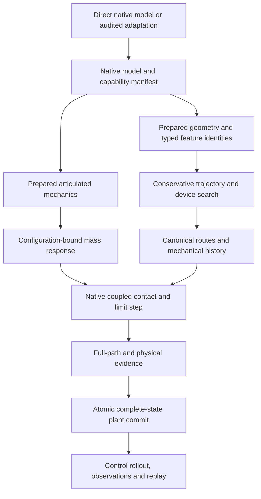
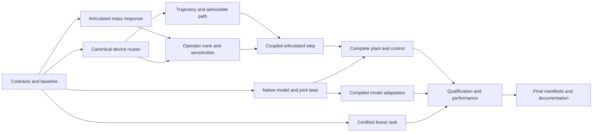

# Native robotics execution and MuJoCo qualification: plan and implementation record

## 0. Authority, status, and evidence boundary

The reviewed design below is implemented on the `feature/native-robotics-execution` branch from `dev` commit `c8ef7e803`. Sections P0–P11 retain the reviewed file-by-file requirements; **NEW** identifies files introduced by this implementation rather than future capabilities. The [qualification guide](../guides_native_robotics_qualification.md) describes the current public contracts, qualification procedure and known limitations.

The original read-only source survey and plan lived in the `bounded-route-kernels` worktree. Implementation began only after explicit `//code` authorization, with the authoritative instructions copied into the new worktree. LSP was unavailable during both phases; exported and cross-module consumers were inventoried by source references, imports, registries and generated-public-surface checks.

The objective is a complete, bounded, native articulated-contact execution path and honest model qualification. It is not a new generic simulator framework or a claim that arbitrary MuJoCo models already have native equivalents.

### Starting state established by source inspection

| Existing owner | Capability at the baseline | Gap addressed by this implementation |
|---|---|---|
| `discretization/particle/_reduced_dynamics.py` | RNEA, ABA, mass/energy utilities, certified semi-implicit velocity Euler | Reusable articulated inertia preparation and a true-dual inverse-mass action; complete contact integration |
| `discretization/particle/_reduced_articulation.py` | Fixed-base 3D fixed/hinge/prismatic trees, FK, Jacobian actions, force pullbacks | Explicit continuous-path/lifted-coordinate ownership and articulated collision participants |
| `discretization/particle/_rigid_constraint_dynamics.py` | Broader maximal-coordinate bilateral mechanics, matrix-free KKT/saddle solves | Its rank audit still materializes the Jacobian and executes dense SVD |
| `discretization/contact/_compiled_search.py` | Compiled and device LBVH candidate discovery with bounded work | Output is not yet a canonical contact epoch usable by the downstream mechanics |
| `applications/contact/_articulated.py` | Correct constrained response composition and certified fixed-route impulses | Preparation materializes the Delassus matrix; no complete discovery/CCD/step owner |
| `applications/contact/_rod_contact_lifecycle.py` | Matrix-free composite response and richer mechanical history | Rod-specific data, host preparation/history, and a second projected iteration are not a ready general compiled robot step |
| `applications/contact/_solver.py` | Monolithic deformable/affine contact and atomic acceptance | Search is host dense/sweep-and-prune; preserve its separate barrier/friction model |
| `applications/robotics/_urdf.py` | Secure native kinematic/inertial adaptation and explicit losses | Collision, executable actuators, and complete robot-model ownership are missing |
| `applications/robotics/_mjx.py` | Complete-state MJX-JAX adapter, feature gates, epochs and provenance | It still executes upstream MJX; it is not a native MuJoCo-model lowering |
| `dynamics/_plant.py`, `_plant_codec.py`, `control` | Complete plant transactions/codecs and result-aware control | Contact-changing control rollout must carry evolving mode/history state, not freeze a sidecar |

## 1. Required outcome and scope ledger

The implementation is complete only when the required rows below work together. A standalone operator, passing toy test, or compiling plant shell is not completion.

| ID | Required end-to-end outcome | Owning phases |
|---|---|---|
| R01 | Prepare articulated inertia once at a configuration and reuse certified vector/multiple-RHS inverse-mass actions | P1 |
| R02 | Device search produces canonical, identity-bound contact epochs with complete narrow-phase failure evidence | P2 |
| R03 | Conservative bounds and full-path admissibility for the actual articulated trajectory, including persistent contact | P3 |
| R04 | One operator-valued cone representation, native response iteration, fixed-branch derivatives and exact numeric binding | P4 |
| R05 | Complete native fixed-base articulated hard-contact step, bounded subdivisions, and whole-request atomic acceptance | P5 |
| R06 | Native stateless joint actuation/damping and coupled hinge/prismatic limits with correct coordinate history | P6 |
| R07 | Direct native construction and secure URDF adaptation feed one executable native model representation | P6 |
| R08 | Complete plant state, observations, control rollout, checkpoint/restore/replay, and casewise failure isolation | P7 |
| R09 | Optional host-only compiled-MjModel adaptation for a closed smooth-mechanics profile, with explicit losses/refusals | P8 |
| R10 | Same-model MuJoCo/MJX qualification distinguished from comparisons between different contact laws | P8, P10 |
| R11 | Opt-in, sound scalable rank evidence for an admitted maximal-coordinate forest profile; preserve general dense behavior | P9 |
| R12 | Preserve existing maximal, rod, DEM, monolithic FEM/MPM, and MJX capabilities through shared cutovers | All |
| R13 | Numerical, derivative, failure, identity, resource, CPU/GPU and end-to-end benchmark evidence | All, P10 |
| R14 | Clean public/representation cutovers, complete consumer migration, authored documentation and regenerated inventories | All, P11 |

### Binding scope of the new articulated plant

1. Three-dimensional, fixed-base, connected reduced trees containing fixed, hinge and prismatic joints. Existing maximal-coordinate free-body/ball-joint functionality remains supported independently; it is not relabeled reduced support.
2. First required hard-contact geometry profile: body-attached spheres and capsules, and explicit static planes, with positive physical radii and qualified pair/witness rules. Implement sphere-sphere, sphere-capsule, capsule-capsule, sphere-plane and capsule-plane coverage. Infinite planes are not fabricated finite BVH boxes.
3. A separate required device mesh-feature path serves existing monolithic/fixed-route contact consumers under an explicitly declared positive-offset/shell surface profile. It does not expand the first articulated plant's primitive geometry admission. It must not be advertised as exact zero-thickness solid contact; that requires limiting oriented normals and solid admissibility machinery beyond the current unsigned-distance owner.
4. The new plant uses a declared first-order, position-level, inelastic hard-contact discretization: zero restitution and zero compliance, with static/dynamic isotropic Coulomb friction. Existing fixed-route impact/cone APIs retain their admitted restitution/compliance capabilities. Unsupported plant laws fail at preparation; no silent clamping or fallback to different physics.
5. Native stateless generalized-effort input, explicitly mapped scalar joint motors, damping, and unilateral hinge/prismatic stops are required. Stateful muscle/filter/delay actuators, tendon constraints, loop closures, fluid forces, rolling/spinning/adhesive laws, topology mutation, and floating/ball reduced articulation are not implied.
6. Runtime state includes the histories required by the admitted profile. Physics is never reconstructed from only q/v while silently discarding winding, contact, limits, warm starts, sensor epochs or PRNG state.
7. All numerical/model/capacity refusals are observable. Failed or incomplete steps retain the complete prior accepted state. A certified safe prefix is not a successful full requested step.
8. No native runtime dependency on MuJoCo or MJX. MuJoCo/MJX remain optional qualification/source-adaptation providers.

These are deliberate scientific capability boundaries, not temporary stubs. Expanding them requires a new admitted capability and its complete qualification, not a misleading selector.

### Explicit non-goals

No arbitrary MJCF equivalence; no replacement of MuJoCo regularized contact by renamed native Coulomb parameters; no promise of gradients through mode creation/destruction; no universal faster-than-MJX claim; no new renderer, optimizer, sparse runtime, XML parser, contact registry or global numerical cache; no automatic multi-GPU qualification. Existing native soft and maximal engines are not collapsed into a single physical model.

## 2. Architecture and contracts

### Public vocabulary

The implemented public owners are:

- `PreparedArticulatedMass`: dynamic configuration-bound inertia factors and validity evidence; its inverse-mass operator maps the generalized tangent dual into the generalized tangent.
- `NativeRobotModel` and `NativeRobotModelManifest`: the single executable native model authority, independent of source format.
- `NativeArticulatedPlantPlan` and `PreparedArticulatedPlant`: preparation and complete native plant execution.
- `ArticulatedContactStepPolicy`, result and evidence: the domain-owned coupled step, not a second generic integrator framework.
- `ContactManifoldState`: mechanical impulse/witness/frame history. Keep it distinct from closure-law `ContactRouteState` unless a separately justified full migration is performed.
- `RigidConstraintRankAudit` and explicit rank/condition evidence: preserve the general route and admit a certified forest route explicitly.

Keep `RobotAdaptation` as the one public adaptation result, but make its model ownership source-neutral. Migrate its old field consumers in the same cutover; do not keep forwarding compatibility properties.

### Common implementation rules

- New concrete classes inherit `StrictModule` and are final by default. Use runtime-resolvable `phydrax.typing` forms, nominal dimensions and `__strict_contract__` where required. Scientific spaces/axes/frames are explicit, not inferred from equal sizes.
- Static structure contains only immutable policies, layouts and topology identity. Configuration, geometry, inertias, factors, masks, keys, histories, commands, evidence and revision counters remain dynamic leaves. Use fixed-role/non-trainable metadata rather than static array storage.
- Host preparation may parse and hash. Runtime binding, search, root iteration, history update and subdivision may not call NumPy, host fingerprints or scalar synchronization.
- Supported large loops use bounded JAX scan/for/while owners and native sparse worksets. No Python iteration over numerical axes, unbounded Cartesian materialization or data-dependent shape growth.
- Exact law, geometry, discretization and execution identities remain distinct. Changes here intentionally change prepared/compiler/persistence identities; rebuild affected prepared artifacts. Never fake historical IDs or introduce compatibility generations/schema-version fields.
- Dense authorities remain explicit bounded routes for reference and preserved capabilities. They are not hidden fallbacks in a purported matrix-free execution profile.

## 3. Scientific definition of the new contact step

### 3.1 Coordinates and source mechanics

Use lifted scalar joint coordinates for the continuous trajectory. Native FK may evaluate their principal-angle representatives, but the plant owns winding/reference history and the actual increment. Endpoints modulo 2π do not define a path.

For one attempted segment of duration h, at its provisional accepted source:

- M₀ = M(q₀), prepared once for that segment.
- a₀ is the existing native smooth acceleration for the declared effort, damping, gravity and external loads.
- v_free = v₀ + h a₀.
- q₁ = q₀ + h v₁ in the lifted scalar chart.
- v₁ = v_free + M₀⁻¹ G(q₁)* p.

The intra-segment trajectory is binding, not inferred by another owner: `q(s) = q₀ + s h v₁`, `s ∈ [0,1]`, in lifted scalar joint coordinates. Body/geometry positions are exactly native FK evaluated on that path. Physical time is `t = t₀ + s h`, so the physical generalized velocity along the path is v₁ and contact normal speed is the corresponding gap derivative. The free predictor uses the same definition with v_free; every accepted subdivision uses its own provisional source and endpoint velocity. Broad phase, candidate coverage, final admissibility and work evidence must all bind this identical trajectory.

The first plant is not an event-exact restitution solver. At each active normal row:

- pₙ ≥ 0;
- g(q₁)/h ≥ 0;
- pₙ × g(q₁)/h = 0, within the declared scaled tolerances.

Tangential friction uses the physical tangential velocity Gₜ(q₁)v₁ and the existing static/dynamic Coulomb law. Joint-stop rows use the same generalized response with their own coordinate gap and no tangential component.

Physical contact velocity and law velocity must be separate evidence. In particular, g(q₁)/h is not a measured physical normal speed, and position-level complementarity does not assert Gₙ(q₁)v₁ ≥ 0 at a newly reached endpoint. Do not preserve misleading field names such as a measured `minimum_post_normal_velocity` when the value is a biased law residual.

For frozen-route relinearization at q_hat, the normal bias is:

`b_n = (g(q_hat) - G_n(q_hat) (q_hat - q_0)) / h`.

Solving one frozen cone is not enough. Independently recertify the final kinematic update, momentum equation, actual gaps, normal complementarity, friction law, active-material completeness, physical work and trajectory coverage. The coupled root/linearization includes the geometry derivatives of both G(q₁)*p and Gₜ(q₁)v₁. Use native nonlinear/linearization owners, not a private Newton or finite-difference loop.

### 3.2 Contact-free identity and bounded continuation

1. Attempt the whole requested interval with the existing native contact-free Euler result.
2. If that exact trajectory is completely admissible and no contact/limit response is needed, return the unchanged native result. Do not substep merely to change its rounding or dynamics.
3. Otherwise construct a complete canonical candidate epoch from conservative bounds on the actual trial path and solve the declared coupled contact problem.
4. Freeze route/feature identity within an inner root solve. Rebuild under an explicit bounded outer epoch when feature margins or coverage require it.
5. Certify the converged actual path. On an unresolved solve/coverage failure, subdivide time within fixed budgets and solve the same declared law on each segment. M₀ and smooth effort are rebound at each segment's provisional source, not silently frozen for the entire request.
6. Accumulate provisional state/history and covered duration. Commit only if the concatenated accepted segments cover the entire requested interval. Otherwise roll back all state, history, clock, controls and PRNG advancement.

Budgets include nonlinear iterations, cone iterations, route rebuilds, interval evaluations, substeps and minimum segment duration. Exhaustion is a distinct failure, not a smaller successful dt. Only the gap component scales as epsilon_gap / h in velocity-like law residuals. Impulse, friction and work checks use the distinct dimensional budgets below; decreasing h must not loosen them through a shared scalar tolerance.

### Dimensional certificate tolerances

Introduce a physical certificate policy separate from the nonlinear solver's convergence tolerance. It records per-law/block physical units and positive scales, the gap and physical slip-speed tolerances, impulse positivity/cone tolerances, complementarity-work tolerance, physical-work allowance, and mass/kinematic identity tolerances. Apply the mixed-layout scale/dual transformations defined in P4 consistently.

- For every valid normal row require `g >= -epsilon_gap` and `p_n >= -epsilon_impulse`.
- Require normal complementarity in an energy-consistent form: `abs(p_n * g / h) <= epsilon_complementarity_work`. A tiny geometric residual under a large impulse is not automatically acceptable.
- Coulomb-cone violation `max(norm(p_t) - mu_s * max(p_n,0), 0)` and sliding-law impulse error have impulse units. Sticking uses a separately declared physical slip-speed tolerance; sliding branches require a separately qualified speed margin. Check physical tangential work `p_t · v_t <= epsilon_friction_work`.
- p is an impulse. For geometric point contact, p/h is a segment-averaged force, not pressure; pressure is reported only when a positive physical area measure is explicitly supplied. Joint-stop reactions use their proper generalized impulse/effort units.
- Use explicit, timestep-independent physical reference scales plus audited floating-point error allowances. Do not scale a tolerance from an arbitrary candidate's large residual or multiply every certificate threshold by 1/h.
- Allocate each requested interval's impulse/work error budgets to accepted segments, for example by `h_segment / h_request`, and charge actual component violations/positive work to the full-request ledger. Floating error allowances also consume a declared total budget; they are not an unlimited per-substep exemption. Keep different physical-unit families separate or combine only through an explicit dimensionless normalization.
- Gap/path tolerance is a declared geometric floor, not an accumulated displacement allowance. Final acceptance requires both every local certificate and the full-request impulse/work budgets. More subdivisions cannot turn unacceptable energy injection into success.

Replace the existing mixed-unit `abs(min(impulse, velocity))` acceptance test and single tolerance applied to unrelated dimensions. Keep numerical iteration tolerances as iteration controls, not physical certificates. Fixed-route impact and new position-level step certificates share dimensional infrastructure but evaluate their own declared law residuals. Add large-impulse/small-gap, timestep-subdivision, unit-rescaling, zero-impulse and aggregate-budget regression cases.

### 3.3 Path certification must support resting contact

Existing `collision_free_step_limit` certifies strict separation and rejects initial touching distances. Preserve that contract for barrier consumers.

Add an explicitly separate admissible-path result for the hard-contact plant, proving the declared gap floor over the entire interval, including legal initial resting/sliding contact. Distinguish complete admissibility, initially inadmissible state, certified prefix, unresolved interval, invalid geometry and work exhaustion.

Broad phase and interval certification must use the same actual articulated trajectory and numerical revision. Endpoint-linear swept boxes are not conservative for rotating links or curved link-center motion.

The required interval provider must:

- enclose every ancestor hinge/prismatic transformation over an interval;
- include interior sine/cosine extrema and full turns;
- contract as the interval contracts;
- preserve proper rigid transformations and frame conventions;
- expose the actual guarantee/error level rather than let a caller upgrade it by selecting an enum.

AABB separation is only a sufficient filter. It cannot certify all separated oblique primitive pairs, even with arbitrarily fine temporal subdivision. Reuse primitive distance at the interval midpoint and displacement enclosures to bound distance from below. For unsigned core features, a valid bound is midpoint distance minus the two Hausdorff-displacement bounds; signed/oriented and plane gaps require their corresponding derivations. Outward/error enclosure is required, not sample-based inflation.

Use the actual physical-radius/offset gap. Positive-offset shell contact is not exact zero-thickness solid contact. Initial overlap/containment and zero-normal cases require explicit rejection or independently qualified classification; neither finite distance nor closed mesh orientation is sufficient by itself.

### 3.4 Work, energy and derivatives

A gap certificate is not an energy certificate. In the frozen segment metric, the contact kinetic change satisfies:

`K_M0(v1) - K_M0(v_free) = p · G(q1)v1 - 0.5 (v1-v_free) · M0(v1-v_free)`.

Use this as an independent operator/work consistency check, not as a dissipation test by itself. For an exact smooth active gap, a feasible path ending at `g(q₁)=0` has a nonpositive left derivative at the endpoint; hence `G_n(q₁)v₁ <= 0`. Together with nonnegative normal impulse and dissipative tangential friction this implies nonpositive contact correction in the frozen SPD metric. Those hypotheses do not automatically hold at finite gap/work tolerances.

For the finite-tolerance implementation, compute physical `W_contact = p · G(q₁)v₁`, not the biased law work, and require `W_contact <= epsilon_contact_work`. Independently require `K_M0(v₁) - K_M0(v_free) <= epsilon_contact_energy` and bound the displayed identity's residual. The budgets are compatible (`epsilon_contact_energy` cannot exceed the admitted work plus identity-error allowance) and their positive parts are accumulated across provisional segments under the full-request limits. Reject a correction that passes gap complementarity but injects excessive physical work; do not clip impulses or velocities to repair its evidence.

The total mechanical-energy ledger must explicitly include the inelastic correction loss `D_contact = 0.5 (v1-v_free) · M0(v1-v_free)`. It is not a small numerical defect and must not be omitted merely because `p · Gv1` vanishes at a stopped contact. Define:

- `E0 = E(q0,v0)`, `E1 = E(q1,v1)`, and `E_f = E(q_f,v_free)`, where q_f is the native smooth Euler endpoint;
- `F0` is the segment's held source generalized effort, including the source-frame external-load pullback but excluding conservative gravity already represented in potential energy;
- `W_f = h F0 · v_free` is the existing predictor work quadrature and `r_f = E_f - E0 - W_f` is its native smooth energy defect;
- `W_s = h F0 · v1` is the same source-force quadrature along the accepted lifted displacement; `R_work = W_f - W_s` records their difference;
- `R_geometry = U(q1)-U(q_f) + 0.5 v1 · (M(q1)-M0)v1 - 0.5 v_free · (M(q_f)-M0)v_free` is the variable-mass/potential correction, evaluated with native energy and mass actions, not dense matrices.

The segment ledger is:

`E1 - E0 - W_s - W_contact + D_contact = r_f + R_geometry + R_work`.

Independently bound the ledger identity residual, the nonnegativity error of D_contact, and the source predictor defect. Geometry/work terms are not unrestricted catch-all residuals: derive admissible interval/roundoff bounds from the articulated geometry/inertia/force owners, retain their measured values and bounds separately, and charge their allowed discretization contribution to the request's accuracy budget. Do not define an allowance by taking the absolute value of the observed error. P1/P3 must expose the bounded mass/potential variation needed by this check. Also check positive actual mechanical-energy surplus `E1-E0-W_s` against its explicit physical allowance; subtracting R_geometry must not hide excessive physical energy injection.

The full-request ledger sums the segment works, losses and defects and uses the actual initial/final energies; no contact loss or force work is counted twice. Error allocation may be adaptive from the remaining declared budget rather than necessarily proportional to segment duration, especially at a newly activated contact. If a coarser trial spends too much of the budget, a declared bounded replay at finer subdivision may be attempted; all work is recorded and no provisional state is committed.

When contact is absent, retain the exact existing native free-step result and its existing absolute energy-defect test. With constant mass, no smooth force and no potential variation, contact acceptance reduces to `E1-E0-W_contact+D_contact = 0` within numerical tolerance. Add the initially touching slider approaching a plane at speed V: `p=mV`, `v1=0`, `W_contact=0`, and `D_contact=mV²/2` must be accepted, not rejected as an energy defect. Add gravity/variable-inertia cases and subdivision tests that distinguish actual physical work, known correction loss and bounded discretization error. D_contact is a mechanical correction-loss record; it is not automatically a thermodynamic heat assignment.

Qualify derivatives only on successful fixed-feature/fixed-friction/regular branches. Search, route births, winding transitions, chart cuts, contact/limit activation and subdivision decisions are discrete. A successful primal does not automatically admit JVP/VJP through those events. Preserve original arguments/results and numerical leaves; do not freeze geometry, mass or force-law parameters to make differentiation convenient.

## 4. Dependency and ownership map

One integration owner holds the interface map and verification record. Each shared file has one active owner. P2/P3 share the contact geometry owner; P4 owns the cone and response migration; P6 owns robot model/actuation adaptation; P7 owns lifecycle/control integration. P9 is independent and opt-in: it must not block the first reduced-coordinate contact plant or silently replace general maximal mechanics.

## 5. P0 — baseline, invariants and first failing scenarios

### Files and work

- `tools/robotics_articulation_benchmarks.py`: retain existing native smooth cases; add isolated factor/application timing hooks after P1. Record current source and runtime identity before changes.
- `tools/contact_search_benchmarks.py`, `contact_closure_benchmarks.py`, `rigid_constraint_benchmarks.py`: preserve existing authorities and separate preparation/runtime/evidence costs.
- Existing tests in the phase maps below: use them as the behavior baseline; do not run an unrelated full suite.
- Existing source-described failure scenarios needing focused reproduction before repair: degenerate narrow phase disappearing from kinematics success; route-key collisions/overflow; nonlinear broad-phase misses; strict-separation refusal of resting contact; unsafe sampled trajectory bounds; mismatch between contact search skin and per-object displacement envelopes.

### Required baseline artifacts

Record actual code/build/provider/driver/backend/dtype identity, exact commands, capacities, active work, numerical tolerances, requested law/geometry/derivative profile, compile-cache policy and observed statuses. Separate correctness references from performance baselines. Do not copy timing claims from unrelated APIC or native-only articulation experiments.

Numerical references must be independent: analytic one-/two-link systems, independently formed small mass/constraint matrices, analytic sphere/capsule/plane geometry, checked high-precision interval fixtures, and host MuJoCo only where the model/law comparison is valid.

## 6. P1 — prepared articulated inertia and inverse-mass action

| File | Required change |
|---|---|
| `phydrax/discretization/particle/_reduced_dynamics.py` | Separate configuration/inertia-only ABA preparation from velocity/bias/force work and RHS application. Preserve RNEA decomposition and the current free-step result. Remove duplicated articulated-inertia preparation from repeated actions. |
| **NEW** `phydrax/discretization/particle/_articulated_mass.py` | Own the prepared factor/binding, true-dual inverse-mass operator, mass action, multiple-RHS application and evidence. Keep it a numerical mechanics substrate, not a contact-specific inverse. |
| `phydrax/discretization/particle/_reduced_articulation.py` | Expose the immutable topology/space data needed for factor preparation without duplicating FK, motion-subspace or joint conventions. |
| `phydrax/discretization/particle/__init__.py`, `phydrax/discretization/__init__.py` | Explicit canonical exports/lazy map for the new public prepared action. |

### Factor/application contract

- Preparation at q stores transforms, motion subspaces, articulated spatial inertias, projected columns, scalar pivots and reciprocal pivots as dynamic arrays. Fixed edges remain distinct from moving edges.
- Preserve the reverse-topological factor order and forward substitution order. Do not form a generalized dense inverse or mass matrix.
- Bind exact articulation, frame, mass-property and configuration revisions. No host numerical fingerprint inside compiled stepping; use owned dynamic revisions and explicit numerical state. A matching static operator ID alone does not prove the same q or inertias.
- Inverse mass maps `DualSpace(tangent)` to `tangent`. Preserve true-dual spaces, units, virtual work and symmetry evidence; do not substitute unrelated per-body inverse inertia for constrained articulated response.
- Support multiple RHS in one bounded action with explicit RHS-axis mapping. No per-column Python solve loop. Resource policies bound scratch/RHS batches where needed.
- Validate finite and positive pivots through the owning native numerical contracts. Propagate preparation/application failure. No jitter, absolute-value pivot repair, or plausible zero presented as success.
- Provide independent `M(q)x` action through the existing mechanics algebra and certify inverse residuals without materializing M. Reuse one preparation for the primal/JVP/VJP actions at the same point.
- Preserve geometry/mass derivatives through preparation and application. Conditioned factors are dynamic leaves, not static closure captures or global cached arrays.

### Tests and evidence

Extend `tests/unit/discretization/test_reduced_dynamics.py` and add **NEW** `tests/unit/discretization/test_articulated_mass.py`:

- analytic hinge/slider and independent small dense inverse-action references;
- mixed fixed/moving trees, empty DOFs, branching and permuted stable IDs;
- vector versus multiple RHS; prepared versus cold action;
- virtual-work/adjoint symmetry; q, COM, mass and inertia JVP/VJP checks;
- invalid/stale factors, nonpositive pivots, nonfinite inputs, resource refusal;
- no accepted stale revision after state/material change;
- eager/JIT/vmap, explicit CPU target and actual GPU execution.

Compiler, memory and host-transfer inspection belongs in benchmark evidence, not permanent source/JAXPR-text assertions. Extend `tools/robotics_articulation_benchmarks.py` to separate factor preparation, repeated action, derivative actions and full smooth stepping.

## 7. P2 — canonical device contact routes and failure closure

| File | Required change |
|---|---|
| `phydrax/discretization/contact/_compiled_search.py` | Return a canonical `ContactCandidateEpoch` plus backend-specific evidence. Preserve primitive identities at leaf emission. Replace row-only packing with device canonicalization, counting, ordering and complete failure propagation. |
| `.../contact/_surface.py`, `_participant.py` | Own a typed feature-address catalogue and explicit participant/body/primitive mappings. Preserve original scientific IDs and frames. |
| `.../contact/_stencils.py` | Split host preparation validation from device runtime packing. Remove NumPy/fingerprint/unique operations from the device path. Share key, orientation and witness conventions across host/device construction. |
| `.../contact/_search.py` | Keep dense and sweep authorities, but produce the same canonical epoch schema and accept full-path envelopes. Separate host timing from scientific runtime epoch state. |
| `.../contact/_distance.py`, `_implicit_geometry.py` | Reuse current distance kernels and add the admitted analytic sphere/capsule/plane candidate/witness paths where missing. Own touching-contact normals and physical radius conventions here, not in the plant. |
| `.../contact/_kinematics.py` | Propagate active stencil/normal/degeneracy failures; never mask a failed active candidate and call the remaining epoch complete. Expose witnesses/frames through the canonical result. |
| `.../contact/_cache.py`, `_distributed.py` | Migrate changed epoch/key representations. Device cache reuse uses full-path displacement bounds and bounded device branches; preserve existing distributed semantics without claiming new distributed plant support. |

### Identity decision

Do not Cantor-pair unrestricted raw IDs. Establish a prepared canonical catalogue of typed `(participant, primitive kind, original feature ID)` identities. Original IDs remain explicit scientific metadata. Device ranks are execution addresses whose meaning is bound to that catalogue and topology identity, not inferred from input ordering.

A compact scalar route key may use injective pairing of those bounded ranks, route kind and explicit witness slot only after exact host-integer proof that every intermediate and final arithmetic expression fits the device integer type. Derive kind/witness ranges from their canonical declarations. Do not use an unchecked hash. Reject unrepresentable preparation rather than narrowing IDs.

- Canonical ordering must survive source-array permutations with unchanged scientific IDs.
- Canonical orientation must agree with force signs, normals, tangent frames and coefficient order; an unordered key alone is insufficient.
- A key is never transferable across catalogues merely because its integer value matches.
- Runtime geometry/history revisions do not enter static IDs and trigger recompilation. Topology/catalogue changes intentionally invalidate old bindings; topology mutation is not admitted by the first plant.
- Distinguish primitive-pair identity from a defined persistent witness slot. Do not invent continuity across a nearest-feature branch change.

### Geometry and completeness

Finite spheres/capsules can use bounded primitive AABBs in the common device search. Planes use an explicit bounded analytic pair route, not an invented finite AABB. Add all required pair kinds and independent completeness tests. Reuse the existing capsule geometry owner where applicable instead of copying its formulas.

Capsule support manifolds must be mechanically complete in the admitted nonunique cases:

- Capsule-plane contact emits both endpoint gaps `g_a = n·a - d - r` and `g_b = n·b - d - r`, with distinct stable endpoint slots, independent normal impulses and corresponding physical friction witnesses. Their conjunction certifies the whole capsule against the plane. A horizontal capsule must support a centered load without an artificial torque from arbitrarily selecting one endpoint.
- For parallel, laterally separated capsule axes with an overlapping axial projection interval, emit the two extremal closest-point pairs of that overlap as separate stable support slots. Define the axial orientation from the canonical capsule's body-attached endpoint order, not a world-axis heuristic. A collapsed overlap uses one active witness, not duplicated rows.
- Disjoint parallel intervals and nonparallel axes use the qualified unique closest-feature branch. Exact/uncertain parallelism, coincident axes, degeneracy and witness transitions need explicit geometric evidence. Deep overlap or unclassifiable geometry refuses; it never acquires a fallback normal.
- Reuse existing segment/plane distance formulas, but extend the witness/manifold owner rather than reusing its current one-endpoint tie-breaking rule as a complete rigid support model. A forward resting-support result must be supported even when derivatives through a witness tie are refused. Nonunique local impulses do not invalidate a physically certified primal solely because an impulse derivative is not unique.

Add independent centered-load/pitch equilibrium tests for a capsule on a plane, two-witness parallel capsule support and reversed capsule endpoint/body order. Check resultant force, torque, action–reaction, capacity, stable witness identities and separate derivative admission.

Mesh vertex-face/edge-edge discovery remains shared with monolithic contact. It does not automatically cover every primitive family, initial solid containment or zero-thickness touching normal. Positive physical radii/offsets and solver clearances are separate quantities and identities.

Output, traversal, stack or interval exhaustion means incomplete. Preserve diagnostic counts; a traversal-exhausted count is only discovered work, not necessarily the total required capacity. Never turn truncation into a successful smaller contact set.

### Clean cutover

Remove obsolete `CompiledCandidateBatch` and row-only result/packing paths after migrating all consumers. Retain their useful backend evidence in the new result rather than discarding exhaustion detail. Update:

- `tests/unit/discretization/contact/test_contact_closure_substrate.py`;
- `test_contact_feature_policy.py`, `test_contact_substrate.py`, `test_ccd_degenerate_regression.py`;
- `tools/contact_search_benchmarks.py`;
- `phydrax/discretization/contact/__init__.py`, parent discretization exports;
- application `_potential.py`, `_friction.py`, `_solver.py`, `_coupling.py`, `_adapters.py`, `_rod_contact_lifecycle.py`, `_articulated.py` where epochs/keys are consumed;
- closure/history/state-transfer consumers of route keys, even if their physical state schema stays unchanged.

Add **NEW** `tests/unit/discretization/contact/test_device_contact_routes.py`: JIT/vmap search→epoch→narrow phase→kinematics; raw-ID boundary/namespace cases; source permutations and canonical orientation; exact capacity and every overflow; active degeneracy; empty scenes; dynamic numeric updates without identity churn; no successful downstream response from incomplete search.

## 8. P3 — articulated trajectories, admissible paths and shared history

| File | Required change |
|---|---|
| `phydrax/discretization/contact/_trajectory.py` | Make the actual trajectory and interval guarantee explicit. Replace sampled cubic subinterval inflation with exact Bernstein restriction/subdivision if retained. Do not use projected interpolated rotation matrices as an articulated rotation path. |
| `.../contact/_participant.py` | Expose the trajectory object/bounds contract when endpoints do not uniquely determine the path. Array-bearing providers are dynamic PyTrees. |
| `phydrax/applications/contact/_participant_adapters.py` | Add prepared reduced-articulation participant actions and shrinking interval bounds using native FK. Preserve existing maximal/affine/FEM/MPM adapters and their profiles. |
| `phydrax/discretization/contact/_compiled_search.py`, `_search.py` | Build candidate coverage from the same interval enclosures later certified by the plant. Define whether every skin/envelope is per-object or pairwise; account for motion of both participants. |
| `.../contact/_ccd.py` | Preserve strict separation; add hard-contact admissible-path evidence and midpoint-distance/displacement predicates. Bind coverage to trajectory, interval, topology and numeric revision. |
| **NEW** `phydrax/applications/contact/_manifold.py` | Own generic mechanical impulse/witness/frame history, keyed transitions, bounded retention and atomic candidate/accepted updates. |
| `phydrax/applications/contact/_route_state.py` | Reuse/extract its actual device sorted-key matching invariant. Do not replace closure-law state with mechanical impulse state. |
| `_rod_contact_lifecycle.py` | Migrate shared mechanical history logic where semantics truly match; preserve rod-specific witness and law behavior. Remove superseded host duplicate bookkeeping only after complete parity coverage. |

### History contract

Dynamic fields include occupied/active masks, keys, witnesses, normal/tangent frame, warm impulses, branch labels, age/retention, material/geometry revisions and transaction revision. Static fields describe capacities and schema/topology identity.

- Device sorted-key join, not contact×contact matching.
- Deterministic birth, death, retention and eviction; active history overflow refuses.
- Transport tangential warm starts through the physical world impulse and the new tangent frame; never copy local components across a changed basis blindly.
- Material/law changes explicitly reset or transform admissible history; stale geometry/key/catalogue bindings refuse.
- Preserve closure-law history and monolithic lagged-friction history as distinct physical states. Share matching utilities, not incompatible meanings.
- No dictionaries, NumPy copies or host scalar decisions in runtime history updates.

### Tests

Add **NEW** `tests/unit/discretization/contact/test_contact_trajectory_bounds.py` and **NEW** `tests/unit/applications/contact/test_contact_manifold.py`; extend existing CCD/substrate/participant/rod/monolithic tests.

Required scenarios: full-turn motion with identical endpoints; rotating arc crossing a thin obstacle; reversed paths; interior extrema; subinterval inclusion and contraction; oblique separated features with overlapping AABBs; valid initial resting contact; initially invalid overlap; zero normals; two moving objects closing the skin; key permutations, resurrection, retention and active overflow; tangent-basis changes and rigid-frame objectivity; wrong trajectory coverage; certified prefix versus full-step completion; exact rollback of history and epochs.

Analytic proof fixtures and error models are required. Random temporal sampling supplements them but is not a conservatism proof.

## 9. P4 — one operator-valued contact law and derivative path

| File | Required change |
|---|---|
| `phydrax/applications/contact/_cone.py` | Replace raw-array effective mass with a native operator contract mapping contact dual to contact velocity. Keep the same Signorini/Coulomb law, masks, restitution/compliance capabilities and result certification. Actions, diagnostic recomputation and revision matching must not require a dense matrix. |
| `.../_cone_advanced.py` | Migrate SAP/semismooth/primal-dual consumers. Use native linalg/nonlinear operators and prepared linearization; remove private `_cg_normal` execution where superseded. Dense variants require explicit bounded materialization. |
| `.../_closure_sensitivity.py` | Replace dense tangent-matrix and `jacfwd` solve requirements with owning parameter/action tangents and a matrix-free fixed-branch residual linearization. Implement/qualify the transpose sensitivity from the same linearization. Remove host `bool` decisions from compiled derivative execution. |
| `.../_articulated.py` | Stop materializing Delassus in ordinary preparation. Use prepared articulated response, native property evidence and operator actions for recertification. Correct evidence names that confuse physical and biased law velocity. |
| `.../_rod_contact_lifecycle.py` | Make composite response consume the common operator-valued cone mechanism. Remove the duplicated projected-iteration implementation after migrating its actual semantics and certificates. Preserve the explicit dense authority as a bounded reference, not an implicit fallback. |
| `phydrax/linalg/_properties.py` and the owning native bound/property substrate | Reuse and extend only the genuinely missing structural/operator-bound invariant. No domain-local eigensolver or fake minimum eigenvalue. |

### Mixed contact/limit layout and physical scaling

Contact rows and unilateral joint stops share one response solve, but not a fictitious uniform friction law. Add an explicit immutable block layout identifying Coulomb contact blocks and normal-only limit blocks, their canonical IDs, active components, and physical residual scales. Use a fixed maximum block width with explicit component masks: three for the new 3D mixed program, while homogeneous existing 1D/2D programs retain their appropriate width. A normal-only stop is not merely a three-component contact with friction set to zero: its branch margins, projection, derivative equations and padding gauges must be defined explicitly.

Each inactive padded impulse component has the equation `p_component = 0`; it must not introduce an unconstrained null direction into implicit sensitivity. Geometric contact keys and joint-stop IDs retain distinct typed ownership. Hinge-limit gaps/rates and translational gaps/rates have different units. If rows are normalized by a positive scale S, apply the congruent response `S W S*` and dual impulse mapping so physical work is unchanged. Use one common scale across each Coulomb normal/tangent block unless an explicitly transformed friction metric is implemented. Preserve physical-unit residuals in evidence; a dimensionless convergence norm must not hide a violated physical bound.

Extend `_cone.py`, `_closure_sensitivity.py`, `_articulated_step.py`, `_rigid_unilateral.py` and their tests together. Include simultaneous contact/stop reactions, normal-only derivative admission, padded zero components, unit/characteristic-length changes and coupled off-diagonal response. Do not run two independent contact and stop corrections and call the result a coupled solve.

### Operator evidence and iteration

A structurally constructed `G M⁻¹ G*` is positive semidefinite under its stated mass/adjoint hypotheses; it need not be positive definite. Keep the finite-precision and revision evidence. Do not report a fabricated minimum eigenvalue when only a structural lower bound is available.

Step-size/preconditioner decisions must be supplied by an owning conservative bound or a qualified bounded native method. A few power iterations multiplied by a safety factor are not a certified spectral upper bound. Unsupported or inconclusive evidence yields explicit bounded-reference admission or refusal, not dropped checks.

The ordinary action path must have bounded linear working storage in bodies/routes, not a hidden identity-basis materialization. If exact local diagonal blocks need multiple RHS, charge their work and scratch explicitly and prepare once, not inside every contact iteration.

### Numeric revision and stale-result refusal

`ContactConeNumericRevision` must bind the actual operator numerical state as well as free velocity, masks, materials, compliance, restitution and solver controls. Static `operator_id` alone is insufficient. Snapshot immutable numerical leaves/revisions without host hashing in iterations; keep array-bearing operators visible in the PyTree.

A result is recertified using current actions and its bound revision. Changing geometry, inertias, friction, compliance, route mask/order or solver parameters must invalidate stale results. Any rejected solve applies no impulse and preserves source accepted state; candidate/evidence remain inspectable.

### Derivatives

Use one fixed-branch residual and one prepared linearization for JVP/VJP. Include the supported tangents of response, free velocity, compliance and friction/law parameters; masks, keys and branch decisions remain discrete. The implicit Jacobian can be nonsymmetric: use the owning admissible linear solver, not unjustified CG.

The public tangent contract should be one truthful structured parameter/action tangent, not an arbitrary dense matrix required solely by the old implementation. Migrate `contact_cone_solution_jvp` callers in the same change. Preserve explicit refusal at cone apex, stick/slip transitions, stale results and unqualified regularity. Higher derivatives are advertised only after their actual transformed path is qualified.

### Known consumers to migrate

- `_articulated.py`, `_closure_sensitivity.py`, `_cone_advanced.py`, `_rod_contact_lifecycle.py`;
- `tests/unit/applications/test_articulated_contact.py`;
- `tests/unit/applications/contact/test_contact_closure_extended.py`;
- `tests/unit/applications/contact/test_rod_contact_lifecycle.py`;
- `tools/contact_closure_benchmarks.py`;
- application exports, contact/robotics API references, contact formulation/differentiation guides;
- all additional references found by the pre-cutover LSP and registry/fixture search.

Dense/local-block test inputs become explicit native dense/block-diagonal operators. Remove obsolete `.effective_mass` array assumptions and compatibility aliases, not merely add an operator branch beside them.

### Tests

Extend the existing cone/articulated/rod suites and add **NEW** `tests/unit/applications/contact/test_operator_contact_cone.py` for operator/dense authority agreement, off-diagonal coupling, static/dynamic friction, restitution retained in fixed-route APIs, compliance, invalid/stale operator state, independent law recertification, source-versus-law velocity, rank-deficient PSD response, nonfinite actions, no-contact/zero-capacity cases, bounded work and failure behavior. Add finite-difference and adjoint-duality sensitivity checks on qualified branches, including geometry and inertia parameters.

## 10. P5 — complete native articulated contact stepping

| File | Required change |
|---|---|
| **NEW** `phydrax/applications/contact/_articulated_step.py` | Own the declared coupled step, bounded route relinearization/time subdivision, actual-path checks and complete physical evidence. Compose mechanics/search/cone owners; no second Newton or broadphase implementation. |
| `.../_articulated.py` | Expose reusable participant/response bindings and keep fixed-route impact semantics distinct from the new timestep. |
| `.../_participant_adapters.py` | Bind body-attached collision primitives/surfaces to articulated FK, velocity actions, pullbacks and trajectory enclosures. |
| `phydrax/discretization/particle/_reduced_dynamics.py` | Reuse the existing smooth predictor and accepted/candidate evidence; expose only a coherent prediction substrate if the current step bundles responsibilities that otherwise force duplication. |
| `phydrax/applications/contact/_solver.py`, `_coupling.py`, `_adapters.py` | Admit the canonical device epoch/search where shared. Preserve frozen-route barrier/friction equations and existing monolithic transactional results. Do not replace monolithic mechanics with the new impulse scheme. |

### Step evidence

Retain: source/provisional/candidate/accepted states; actual covered time; substep and route-rebuild counts; every capacity/exhaustion reason; mass response evidence; root and linear-solve status; gap/normal/friction/work residuals; feature/branch margins; actual physical versus law velocities; momentum/kinematic consistency; energy/work ledger; path guarantee and tolerance; numeric binding; and transaction result.

No host synchronization within a solve, step or rollout. All loop bounds and buffers are prepared. Unused speculative slots are masked; masks never replace failure evidence.

### Required tests and examples

**NEW** `tests/unit/applications/contact/test_articulated_step.py` and **NEW** `tests/integration/test_native_articulated_contact.py`:

- exact contact-free Euler result, including an oblique noncontact case whose AABBs overlap;
- analytic inelastic slider/plane and two-link contact, with independently checked momentum/work;
- resting contact, sliding/sticking, simultaneous contact and joint stops;
- self-contact, multiple geoms per body, static world geometry, contact-pair exclusions;
- full-path collision with clear endpoints, winding/full turn, reversed path;
- contact feature and friction-mode transitions with explicit derivative refusal;
- source/geometry/material/solver mismatch; invalid reset penetration;
- solve, search, history, interval, route-rebuild and subdivision exhaustion;
- no partial-time acceptance and exact all-leaf rollback;
- casewise batched success/failure isolation and deterministic repeated replay;
- source-bound force/geometry JVP/VJP on admitted fixed branches.

Add **NEW** `examples/native_articulated_contact.py` only after the plant exists. It must run an actual supported scenario and inspect status/coverage/work evidence, not hide failures behind finite outputs.

## 11. P6 — executable native robot model, coordinates and actuation

| File | Required change |
|---|---|
| **NEW** `phydrax/applications/robotics/_native_model.py` | Own `NativeRobotModel`, manifest/evidence and source-neutral `RobotAdaptation`. Compose existing body/joint/articulation/collision/law plans; do not duplicate their physical definitions. |
| `.../robotics/_urdf.py` | Keep bounded secure parsing. Lower into the common model; install only supported runtime semantics. Preserve exact source/frame/unit/loss evidence. |
| `phydrax/discretization/particle/_rigid_joint_coordinates.py` | Canonical scalar coordinate/rate/reference and winding semantics shared by reduced/native adaptation and maximal law owners. |
| `.../_rigid_joint_laws.py` | Add the required prismatic scalar law support and dynamic stateless command input; preserve work, signs, saturation and chart evidence. Do not equate native PD with MuJoCo gains without formula qualification. |
| `.../_rigid_unilateral.py` | Assemble reduced hinge/prismatic stop rows for the same generalized contact response. Preserve existing maximal stop behavior. No independent maximal-body correction appended after ABA. |
| `.../_reduced_articulation.py` | Preserve FK chart behavior while allowing the plant to carry lifted coordinates/history. Do not silently interpret principal angles as arbitrary unwrapped positions. |

### Coordinate and actuator decisions

- Preserve the existing standalone principal-coordinate reduced state. The complete plant additionally owns integer winding/reference history and derives the continuous lifted trajectory explicitly. Do not introduce a second optional coordinate convention or silently reinterpret existing standalone q values.
- Winding updates follow the actual increment, not endpoint angle subtraction. Declare numeric/counter range and overflow refusal. FK periodicity does not make limit or servo coordinates periodic.
- URDF effort/velocity bounds are not actuators or physical stops by themselves. Require explicit actuator mapping/contact policy where the format is silent.
- Stateless joint motors map a separate command space to generalized effort with explicit gear/sign and clamp order. Damping is executed, not merely recorded. Zero effort capacity has an explicit disabled meaning.
- Hinge/prismatic limits use unwrapped coordinate gaps and participate in the same coupled response as contacts. Do not clip q or v after the solve.
- Preserve inactive-limit margins for smooth differentiation. Do not claim derivatives through stop activation or saturation kinks.

### Adaptation security and loss accounting

The first URDF collision lowering is limited to exact supported geometry. Standard URDF spheres are admitted; the native capsule profile is available through direct construction and the compiled-MjModel adapter, not by inventing a URDF capsule tag or approximating a cylinder. Box/cylinder/mesh collision remains explicitly unsupported by this first plant profile unless a separately proved exact native geometry route is added and qualified. Primitive-only URDF remains bounded/self-contained. Mesh resources additionally require the existing bounded resource owner and a qualified asset manifest; absent that, refuse rather than silently approximate collision geometry.

Direct native models do not manufacture external-format loss reports. Source adapters retain genuine report chains. Interpretation-changing losses that affect a required capability remain unwaivable. Changing from provider contact to a native contact law is a new explicit model transformation/semantic identity, not a waiver pretending equivalence.

### Consumer migrations

Move the actual `RobotAdaptation` definition to the common owner, keep its public name, and migrate field consumers without permanent aliases:

- `tests/unit/applications/test_robot_urdf.py`;
- `tools/robotics_articulation_benchmarks.py`, `tools/qualify_fixed_body_route.py`;
- `examples/robotics_articulation.py`, `examples/robotics_fixed_body_muscle_route.py`;
- robotics facade and authored guide/API pages.

Fix the existing missing explicit `root_policy` calls in the fixed-body route example/tool as part of this migration; do not retain their negative typing suppressions.

Add **NEW** `tests/unit/applications/test_native_robot_model.py`; extend rigid-coordinate/law/limit and reduced-articulation tests for COM/inertia rotations, arbitrary joint reference offsets, fixed descendants, winding/checkpoint continuation, dynamic commands, damping power, zero effort, bounds versus physical stops, and deterministic mapping under input permutation.

## 12. P7 — complete plant lifecycle and control

| File | Required change |
|---|---|
| **NEW** `phydrax/applications/robotics/_articulated_plant.py` | Implement `AbstractDiscretePlant` over the native model and contact step. Own complete payload, command/observation schemas, reset/refresh/observe, provenance and capability negotiation. |
| `phydrax/dynamics/_plant.py`, `_plant_codec.py` | Reuse transactions and complete codecs. Change shared code only for a demonstrated missing invariant, with full affected-family tests. Never bypass constructor/restore validation. |
| **NEW** `phydrax/control/_plant_dynamics.py` | Provide complete-state plant rollout as a real control-dynamics contract, carrying evolving discrete and numerical history through scan. Reuse/extract the existing transition/acceptance scan invariant instead of copying a second rollout engine. |
| `phydrax/control/_dynamics.py`, `_trajectory.py`, `_problem.py`, `_sampling_mpc.py`, `__init__.py` | Admit that complete-state contract, preserve existing array-system behavior, retain plant endpoint/history and first failure evidence, and make sampling MPC evaluate from exact initial plant state. |
| `phydrax/applications/robotics/_environment.py` | Support the complete native plant via the common lifecycle; plant/task/wrapper/clock/PRNG commit atomically. |
| `.../robotics/_soft_tasks.py` | Keep the existing fixed-mode smooth bridge explicitly fixed-mode. Do not reuse it for contact-changing rollout. If common scan/bridge logic is extracted, migrate the actual caller and remove only superseded implementation. |

### Complete payload

Include q/v, winding/reference history, contact and limit history/modes/warm starts, any admitted actuator command state, geometry/material revision binding, and sensor epochs. Runtime envelope continues to own clock, step index, keys and semantic/numeric/executable identities.

A controller may see a selected vector view, but the scan carry must retain the complete state. Do not cast discrete state into floating coordinates or reconstruct it from a frozen mode anchor. Trajectory retention is an explicit resource policy: endpoint-only versus retained complete checkpoints must not claim the same replay capability. Candidate states never feed the next step after a failed transition.

Observation refresh uses the accepted state and exact requested sampling stage. Avoid mutating or advancing a state merely to read sensors. Initial and final terminal observations remain distinguishable from auto-reset observations.

Sampling MPC may evaluate mode-changing forward trajectories. Gradient-based control is admitted only under the actual fixed-mode/regular derivative profile; no global differentiability claim follows from JIT compatibility.

### Tests

Add **NEW** `tests/unit/applications/test_articulated_plant.py` and **NEW** `tests/unit/control/test_plant_control_dynamics.py`. Extend `test_robot_environment.py`, relevant plant/codec tests only if their shared interfaces change, and sampling-MPC cases.

Cover contact birth/death across several steps, winding and actuator/limit history, same q/v with different history producing different valid next states, complete checkpoint continuation, mixed batch failures, stale controls/sensors, exact clocks, repeat/reset wrappers, invalid commands not entering mechanics, candidate isolation, retained-state memory refusal and complete rollout versus manual stepping.

## 13. P8 — optional compiled-MuJoCo adaptation and valid comparisons

| File | Required change |
|---|---|
| **NEW** `phydrax/applications/robotics/_mujoco_model.py` | Host-only `adapt_mujoco_model` accepts a compiled public `mujoco.MjModel`, inventories it, snapshots supported data and lowers to `NativeRobotModel`. No XML parser, callbacks, plugins or mutable provider model retained in native runtime. |
| **NEW** `_mujoco_manifest.py`, only if actual sharing is useful | Own factual compiled-source inventory/fingerprinting shared with `_mjx.py`. Keep native and MJX acceptance policies separate; remove relocated helper bodies, not add re-export shims. |
| `.../robotics/_mjx.py` | Preserve the existing provider adapter and release rules. Share factual inspection only. Tighten discovered feature/time gates where needed for honest qualification; do not broaden native claims to match MJX features. |
| `phydrax/interchange/_report.py` and negotiation owners | Reuse existing reports/losses/capability requirements. Extend only for missing source-to-native evidence, not a parallel report format. |
| `pyproject.toml` | Change only if a MuJoCo-only adaptation extra is needed. Native imports and runtime must remain provider-independent. |

### Closed compatibility profile

Initial native compiled-model compatibility: fixed-base scalar-joint trees, supported COM inertias and reference transforms, supported stateless scalar joint motors/damping, explicitly admitted native geometry, and selected q/qdot/clock/frame observations. Reject free/ball or multi-joint bodies in this reduced adapter, loops/equalities, unsupported passive forces/armature, stateful actuators, tendons, plugins/flex/mocap/fluid options and unimplemented sensors. Existing MJX still supports its own broader profile.

Required mappings:

- compiled body/inertial transforms and COM tensors without double parallel-axis shifts;
- qpos reference offsets, joint axis/anchor frames, DOF and actuator order;
- native typed scientific IDs and exact source-index maps;
- geometry poses, capsule half-length/radius conventions, static world geoms and every collision-pair filter/override;
- gear, gain, bias and control/force clamp order;
- unwrapped coordinates, inactive-limit margins, damping and sample-and-hold timing;
- exact timestep/integrator/actuator-update policy for any step comparison;
- sensor frame, quantity, units and freshness stage.

Do not reuse the MJX feature manifest as the native admission gate. MuJoCo `solref`/`solimp`, regularized limits, contact dimensionality, friction mixing and integrator names are not automatic equivalents of native policies.

### Qualification tiers

| Tier | Valid claim |
|---|---|
| Smooth model mapping | Same named body/COM/site poses, Jacobian actions, virtual work, mass actions, inverse/bias/gravity/forward dynamics at identical mapped state and inputs |
| Smooth actuation | Same admitted transmission/gain/clipping/damping behavior and power |
| Matched stepping | Only after dt, integration, damping treatment, actuator order and complete initialization match |
| Different native contact physics | Same geometry/mass/source state, but explicitly different contact law; compare independent physical invariants and convergence, not identical trajectories/forces |
| Fixed-branch AD | Native JVP/VJP/adjoint checks and provider comparisons only in a shared admitted smooth domain |

Compile a MuJoCo fixture once and adapt that exact compiled object for same-model qualification. For native/URDF-first fixtures, verify mapped numeric content explicitly; robot names are not identity. Existing muscle-projection qualification remains a separate same-state provider-field check.

### Files for qualification

- **NEW** `tests/integration/test_native_mujoco_model.py`: optional provider gate, every admitted mapping and feature refusal, independent frame/inertia/gear references.
- **NEW** `tests/integration/test_native_mujoco_qualification.py`: the comparison tiers above, including deliberately invalid parity requests.
- **NEW** `tools/qualify_native_mujoco.py`: reuse benchmark/evidence utilities; record exact model/source/adaptation identities, versions, device/dtype, law/integrator/tolerances, statuses, errors and not-evaluated reasons.
- **NEW** `tests/fixtures/robotics/native_mujoco_profiles.json` plus small source fixtures: deterministic provenance, model hashes, supported fields and independent tolerances; no compatibility-generation field.
- Extend `tests/integration/test_robot_mjx_adapter.py` for duration/provider-clock agreement and any factual gate changes; preserve `test_robot_mjx_muscle_projection.py`.

Qualification reports are generated only from actual executions. A missing optional provider is not a product failure; an unsupported comparison is not a pass.

## 14. P9 — scalable maximal-coordinate rank evidence

This is a separate opt-in route. Preserve the general dense-SVD audit as the default; do not restrict existing maximal graphs to forests.

### Exact existing predicate

The current audit concerns the scaled, unweighted mobile-coordinate Jacobian of the existing retracted constraint residuals. It is not the mass-weighted Schur operator. Preserve the actual characteristic-length scaling, strict relative cutoff and row/coordinate packing.

Local full rank, nonzero pivots, a small KKT residual, or successful tree elimination do not establish the existing global numerical-rank threshold.

### Chosen certificate design

Implement one verified right-inverse bound for an admitted forest, not both a new inertia scheme and a new bound scheme.

For each parent/child row block `B_e x_parent + A_e x_child = y_e`, obtain a verified local right inverse Q_e and bounds on Q_e and Q_e B_e. A tree recurrence defines a global right-inverse candidate R without storing it densely. Bound its norm and its global residual E = J R - I using outward/error-enclosed native operations.

If `||R|| <= V` and `||E|| <= epsilon < 1`, then a corrected right inverse exists with norm at most `V / (1-epsilon)`, giving:

`L = (1-epsilon) / V <= sigma_min(J)`.

Obtain a conservative upper singular bound `sigma_max(J) <= U`, for example from verified absolute row/column-sum bounds of the actual sparse local blocks. Certify full numerical row rank only when `L > absolute_cutoff + relative_cutoff * U`, including rounding/separation allowance. Failure of this sufficient test is **inconclusive**, not rank deficiency.

The implementation must derive the global recurrence and residual bounds rigorously; ordinary floating estimates are not certificates. Long chains, component scaling, large lever arms and overflow may make the result too pessimistic. Bounded dense fallback is explicit and admitted before tracing; otherwise refuse transactionally. Never allocate an oversized fallback behind a runtime branch.

The proposed concrete bound recurrence is as follows. Store approximate local right-inverse coefficients Q_e and propagation coefficients C_e, and define the exact represented candidate action `x_root = 0`, `x_child = Q_e y_e - C_e x_parent`. Obtain verified nonnegative upper bounds:

- `a_e >= ||Q_e||`, `b_e >= ||C_e||`;
- `u_e >= ||A_e Q_e - I||`, `v_e >= ||B_e - A_e C_e||`.

The second pair accounts for actual stored coefficients rather than assuming a floating-point inverse is exact. Compute outward/error-enclosed scalar sweeps:

- forward: `h_root = 0`, `h_child = a_e + b_e h_parent`;
- reverse: `t_v = 1 + sum_children b_e t_child`;
- reverse: `d_v = sum_children (v_e + b_e d_child)`.

Then candidate bounds are:

- `V = sqrt(max_v h_v * max_e(a_e t_child))`;
- `gamma_infinity = max_e(u_e + v_e h_parent)`;
- `gamma_one = max_e(u_e + a_e d_child)`;
- `epsilon = sqrt(gamma_infinity * gamma_one)`.

These are block-norm domination bounds for the represented R and `J R - I`; the implementation must carry rounding/error enclosures through every accumulation/product/root. The zero-row graph keeps the existing rank-zero/condition-one convention rather than using empty maxima. Any overflow, unresolved local bound, or `epsilon >= 1` is inconclusive. Keep local matrix construction tied to the authoritative residual/JVP and qualify its block action against the original global operator; do not silently change the audited metric. A dense reference for the certificate must use those same represented blocks, while parity with the original SVD decision additionally requires the stated numerical-separation allowance.

Forest admission: canonical graph/row identity, no cycles or parallel-edge cycles, supported local joint blocks, at most one fixed body per connected component for this proof, all other vertices mobile, isolated unconstrained bodies allowed. For a free component, setting a root increment to zero is only part of constructing a right inverse, not physically fixing the body.

### File map

| File | Required change |
|---|---|
| **NEW** `phydrax/linalg/_forest_bounds.py` | Generic verified block-forest right-inverse/norm/residual bound; bounded device sweeps, explicit uncertainty/resource evidence. No mechanics formulas here. |
| **NEW** `phydrax/discretization/particle/_rigid_constraint_rank.py` | Rigid profile admission, geometry-to-local-block bridge, policy/status/evidence normalization and fallback selection. |
| `_rigid_joints.py` | Extract actual local derivative blocks and explicit packing permutations from shared residual expressions; do not duplicate the joint physics. |
| `_rigid_constraint_dynamics.py` | Replace unconditional audit dispatch with explicit general/forest routes; preserve old default. Replace ambiguous rank/condition scalars with route-aware evidence. |
| `phydrax/linalg/_banded_spectrum.py` | Reuse error-enclosure conventions where genuinely shared; change only if a real numerical primitive is missing. A general forest is not a band. |

Evidence distinguishes certified rank bounds, dense measured estimates, condition upper bounds, inconclusive/unsupported/resource failure, executed route and fallback, cutoff/margin/error bounds, and numeric binding. Never label a bound as an exact computed condition number or pretend a full SVD was executed.

Do not weaken `require_exact_svd_rank`, `SVDRankEvidence`, or unrelated sparse-rank definitions. Leave the general SVD implementation unchanged. Preserve nonlinear position-root regularity checks: velocity-Jacobian full row rank does not prove regularity of a nonlinear KKT Jacobian with curvature.

### Tests, consumers and proof artifact

Add **NEW** `tests/unit/linalg/test_forest_bounds.py`, **NEW** `tests/unit/discretization/test_rigid_constraint_rank.py`, and an authored proof section/document only with the actual implementation. Cover dense-oracle enclosure checks, chains/stars/disconnected forests, unit local pivots with poor global condition, unequal component scales, strict threshold equality, conservative residual correction, nonfinite/overflow/ambiguous pivots, unsupported topology, stale numeric state, fallback budgets and derivatives only away from boundaries.

Migrate scalar-field consumers in `_rigid_constraint_dynamics.py`, `tests/unit/discretization/test_rigid_constraints.py`, `test_rigid_joint_dimensions.py`, and `tools/rigid_constraint_benchmarks.py`. Preserve and test `tests/integration/test_constrained_rigid_rollout.py`, `examples/constrained_rigid_chain.py`, `examples/mechanics_expansion.py` and `tools/mechanics_expansion_benchmarks.py`. Remove obsolete scalar aliases rather than making them ambiguous across methods.

## 15. P10 — integrated qualification and performance campaign

### Verification order

1. Format changed code before identity-sensitive checks.
2. Run the actual changed runtime surface: prepared mass action, device search→kinematics, full plant step, complete-state rollout and matched-model comparison.
3. Run exact newly failing/focused nodes before broader affected families.
4. Run changed-file lint/type/selector/contract/declaration/import-boundary checks.
5. Run the repository-required typing gate and conservative consumer matrix.
6. Run optional providers, physical GPU profiling and performance campaigns separately without competing tests/builds.
7. Regenerate final inventories after implementation stabilizes; run only generation-invalidated checks plus the final required integrated matrix.

Select tests from changes since the latest merge into `dev`, using LSP/imports plus semantic impact. GPU suites may need serial/device-isolated invocation; ordinary CPU tests use `-n auto` with one globally bounded worker allocation. Shared plant/control/codec changes require all their importing test families; if the change truly alters global suite/configuration semantics, run the full suite then, not as a substitute for impact analysis.

### Minimum numerical and failure matrix

- CPU and one actual GPU, float32/float64, meaningful dtype/rank/warning tests under `strict_jax`.
- Fixed and mixed-joint trees, empty/zero-active cases, branches, disconnected maximal forests, large stable IDs and input permutations.
- Independent geometry/dynamics oracles, duality, work balance, finite-difference actions and accepted fixed-branch implicit sensitivities.
- Every preparation/execution capacity boundary, unsupported geometry/law, bad normals, stale revisions and all-stage rollback.
- Contact-free identity; sustained and newly activated contact; coupled stops; source versus law velocity; winding and full-path certification.
- Complete casewise reset/step/refresh/observe/checkpoint/replay and mode-changing forward control rollout.
- Dense-authority parity within applicable tolerances, without using the optimized implementation to manufacture its own reference.
- Serialization/identity/PyTree/static-data tests for each changed prepared/state representation.
- Optional MuJoCo/MJX mapping and genuinely matched comparisons; no provider skip hidden by broad exceptions.

### Performance dimensions and measurements

Extend owning tools rather than creating a parallel harness:

- `tools/robotics_articulation_benchmarks.py`: topology preparation, mass binding, repeated/multiple-RHS action, full native contact step and rollout.
- `tools/contact_search_benchmarks.py`: candidate generation through actual canonical kinematics; host/dense/device references; complete candidate counts and refusal rates.
- `tools/contact_closure_benchmarks.py`: operator cone/derivative actions and explicit dense authority.
- `tools/rigid_constraint_benchmarks.py`: rank audit alone, whole step, certification/inconclusive/fallback rates.
- `tools/qualify_native_mujoco.py`: matched backend/model/law comparisons with scientific evidence.

Vary controlling capacities: body/joint count, depth/branching, primitive/triangle counts, contact capacity and actual active contacts, self/static pair structure, batch size, horizon, route refresh frequency, support conditioning, precision and geometry distribution. Include tails, clustered scenes, high contact coupling and moving geometry. Choose diagnostic rows, not an automatic unbounded Cartesian product.

Measure host preparation, transfer, numeric bind/refresh, search, kinematics, response, path checks, commit, lowering, compile, first call, warmed device time, end-to-end time, JVP/VJP, compiler temporary/output/code bytes, logical retained bytes and provider-external memory limits separately. Inspect actual kernel/launch counts, host synchronization and compiled loop behavior: a bounded `lax` loop is not proof of an efficient GPU schedule. Preserve cold/warm cache distinctions and all failures.

No speed claim without measured matched work. Report unsuccessful, inconclusive and resource-refused cases alongside timing; do not count refused work as a speedup. Same-model smooth performance and different-contact-physics throughput must be separate reports. A matrix-free label alone proves neither linear total cost nor speed superiority.

### Permanent test policy

Tests own numerical behavior, boundaries, invariants, transitions and failure meaning. No permanent assertions about source spelling, imports, absence of a particular primitive, or incidental default iteration counts. Use throwaway compiler/transfer inspection and phase-separated benchmarks for execution/resource claims. Helpers must encode independent scientific invariants, not mirror the implementation.

## 16. P11 — public cutovers, docs and generated data

### Public surfaces and caller inventory

Before each exported-symbol change, run LSP references, then search registries, source-identity payloads, examples, tests, qualification tools and persistence fixtures. The inventories above are the initial map, not permission to ignore later callers.

Update as applicable:

- `phydrax/applications/robotics/__init__.py`;
- `phydrax/applications/contact/__init__.py`;
- `phydrax/discretization/contact/__init__.py`;
- `phydrax/discretization/particle/__init__.py` and `phydrax/discretization/__init__.py`;
- `phydrax/control/__init__.py`;
- `phydrax/linalg/__init__.py` only for intentionally public generic bounds;
- runtime-resolvable typing fixtures under `tests/typing/cases` for every new public model/operator/result/plant boundary.

Remove obsolete array-only cone fields, row-only compiled search outputs, duplicated projected solvers, superseded host history implementation, ambiguous rank/condition scalar aliases and old adaptation forwarding paths. Do not remove legitimate dense authorities, host search, fixed-mode bridges or existing physical profiles merely because a new route exists.

### Authored documentation and examples

Update:

- `docs/guides_robotics.md`;
- `docs/guides_robotics_muscle_routes.md` and `guides_soft_robotics.md` where boundaries/shared owners change;
- `docs/guides_constrained_rigid_bodies.md`, `guides_extended_mechanics.md`;
- `docs/guides_contact_formulations.md`, `guides_contact_differentiation.md`, `guides_contact_multiphysics.md`, `guides_monolithic_contact.md`, `guides_deformable_contact.md`;
- `docs/api/applications/robotics.md`, `docs/api/applications/contact.md`;
- `docs/api/discretization/contact.md`, `docs/api/discretization/particle.md`;
- control/dynamics/linalg API pages only for changed contracts;
- **NEW** `docs/guides_native_robotics_qualification.md`, registered in `mkdocs.yml`;
- `CHANGELOG.md`.

Correct stale claims discovered during inspection, including the existing device LBVH described as future and the rod search selector spelling, without changing unrelated semantics.

### Generated consistency

After the final implementation change:

- regenerate `docs/data/public_api.json` with `tools/generate_public_api_manifest.py`;
- regenerate applicable capability inventory with `tools/generate_capability_inventory.py`;
- check `tools/check_public_api_manifest.py`, `tools/check_capability_consistency.py` and their existing integration tests;
- run `python tools/check_typing.py check` and, for public annotation changes, `python -m tools.check_installed_typing` under its supported environments;
- run applicable selector, checked-boundary/declaration and import-boundary audits;
- update affected deterministic identity/persistence fixtures by the owning generator, not by spoofing old IDs or repinning source-text tests.

## 17. Integration and evidence record

Implementation starts only on explicit code authorization, in a fresh worktree from the then-current branch unless `//code--` selects the current worktree. Copy the authoritative `AGENTS.md` before implementation work. The presence of this plan in an existing experiment worktree is not authorization to edit the parent checkout or to begin implementation.

The integration owner maintains one verification record keyed to relevant code/configuration/provider/backend/device inputs. Record exact commands, pass/fail/skip/refusal, failing node IDs, numerical errors, material environment and resource identity. Reuse valid evidence only while those inputs remain unchanged.

Implementation slices may proceed concurrently once interfaces are fixed, but shared files and GPU resources have one active owner. Do not run multiple unrestricted GPU test suites or benchmarks concurrently. A merge invalidates only evidence affected by its delta; do not rerun valid unrelated gates merely for a final summary.

No defaults change based solely on a faster microbenchmark. Preserve the general dense maximal audit by default. Admit new plant/search/contact tuples only after their complete scientific and lifecycle gates pass. A performance experiment that fails its gate is removed rather than left as an unqualified selector.

## 18. Final acceptance checklist

- [x] Articulated inverse-mass preparation/application is reusable, true-dual, differentiable on its admitted domain and never secretly dense.
- [x] Device candidates become canonical mechanics-ready epochs; every active narrow-phase failure propagates.
- [x] Typed feature identity, scalar key encoding and orientation are injective/bounded and stable within their declared catalogue.
- [x] Broad phase and path certification cover the same actual lifted articulated trajectory, including persistent contact and nonlinear motion.
- [x] The normal timestep law, physical velocities, gap tolerances and energy/work claims are distinct and correctly named.
- [x] The coupled root and all final certificates include actual geometry dependence; no frozen-cone result alone authorizes a full step.
- [x] Contact, limits, winding, commands, sensors, clocks and PRNG commit together only after complete requested time coverage.
- [x] Cone and sensitivity consumers have completed the operator-valued clean cutover with exact stale-result refusal.
- [x] Existing maximal/rod/DEM/monolithic/MJX capabilities remain intact and honestly bounded.
- [x] Native model, URDF, optional compiled-model adaptation and source-loss evidence share one model authority without silently inventing physics.
- [x] Complete-state control carries evolving modes and histories; fixed-mode vector bridges do not masquerade as contact rollout.
- [x] Forest rank certification proves the original scaled numerical-rank predicate conservatively; uncertainty is not deficiency, and fallback is resource-admitted.
- [x] Required CPU/GPU/runtime/AD/failure/identity/resource tests and matched scientific qualifications have actual recorded results.
- [x] Benchmarks report preparation, runtime, compiler/memory costs and refusal rates without cross-law or cross-backend overclaims.
- [x] All affected callers, tests, docs, examples and generated inventories are migrated; obsolete implementations/aliases are removed.

These gates have exercised evidence for the declared profiles. They are not a blanket claim of MuJoCo equivalence, arbitrary-precision admission or speed superiority; the implementation ledger and qualification guide state the known boundaries.

## 19. Planning review record

The file-by-file ownership/cutover review found no substantive blocker in the proposed model, route, plant/control, rank-evidence and qualification migrations. The scientific review required and verified corrections to:

1. the single binding intra-segment trajectory used by mechanics, broad phase and path evidence;
2. mechanically complete capsule-plane and parallel capsule-capsule support manifolds;
3. dimensional impulse, gap, friction, complementarity-work and full-request error budgets;
4. explicit inelastic correction loss in the mechanical-energy ledger, including the initially touching approaching-slider regression.

The reviewed plan also includes mixed contact/limit block masks and physical scaling, and a concrete conservative global forest right-inverse/residual bound. The final scientific re-review found no remaining substantive inconsistency in its assigned scope. Both planning reviews were read-only; they are not numerical evidence.

## 20. Implementation and evidence ledger

The current API and known limits are documented in the
[qualification guide](../guides_native_robotics_qualification.md#known-limitations).
The implementation follows the scientific scope above; numerical refusal is
part of the contract, not a successful smaller step or a hidden fallback.

| Requirement | Delivered ownership and contract | Evidence ownership |
| --- | --- | --- |
| R01 | `PreparedArticulatedMass`; configuration-bound ABA factors, true-dual vector/multiple-RHS actions, preserved forward-dynamics evidence | Articulated mass and reduced-dynamics suites; mass phases of `tools/robotics_articulation_benchmarks.py`, which retain float32 reconstruction refusals |
| R02 | One catalogue-bound `ContactCandidateEpoch` across host, compiled and LBVH search; bounded injective keys and complete narrow-phase failure propagation | Device-route, legacy substrate/cache/partition tests and `tools/contact_search_benchmarks.py` |
| R03 | Actual lifted FK trajectory, interval enclosures, full-turn coverage and resting-contact admissibility; linear-workspace ancestry accumulation | Trajectory-bound and analytic contact regressions, native MuJoCo qualification and branched native rollouts |
| R04 | Operator cone, mixed normal/Coulomb blocks, dimensional certificates, generic manifold history and exactly bound fixed-branch derivatives | Cone/history/closure suites, prepared derivative reuse, FD/duality and explicit rank/admission refusals; `tools/contact_closure_benchmarks.py` |
| R05 | Complete coupled articulated step with independent endpoint law/momentum/energy checks, bounded continuation and whole-request rollback | Native step suite, GPU geometry/friction derivative tests and complete-plant rollouts |
| R06 | Executed scalar motors and damping, lifted-coordinate winding and coupled unilateral stops | Analytic mechanics, native step and same-model actuation qualification |
| R07 | `NativeRobotModel` with direct tree construction; secure URDF adaptation, source-neutral `RobotAdaptation` and explicit losses | Native model and URDF tests; compiled model consumes the same authority |
| R08 | Complete plant payload, fresh observations, checkpoint/replay, environment transactions and complete-state control history | Plant/environment/control suites, realization-axis replay and native control rollouts |
| R09 | Host-only compiled `MjModel` adapter with closed admission, exact source evidence and explicit contact/limit law transformations | Compiled-model adapter tests and invalid matched-comparison refusal tests |
| R10 | Distinct smooth, eligible Euler, AD, MJX smooth-reference and different-contact-physics tiers | Native MuJoCo qualification suite and `tools/qualify_native_mujoco.py` |
| R11 | Opt-in verified forest rank certificate with explicit bounded fallback; dense SVD remains the default | Rank/bounds tests and `tools/rigid_constraint_benchmarks.py`, which report inconclusive and convergence-refused rows |
| R12 | Shared epoch/operator/history consumers migrated without replacing their existing maximal, rod, DEM, monolithic, deformable or MJX laws | Owning and downstream consumer test families |
| R13 | CPU/GPU scientific, derivative, failure, identity, resource and scaling evidence; kernel/copy and memory observations kept separate from throughput | Owning test suites and the phase-separated benchmark tools above |
| R14 | Clean adaptation/epoch/cone/history/rank/control cutovers; explicit facades, typing, authored guides/example and deterministic inventories | Repository typing/audits, generated consistency, installed-wheel typing and strict documentation build |

Prepared representation changes require reconstruction from current declarations:
reduced-articulation execution indices are Python integers, per-vertex ancestry
lists are removed, contact epoch/history contracts change, and complete control
and environment state carries additional identity-bound history. Original
scientific IDs are not relabeled to conceal those changes.

Benchmark tools keep source/runtime identities and unsuccessful outcomes in
their reports. The complete-plant qualification is float64; separate float32
substrate evidence does not imply end-to-end float32 plant qualification. The
native path does not claim arbitrary MuJoCo equivalence, gradients through
discrete events, a directed-rounding geometry proof at arbitrary depth, or
universal speed superiority over any provider.

The environment's retained lock participates in source/build provenance.
`uv lock --check` remains blocked by the unpublished optional
`phydrax-rocm-runtime==10.1.0`; no provider requirement was weakened and no
universal optional-extra dependency-lock attestation is claimed.
